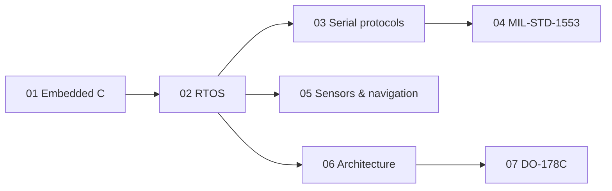

# Embedded Systems Handbook

Practical notes on embedded firmware for real-time and safety-critical systems. Each chapter answers the same three questions for every topic: **what it is, when to choose it over the alternatives, and what goes wrong**.

The notes are written from general engineering knowledge and public standards. They describe no specific product, customer or employer.

## Chapters

| # | Chapter | Covers |
|---|---|---|
| 01 | [Embedded C](chapters/01-embedded-c.md) | `volatile`, `const`, `static`, padding, pointers, memory layout, undefined behaviour, MISRA C, endianness |
| 02 | [RTOS & Concurrency](chapters/02-rtos-and-concurrency.md) | choosing primitives, ISR rules, priority inversion, deadlock, stack sizing, watchdogs |
| 03 | [Serial Protocols](chapters/03-serial-protocols.md) | SPI, I²C, UART, RS-422/485, CAN — trade-offs and failure modes |
| 04 | [MIL-STD-1553](chapters/04-mil-std-1553.md) | bus architecture, word formats, transfers, building a Remote Terminal on an MCU |
| 05 | [Sensors & Navigation](chapters/05-sensors-and-navigation.md) | IMU sensors, sensor fusion, complementary vs Kalman, filters, calibration, AHRS/INS, IMU + GNSS |
| 06 | [Software Architecture](chapters/06-software-architecture.md) | layering, portability, state machines, fault management, patterns, V-model |
| 07 | [DO-178C](chapters/07-do-178c.md) | software levels, processes, traceability, verification, MC/DC, SOI audits |

## How to read it

Chapters stand alone, but the order above goes from language to system level. Every chapter ends with a **Quick answers** list for revision.

## Conventions

- RTOS examples use FreeRTOS / CMSIS-RTOS v2 names; the reasoning applies to any preemptive RTOS.
- Code samples are C99 for 32-bit Arm Cortex-M unless stated otherwise.
- Diagrams are Mermaid and render directly on GitHub.

## Related

- [px4-sitl-learning](https://github.com/batuuhnk/px4-sitl-learning) — PX4 flight stack studied in simulation
- [cpp-temelleri](https://github.com/batuuhnk/cpp-temelleri) — C++ concepts rebuilt side by side with their C equivalents

## License

Text and diagrams: [CC BY 4.0](LICENSE). Code snippets may be reused freely.
