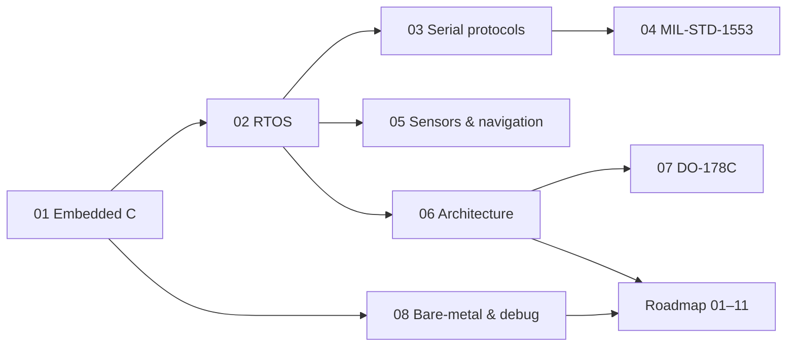

# Embedded Systems Handbook

Practical notes on embedded firmware for real-time and safety-critical systems, in two parts:

- **[Chapters](#chapters)** — what an embedded engineer must *know*. For every topic: **what it is, when to choose it over the alternatives, and what goes wrong**.
- **[Roadmap](#roadmap)** — the chain *around* the code that modern firmware teams expect: review, build, CI, testing, and measuring real-time behaviour instead of assuming it.

The notes are written from general engineering knowledge and public standards. They describe no specific product, customer or employer.

## Chapters

| # | Chapter | Covers |
|---|---|---|
| 01 | [Embedded C](chapters/01-embedded-c.md) | `volatile`, `const`, `static`, padding, pointers, memory layout, undefined behaviour, MISRA C, endianness |
| 02 | [RTOS & Concurrency](chapters/02-rtos-and-concurrency.md) | choosing primitives, ISR rules, priority inversion, deadlock, stack sizing, watchdogs |
| 03 | [Serial Protocols](chapters/03-serial-protocols.md) | SPI, I²C, UART, RS-422/485 — trade-offs and failure modes |
| 04 | [MIL-STD-1553](chapters/04-mil-std-1553.md) | bus architecture, word formats, transfers, building a Remote Terminal on an MCU |
| 05 | [Sensors & Navigation](chapters/05-sensors-and-navigation.md) | IMU sensors, sensor fusion, complementary vs Kalman, filters, calibration, AHRS/INS, IMU + GNSS |
| 06 | [Software Architecture](chapters/06-software-architecture.md) | layering, portability, state machines, fault management, patterns, V-model |
| 07 | [DO-178C](chapters/07-do-178c.md) | software levels, processes, traceability, verification, MC/DC, SOI audits |
| 08 | [Bare-metal, Hardware & Debug](chapters/08-bare-metal-and-debug.md) | super loop, registers, NVIC, DMA, watchdog, bootloader, clocks, SWD/JTAG, HardFault |

## Roadmap

  <picture>
    <source media="(prefers-color-scheme: dark)" srcset="assets/diagrams/roadmap-loop-dark.svg">
    
  </picture>

| Layer | # | Note | Covers |
|---|---|---|---|
| Development chain | 01 | [Git & Code Review](roadmap/01-git-and-code-review.md) | PR workflow, merge/rebase scenarios, hotfixes, change control in DO-178C projects |
| | 02 | [Build System & Cross-Compile](roadmap/02-build-system-and-cross-compile.md) | build chain, Make vs CMake, toolchain files, linker script, `.map` file, bootloader offsets |
| | 03 | [CI/CD & Docker](roadmap/03-ci-cd-and-docker.md) | firmware pipeline, traceability, pinned toolchains, hardware-in-the-loop CI, retrofitting CI to IDE + SVN projects |
| | 04 | [Python & Bash Automation](roadmap/04-python-and-bash-automation.md) | talking to firmware over UART, exit codes, command interpreters, data capture |
| | 05 | [Unit Test, Static Analysis & Coverage](roadmap/05-unit-test-static-analysis-coverage.md) | testable design, Unity, cppcheck, branch coverage, on-target test gating |
| Depth | 06 | [Real-time Metrics](roadmap/06-real-time-metrics.md) | latency, jitter, WCET, schedulability, measuring with GPIO/DWT |
| | 07 | [Atomics & Memory Barriers](roadmap/07-atomics-and-memory-barriers.md) | lost updates, critical sections, LDREX/STREX, DMB/DSB/ISB |
| | 08 | [Board Bring-up](roadmap/08-board-bring-up.md) | bring-up ladder, typical symptoms, checklist, power-on self-test |
| | 09 | [GDB & Fault Analysis](roadmap/09-gdb-and-fault-analysis.md) | GDB chain, watchpoints, HardFault decoding, reset causes, watchdog manager |
| Role-specific | 10 | [Firmware Update & Secure Boot](roadmap/10-firmware-update-and-secure-boot.md) | A/B updates, integrity vs authenticity, rollback, redundant boot records |
| | 11 | [Motor Control](roadmap/11-motor-control.md) | PWM, PI with anti-windup, cascaded loops, 6-step vs FOC |

Every roadmap note follows the same shape: **the question → basics → a failing first approach → the fix → practice → interview questions → principles.** Start from the [roadmap overview](roadmap/README.md).

## How to read it

Chapters stand alone, but the order above goes from language to system level. Most chapters end with a **Quick answers** list for revision; every roadmap note ends with **Interview questions**.

## Conventions

- RTOS examples use FreeRTOS / CMSIS-RTOS v2 names; the reasoning applies to any preemptive RTOS.
- Code samples are C99 for 32-bit Arm Cortex-M unless stated otherwise.
- Diagrams are SVG files in [`assets/diagrams`](assets/diagrams) with light and dark variants; a few flow charts are Mermaid. Both render directly on GitHub.
- Callouts use GitHub alerts: **Tip** = the fix or the result, **Warning** = a diagnosis or a pitfall, **Important** = a rule, **Note** = background.

## Related

- [px4-sitl-learning](https://github.com/batuuhnk/px4-sitl-learning) — PX4 flight stack studied in simulation
- [cpp-temelleri](https://github.com/batuuhnk/cpp-temelleri) — C++ concepts rebuilt side by side with their C equivalents

## License

Text and diagrams: [CC BY 4.0](LICENSE). Code snippets may be reused freely.
