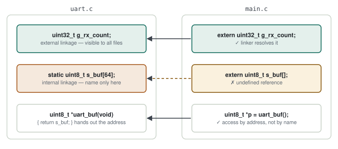
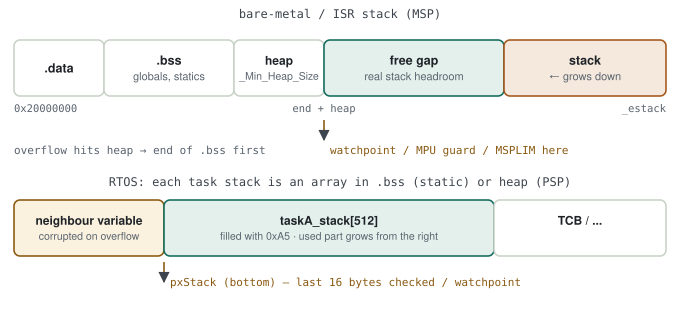

# 01 · Embedded C

> C features that behave differently, or matter more, when the code runs on a microcontroller. Each topic covers what the feature does, when I use it, and what can go wrong.

**Contents:** [volatile](#volatile) · [const](#const) · [static](#static) · [extern & linkage](#extern-and-linkage) · [Struct padding & bit-fields](#struct-padding-and-bit-fields) · [Pointers & function pointers](#pointers-and-function-pointers) · [Memory layout](#memory-layout) · [Macro vs inline](#macro-vs-inline-function) · [Undefined behaviour](#undefined-behaviour) · [MISRA C](#misra-c) · [Endianness](#endianness) · [Fixed-width types](#fixed-width-types-stdinth)

---

## volatile

`volatile` tells the compiler that the value can change in ways it cannot see, so it must not optimise accesses away. Every read and write in the source becomes a real memory access.

**Required for:**
- **Memory-mapped hardware registers.** Without it, the compiler may read a status register once and reuse a stale value.
- **Variables shared with an ISR.** A flag set in an interrupt and polled in a loop can be "optimised" into an infinite loop, because the loop body never appears to change it.

**What it does *not* do:** `volatile` gives no atomicity. A 32-bit (or larger) shared value can still be torn by an interrupt on some architectures, and read-modify-write sequences (`x++`) are never atomic. Shared data larger than a single naturally-aligned word needs a critical section or a mutex.

> [!WARNING]
> **Classic symptom:** works in Debug (`-O0`), fails in Release. Missing `volatile` on an ISR-shared variable is the first thing I check.

---

## const

`const` makes accidental writes a compile-time error. On embedded targets it also decides **where data lives**: large `const` tables (lookup tables, calibration defaults) are normally placed in Flash instead of RAM by the linker.

`const` and `volatile` can be combined. A read-only hardware status register is both:

```c
const volatile uint32_t *const STATUS = (const volatile uint32_t *)0x40021000u;
```

| Declaration | What is constant |
|---|---|
| `const int *p` | the pointed-to value |
| `int *const p` | the pointer itself |
| `const int *const p` | both |

---

## static

`static` means different things in different places:

1. **Local variable inside a function:** keeps its value between calls. It lives in `.data`/`.bss`, not on the stack.
2. **Variable or function at file scope:** *internal linkage*, visible only inside that `.c` file.

I use file-scope `static` for module encapsulation: private state and helpers stay inside the module, names cannot collide, and only the module's own functions can touch its state.

> [!WARNING]
> **A function-local `static` makes the function non-reentrant.** If two tasks (or a task and an ISR) call it, they share hidden state.

### What reentrancy means

A **reentrant** function still works correctly when it is called again — by an interrupt or another task — before the previous call has finished. The condition is simple: every call works on **its own data** (parameters and stack locals). A function-local `static` is one copy shared by every call, so the second call overwrites the first one's data.

```c
const char *temp_to_str(int16_t centi)
{
    static char buf[12];                       /* one copy, shared by everyone */
    snprintf(buf, sizeof buf, "%d.%02d", centi / 100, abs(centi % 100));
    return buf;
}
```

| Time | Task A | Task B (higher priority) | `buf` |
|---|---|---|---|
| 1 | `temp_to_str(2350)` starts writing | | `"23.5…"` (half done) |
| 2 | *(pre-empted)* | `temp_to_str(-120)` → `"-1.20"` | `"-1.20"` |
| 3 | resumes and returns | | mixed / B's value |
| 4 | prints `"-1.20"` on the UART | | **A sent the wrong value** |

> [!TIP]
> **Fix — let the caller provide the storage.**
> ```c
> char *temp_to_str_r(int16_t centi, char *buf, size_t len)   /* _r = reentrant */
> {
>     snprintf(buf, len, "%d.%02d", centi / 100, abs(centi % 100));
>     return buf;
> }
> ```
> Each call brings its own buffer; no shared state remains. That is exactly the difference between `strtok` and `strtok_r`. If shared state is unavoidable (a counter), protect it with a critical section or a mutex — the function is then *thread-safe*, not reentrant.

| Term | Meaning |
|---|---|
| Reentrant | no shared state; safe even from an ISR |
| Thread-safe | shared state protected by a lock; safe between tasks, usually not from an ISR (a mutex cannot be taken in an ISR) |

More in [RTOS & Concurrency](02-rtos-and-concurrency.md#reentrancy).

---

## extern and linkage

`extern` **declares** that a variable is defined in another file; it allocates no memory. The definition exists in exactly one place.

```c
/* config.h */
extern uint32_t system_clock_hz;      /* declaration */

/* config.c */
#include "config.h"                   /* lets the compiler check that both agree */
uint32_t system_clock_hz = 72000000;  /* definition — memory is allocated here */
```

Where possible I prefer a getter function over an `extern` global; encapsulation stays intact.

### Internal vs external linkage

**Linkage** decides whether a name in one file (translation unit) can be bound to the same object from *another* file. The linker does the binding.

<p align="center">
  <picture>
    <source media="(prefers-color-scheme: dark)" srcset="../assets/diagrams/linkage-dark.svg">
    
  </picture>
</p>

| | External linkage | Internal linkage | No linkage |
|---|---|---|---|
| How you get it | file-scope global without `static`; functions by default | file-scope `static` | locals inside a function (`static` or not) |
| Name visible in | the whole program | that `.c` file only | that block only |
| Reachable with `extern` | ✓ | ✗ | ✗ |
| Same name in two files | **multiple definition** link error | fine — two separate variables | fine |

> [!TIP]
> **`static` does two different things.** At file scope it changes **linkage** (external → internal). Inside a function it changes **lifetime** (from the stack to `.bss/.data`, alive for the whole program). Both put the variable in `.bss/.data`; what differs is who can see its name.

### Can a `static` variable be used through `extern`?

**No.** `extern` tells the linker "find this name in another file"; the name of a `static` variable is never exported to the linker (it stays a *local* symbol in the `.o`).

```c
/* uart.c */  static uint8_t s_buf[64];
/* main.c */  extern uint8_t s_buf[];      /* compiles...                              */
              s_buf[0] = 1;                /* ...link error: undefined reference to `s_buf' */
```

> [!WARNING]
> **The nastier case.** If another file has a **non-static** variable with the same name, the linker reports nothing and binds the `extern` to *that* one. It builds and writes to the wrong memory. Include the header with the `extern` declaration in the defining `.c` file, so the compiler catches any mismatch.

### Can its address be used from elsewhere?

**Yes.** `static` hides the **name**, not the **memory**. The variable lives at the same address for the whole program; if a function hands out the address, it can be used from anywhere.

```c
/* uart.c */
static uint8_t s_buf[64];
const uint8_t *uart_rx_buffer(void) { return s_buf; }     /* the address leaves the module */

/* the address of a function-local static can be returned safely too */
uint32_t *tick_counter(void) { static uint32_t ticks; return &ticks; }
```

| | Address of a local (automatic) variable | Address of a `static` variable |
|---|---|---|
| Returning it from a function | ✗ dangling pointer — the stack frame is gone | ✓ valid for the whole program |
| Using it from another file | ✗ | ✓ as long as you hold the pointer |

> [!WARNING]
> **Handing out the address ends encapsulation.** Anyone holding the pointer can write the variable, and reentrancy and race problems come back. Return a `const` pointer for read-only access; offer getter/setter functions for controlled writes. Handing out an address is legitimate where hardware needs it, e.g. a DMA buffer.

### Definitions in headers

```c
/* config.h — WRONG */   uint32_t system_clock_hz;          /* a definition in every file that includes it */
/* config.h — RIGHT */   extern uint32_t system_clock_hz;   /* declaration only */
```

GCC 10 and later default to `-fno-common`: a definition in a header included by two `.c` files gives a **multiple definition** link error. Older compilers merged them silently.

---

## Struct padding and bit-fields

### Padding

Compilers align members to their natural size and insert padding between them:

```c
struct example {      // naive expectation: 6 bytes
    uint8_t  a;       // 1 + 3 padding
    uint32_t b;       // 4
    uint8_t  c;       // 1 + 3 trailing padding
};                    // sizeof == 12 on a typical 32-bit target
```

This matters when a struct is cast straight onto a byte buffer for a protocol frame. Padding (and the other side's different compiler or architecture) silently corrupts the data.

**Options:**
- **Order members largest → smallest.** This removes most padding at no cost.
- **`__attribute__((packed))` / `#pragma pack`.** This removes all padding, but unaligned access is slower on some cores and faults on others. I use it only for wire-format structs, never as a default.
- **Best for portability:** explicit serialise/deserialise functions that write bytes one by one.

### Bit-fields

Bit-fields (`uint8_t flag : 1;`) are convenient for register maps and packed flags, but the **bit order and layout are implementation-defined**. When code must be portable across compilers or architectures, I use explicit masks and shifts instead:

```c
#define CTRL_EN_Pos   (0u)
#define CTRL_EN_Msk   (1u << CTRL_EN_Pos)

reg |=  CTRL_EN_Msk;          /* set   */
reg &= ~CTRL_EN_Msk;          /* clear */
```

---

## Pointers and function pointers

- **Dangling pointers.** Avoiding `malloc` removes most of these. Returning the address of a local variable is still a common source.
- **NULL dereference.** On Cortex-M this usually ends in a HardFault. I check pointer parameters at module boundaries, as MISRA also expects.

**Function pointers** are how C does polymorphism. I use them for:
- **Callbacks.** A driver notifies "transfer complete" without knowing who is listening.
- **Driver interfaces.** A `struct` of function pointers lets the same upper layer run on different hardware.
- **State machines and jump tables.** Adding a state becomes one table row instead of another `case` in a growing `switch`.

```c
typedef struct {
    int32_t (*init)(void);
    int32_t (*read)(uint8_t *buf, uint16_t len);
    int32_t (*write)(const uint8_t *buf, uint16_t len);
} bus_ops_t;
```

**Risk:** an uninitialised or out-of-range table entry jumps to garbage. Every call through a table gets a bounds and NULL check.

---

## Memory layout

| Section | Contents | Where |
|---|---|---|
| `.text` | code, `const` data | Flash |
| `.data` | initialised globals/statics | stored in Flash, copied to RAM at startup |
| `.bss` | zero-initialised globals/statics | RAM, zeroed at startup (no Flash cost) |
| heap | `malloc`/`free` | RAM, usually avoided |
| stack | locals, call frames (one per RTOS task) | RAM |

Knowing this turns into practical memory work. For example, I make a 4 KB lookup table `const` to move it to Flash, and keep large buffers out of task stacks.

### Detecting a stack overflow

**Causes:** deep call chains, **large local arrays**, recursion, `printf`/`sprintf` (~1 KB of stack), nested interrupts (each ISR entry pushes 32+ bytes onto the main stack).
**Symptoms:** random HardFaults, corrupted globals at the end of `.bss`, `IMPRECISERR`/`STKERR` in CFSR, a nonsense stacked PC. An overflow rarely announces itself; it looks like some other bug.

There are two kinds of stack:

| | Bare-metal / ISR stack (MSP) | RTOS task stacks (PSP) |
|---|---|---|
| Where | top of RAM, grows down from `_estack` | one array per task: in `.bss` (static) or the RTOS heap |
| Size set by | linker script: `_Min_Stack_Size` | task creation: `stack_size` / `usStackDepth` |
| Used by | `main()` before the scheduler, and **every ISR** | that task's code |

<p align="center">
  <picture>
    <source media="(prefers-color-scheme: dark)" srcset="../assets/diagrams/stack-layout-dark.svg">
    
  </picture>
</p>

**What the `.map` file tells you.** Not the usage (that only exists at run time), but the **boundaries** — where the stack ends and what it hits when it overflows:

```text
.bss            0x20000400     0x1a40
                0x20001e40                _ebss = .
._user_heap_stack
                0x20001e40      0x600
                0x20001e40                PROVIDE (end = .)
                0x20002040                . = (. + _Min_Heap_Size)      /* 0x200 */
                0x20002440                . = (. + _Min_Stack_Size)     /* 0x400 */
                0x20008000                _estack = (ORIGIN (RAM) + LENGTH (RAM))
```

- `._user_heap_stack` is only a **check** that heap + minimum stack fit (`region RAM overflowed` if not). `_Min_Stack_Size` does **not** limit the stack; nothing stops it from growing past that value.
- `_estack` − (`end` + heap) is the real headroom: here 0x20008000 − 0x20002040 ≈ 24 KB.
- The last symbols of `.bss`, and the symbol right below each static task-stack array, are the first victims.

**Without writing code**

| Method | How | Shows |
|---|---|---|
| Static analysis | `-fstack-usage` (`.su` files; GCC 10+ `-fcallgraph-info=su` for the worst path); STM32CubeIDE: *Window → Show View → Static Stack Analyzer* | frame size per function and the deepest chain, without running |
| Paint with the debugger | halt at reset, fill the stack area with a pattern from GDB, run, then find the lowest overwritten address in a memory view | the real high-water mark |
| Watchpoint at the limit | take the limit from the `.map` (or the first word of a task-stack array) and set a write watchpoint there | stops **at the instruction** that overflows |
| RTOS-aware view | STM32CubeIDE debug: *FreeRTOS Task List* | *Min Free Stack* per task |

```gdb
(gdb) monitor reset halt
(gdb) set $p = (uint32_t *)0x20002040          # end + heap, from the .map
(gdb) while ($p < (uint32_t *)0x20007f00)
 >set *$p = 0xDEADBEEF
 >set $p = $p + 1
 >end
(gdb) continue                                  # run the heaviest scenario, then interrupt
(gdb) x/64wx 0x20002040                         # first changed word = deepest point
(gdb) watch *(uint32_t *)0x20002040             # stop on the instruction that reaches the limit
```

> [!TIP]
> **What static analysis misses:** recursion, calls through function pointers and VLAs/`alloca` (marked `dynamic`/`unbounded`). It also does not add nested ISRs: worst case = deepest task chain + the stacks of every ISR that can nest.

**With code — bare-metal and RTOS**

| Method | Catches | Note |
|---|---|---|
| Stack painting + high-water mark | afterwards, on periodic reads | best for measuring margin |
| Canary word at the limit | when checked, late | cheap; damage may already be done |
| **MPU guard region** (M3/M4/M7) | **immediately** — a 32-byte no-access region at the limit | MemManage fault; stacked PC is the culprit |
| **MSPLIM / PSPLIM** (ARMv8-M: M23/M33) | **immediately**, in hardware | UsageFault `STKOF` |
| `configCHECK_FOR_STACK_OVERFLOW 2` (FreeRTOS) | at context switch | SP check + pattern in the last 16 bytes → `vApplicationStackOverflowHook` |
| `uxTaskGetStackHighWaterMark` / `osThreadGetStackSpace` | on demand | log per task; enlarge any with < 20–25 % left |
| `-fstack-protector` | at function return | catches buffer overruns *on* the stack, not stack exhaustion |

> [!WARNING]
> FreeRTOS checks only at a **context switch**. A task that overflows into another task's stack or TCB and crashes before the next switch never reaches the hook, and the ISR stack (MSP) is not checked at all. Reliable detection needs an MPU-based port or PSPLIM on ARMv8-M.

---

## Macro vs inline function

| | Macro | `static inline` function |
|---|---|---|
| Type checking | none | full |
| Side effects (`SQ(i++)`) | argument evaluated multiple times | evaluated once |
| Debugging | invisible to the debugger | steppable |
| Compile-time constants, `#ifdef` | ✔ | ✘ |

Classic macro bug: `#define SQ(x) x*x` → `SQ(a+b)` expands to `a+b*a+b`. If a macro is unavoidable, I parenthesise everything: `((x)*(x))`.

**Rule I follow:** function-like logic goes in `static inline` functions. Macros are only for constants, conditional compilation and register bit definitions.

---

## Undefined behaviour

Undefined behaviour (UB) is code whose result the C standard does not define. It may "work" until the optimisation level, compiler version or timing changes, and on embedded targets that failure tends to appear in the field, rarely and without a way to reproduce it.

Common sources:
- **Signed integer overflow** (`INT32_MAX + 1`). Unsigned overflow is defined: it wraps.
- **Reading an uninitialised variable.**
- **Modifying a variable twice without a sequence point** (`i = i++ + ++i`).
- **Out-of-bounds array access.** This is the most common and most dangerous case, because nothing traps on a bare MCU.
- **Shifting by ≥ the type width**, or shifting a negative value left.

In safety-critical work, avoiding UB is a verification requirement, not just style: if behaviour is undefined, no test can define the expected result.

---

## MISRA C

MISRA C restricts the parts of C that are undefined, implementation-defined or easy to misuse, so that the code becomes predictable and analysable. The rule categories I find most valuable in practice (MISRA C:2012):

- **No dynamic memory** (Rule 21.3). It avoids fragmentation and non-deterministic timing.
- **Explicit, well-defined type conversions** (essential type model, Rules 10.x). Silent signed/unsigned mixing is a frequent source of field bugs.
- **Every `switch` has a `default`, no silent fall-through** (Rules 16.x).
- **Restricted `goto`** (Rule 15.1, advisory) and a **single point of exit** (Rule 15.5, advisory). Both keep control flow traceable.
- **Fixed-width types** instead of plain `int`/`long` (Directive 4.6).
- **Bounded complexity.** Simpler functions are cheaper to test and cover.

I treat MISRA as a team agreement backed by a static analyser, not a checklist applied at the end.

---

## Endianness

- **Little-endian:** least-significant byte at the lowest address. ARM Cortex-M is little-endian by default.
- **Big-endian:** most-significant byte first. This is "network byte order", and many avionics and industrial interfaces use it.

Casting a struct onto a byte buffer bakes in the host's endianness *and* its padding. Explicit pack/unpack helpers avoid both problems:

```c
static inline void put_be16(uint8_t *p, uint16_t v) { p[0] = (uint8_t)(v >> 8); p[1] = (uint8_t)v; }
static inline uint16_t get_be16(const uint8_t *p)  { return (uint16_t)((p[0] << 8) | p[1]); }
```

---

## Fixed-width types (`stdint.h`)

`int` can be 16 bits on one target and 32 bits on another. For anything where size matters (register maps, protocol fields, EEPROM records) I use `uint8_t`, `int16_t`, `uint32_t` and so on. Plain `int`/`long` appear only where the exact size truly does not matter.

---

### Quick reference

| Topic | One-line takeaway |
|---|---|
| `volatile` | Stops the compiler optimising accesses away; provides no atomicity |
| `const volatile` | Read-only to software, changeable by hardware |
| `static` | Persistence inside functions, encapsulation at file scope |
| Padding | Order members by size; use `packed` only for wire formats |
| Bit-fields | Layout is implementation-defined; use masks when portability matters |
| Macro vs inline | Use `static inline` for logic; keep macros for constants and `#ifdef` |
| UB | Most MISRA rules exist to remove it |
| `stdint.h` | Use exact-width types wherever size matters |

[← Back to index](../README.md) · [Next: RTOS & Concurrency →](02-rtos-and-concurrency.md)
