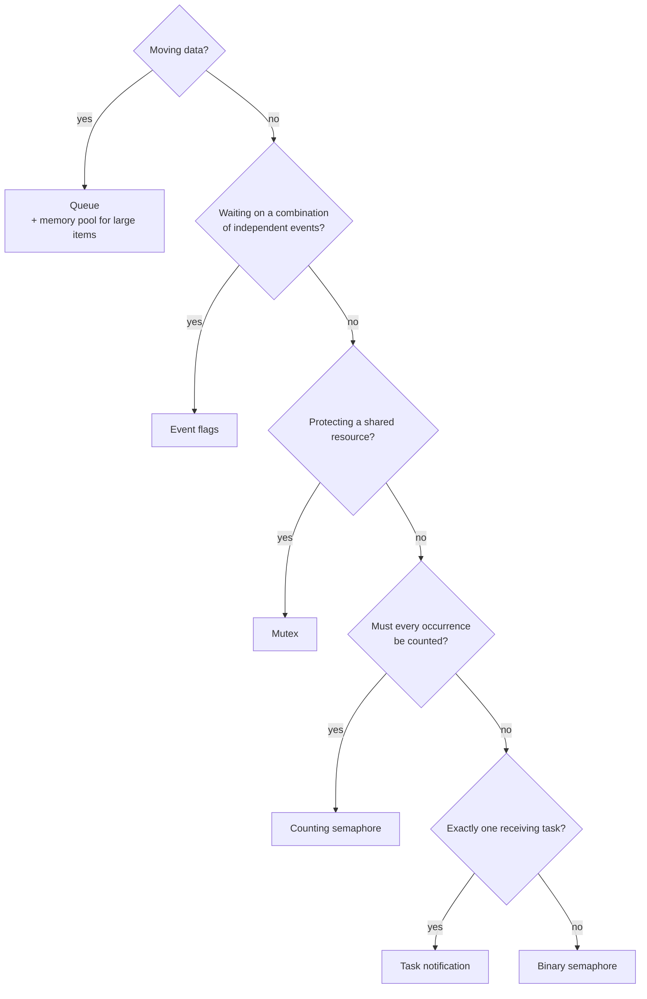

# 02 · RTOS & Concurrency

> Choosing the right synchronisation primitive, and the timing problems that follow when the wrong one is picked. Examples use FreeRTOS / CMSIS-RTOS v2 naming, but the reasoning applies to any preemptive RTOS.

**Contents:** [Two different needs](#two-different-needs) · [Primitives](#primitives) · [Decision flow](#decision-flow) · [ISR rules](#isr-rules) · [Timing problems](#timing-problems) · [Memory & performance](#memory-and-performance) · [Watchdog in an RTOS](#watchdog-in-an-rtos) · [Communication patterns](#inter-task-communication-patterns) · [Critical sections](#critical-sections) · [Real-time classes](#real-time-classes) · [MCU notes](#mcu-notes)

---

## Two different needs

Most RTOS bugs come from mixing up two separate needs:

| Need | Question it answers | Typical primitive |
|---|---|---|
| **Synchronisation** | "Has something happened?" | semaphore, task notification, event flags |
| **Resource protection** | "Who may use this right now?" | mutex |
| **Data transfer** | "Here is the data" | queue (+ memory pool for large blocks) |

---

## Primitives

### Binary semaphore: a signal

The value is 0 or 1. It works like a doorbell: the ISR rings it and the task answers.

**Typical use, deferred processing:** a DMA-complete interrupt gives the semaphore, and the task does the actual processing. The ISR stays short.

**Limits:**
- It has **no ownership and no priority inheritance**, so I never use it to protect a resource.
- If the ISR fires twice before the task runs, **one event is lost** (the value is already 1).

### Counting semaphore: count events or resources

1. **Event counting.** Every give increments the count, so bursts are not lost. Example: commands arriving back-to-back on a UART.
2. **Resource pools.** Initialise the count to *N* buffers, take one to allocate, give one to release. When the count is 0, the pool is empty.

### Mutex: protect a shared resource

Example: several tasks share one SPI bus with multiple sensors on it. The mutex serialises access.

Two properties a semaphore lacks:
1. **Ownership.** Only the task that took the mutex can release it.
2. **Priority inheritance.** This bounds [priority inversion](#priority-inversion).

> **Rule:** protection → mutex, signalling → semaphore. A mutex can never be taken from an ISR, because it blocks and has an owner.

### Recursive mutex

A recursive mutex lets the same task take the same mutex again (one release per take). It is needed when a locked function calls another function that takes the same lock. Example: `read_all_regs()` calling `read_reg()`.

When I need one, it usually means the locking belongs one layer higher. It is sometimes unavoidable in library code.

### Queue: move data

A queue moves data between tasks in FIFO order, safely and with built-in buffering. Unlike "global variable + flag", it is thread-safe and holds more than one item.

- **Items are copied.** That is fine for small structs. For large blocks I put a **pointer** to a memory-pool block in the queue.
- **Sizing.** Compare producer and consumer rates. During development I watch the fill level (`uxQueueMessagesWaiting`) and size the queue from real data.

### Event flags (event group): combine conditions

Each bit is one event. A task can wait for **ALL** (AND) or **ANY** (OR) of a set of bits, optionally with a timeout.

- **AND:** a fusion task waits until the accel, gyro *and* magnetometer samples are all ready.
- **OR:** a fault monitor wakes on UART error *or* sensor timeout *or* watchdog warning, then checks which bits are set.
- **With a timeout:** whichever bit is still missing when the timeout expires points to the faulty source.

### Task notification: the lightweight 1:1 signal

Every FreeRTOS task already has a 32-bit notification value built in. Notifications can act as a binary semaphore, a counter, or a set of event bits, with no separate kernel object, so they use less RAM and run faster.

**Constraint:** only **one receiving task** can wait on a notification. For 1:1 signalling (for example, a timer ISR waking one control task) it is my default. For 1:many signalling I use event flags or a semaphore.

### Software timer

A software timer handles periodic or delayed work without a dedicated hardware timer or task. Callbacks run in the timer service (daemon) task.

- **Periodic:** heartbeat LED, housekeeping.
- **One-shot:** communication timeouts. Start the timer when a command is sent, stop it when the reply arrives, and handle the timeout in the callback.
- Callbacks must stay short and non-blocking. Real work is handed off to a task.

### Memory pool

A memory pool is a set of fixed-size blocks. It replaces `malloc` and removes three problems: **fragmentation**, **non-deterministic allocation time** and **leaks**. Allocate and free take constant time.

A common pairing: take a pool block → fill it with a received packet → queue the pointer → the consumer returns the block when done.

---

## Decision flow



Periodic or delayed work → **software timer**. Dynamic allocation → **memory pool**. I always start from the lightest primitive that does the job.

---

## ISR rules

**The golden rule:** do as little as possible in the ISR (set a flag, give a semaphore, post to a queue) and return. Processing happens in a task.

| Allowed from an ISR | Not allowed |
|---|---|
| semaphore give, queue send, event-flag set, task-notify | mutex take/give |
| — | anything that blocks or waits |

- In FreeRTOS, use the `...FromISR()` variants. In CMSIS-RTOS v2, the same call works from an ISR with a **timeout of 0**.
- If the ISR woke a higher-priority task, request a context switch on exit (`portYIELD_FROM_ISR`). Otherwise the task waits for the next tick.

---

## Timing problems

### Deadlock

Two or more tasks each wait for a resource the other holds. All four Coffman conditions must hold: mutual exclusion, hold-and-wait, no preemption and circular wait.

```
Task A: take(M1) → take(M2)      Task B: take(M2) → take(M1)
          holds M1, waits M2               holds M2, waits M1   → deadlock
```

**Prevention, most effective first:**
1. **Global lock ordering.** Every task takes locks in the same order. This removes circular wait by design.
2. **Fewer locks.** Group related resources under one mutex.
3. **Timeouts** on every take, with logging and recovery. This turns a silent hang into a detectable fault.
4. **Watchdog** as the last line of defence.

### Priority inversion

Low-priority **L** holds a mutex that high-priority **H** needs. Medium-priority **M** preempts L, so H is now effectively waiting on M.

The best-known case is **Mars Pathfinder (1997)**. A low-priority task held a shared bus mutex, medium-priority tasks kept preempting it, the high-priority bus task missed its deadline, and the watchdog kept resetting the spacecraft. The fix was to enable priority inheritance on that mutex, and it was uploaded from Earth.

- **Priority inheritance (reactive).** While H waits, L temporarily runs at H's priority, so M cannot preempt it. This turns *unbounded* inversion into *bounded* inversion. FreeRTOS mutexes do this.
- **Priority ceiling (proactive).** Each mutex has a ceiling equal to the highest priority of any task that uses it, and taking the mutex raises the owner to that ceiling immediately. It is easier to analyse for worst-case blocking, and the original protocol also prevents deadlock, which is why certifiable systems often prefer it. FreeRTOS does not offer it natively; POSIX (`PTHREAD_PRIO_PROTECT`) and several safety RTOSes do.

### Starvation

A task never gets CPU time because higher-priority tasks never block. The cure is honest priority assignment, and **every task must have a blocking point** (a delay, or a wait on a semaphore or queue).

### Race condition

The result depends on interleaving. Example: an ISR updates a multi-byte value while a task is halfway through reading it.

- Shared between tasks → **mutex**.
- Shared with an ISR → short **critical section**.
- A single-word flag written only by the ISR → `volatile` may be enough.
- **Cleanest:** don't share at all. Pass copies through a queue.

### Jitter

Jitter is variation in when a periodic job actually runs. Filters and fusion algorithms that assume a fixed `dt` lose accuracy as jitter grows.

| Cause | Mitigation |
|---|---|
| `vTaskDelay` adds the task's own run time to the period | **`vTaskDelayUntil`** keeps an absolute period |
| Preemption by higher-priority work | give the periodic task appropriate priority |
| Heavy interrupt load | keep ISRs short and defer work |
| Assuming a constant `dt` | **timestamp samples** and use the measured `dt` |

---

## Memory and performance

### Stack overflow

Each task has a fixed stack. When it overflows, it silently corrupts whatever memory is next to it.

- **Common causes:** deep call chains, large local arrays, recursion, and `printf`-family calls (often hundreds of bytes to over 1 KB).
- **Detection:** `configCHECK_FOR_STACK_OVERFLOW` (method 1 checks the stack pointer, method 2 adds a guard pattern) calls `vApplicationStackOverflowHook`.
- **Sizing:** measure with `uxTaskGetStackHighWaterMark` under worst-case load, then add a margin (20–30%).

### Context switch

A context switch saves and restores registers and the stack pointer. It happens on blocking, preemption, time-slice expiry or yield.

On Cortex-M it typically costs around a microsecond (cycle count depends on core, FPU state and clock). That is negligible for most designs, but it matters for control loops in the tens-of-microseconds range, where a bare-metal loop or a dedicated timer ISR may fit better. More tasks means more potential switches.

### Reentrancy

A reentrant function is safe to call from several tasks or ISRs at once. It uses only parameters and locals: no hidden `static` or global state.

- In drivers, I keep per-instance state in a struct passed by pointer. The same driver code can then serve several sensors safely.
- Some standard library functions are not reentrant (`strtok`, `rand`). Use the reentrant variants (`strtok_r`) or avoid them.

### Idle task and power

The idle task runs when nothing else is ready. Its uses:
- **Idle hook → sleep mode.** The MCU wakes on the next interrupt.
- **Cleanup.** It frees memory of deleted tasks, so it must not starve.
- **CPU load measurement.** Idle time ≈ free capacity.
- **Tickless idle.** It suppresses the periodic tick during long idle periods for deeper sleep, at the cost of extra wake-up latency.

---

## Watchdog in an RTOS

In a bare-metal loop, kicking the watchdog in the main loop is enough. With several tasks it is not: one task can be alive while another is stuck.

**Watchdog manager pattern:** every critical task checks in periodically (for example by setting its event-flag bit). A manager task kicks the hardware watchdog **only when all expected check-ins have arrived**. A missing check-in is logged with the task's identity before the reset, which makes post-mortem analysis possible.

---

## Inter-task communication patterns

| Pattern | Shape | Good for |
|---|---|---|
| **Producer–consumer** | producer → queue → consumer | rate decoupling, the basis of the rest |
| **Pipeline** | ISR → queue → filter → queue → fusion → queue → output | sensor processing chains |
| **Client–server** | many clients → request queue → one server task | owning a bus or device without mutexes |
| **Publish–subscribe** | one producer → many subscribers | one sample consumed by processing *and* logging |
| **Event-driven** | tasks block on events, often with a state machine | device mode and fault handling |

**Queue-full policy is a design decision.** Either block the producer or drop the oldest item. For navigation and control data, **fresh beats complete**, so dropping the oldest sample is usually right.

---

## Critical sections

| Level | Stops | Use when data is shared with |
|---|---|---|
| Suspend scheduler | task switches only | other tasks only |
| Disable interrupts | task switches and ISRs | an ISR |

A critical section must be **a few instructions long**, measured in microseconds. If one lasts milliseconds, the design needs a mutex or a different ownership model.

---

## Real-time classes

| Class | Missed deadline means… | Example |
|---|---|---|
| **Hard** | system failure | flight control, actuation |
| **Firm** | that result is worthless, the system continues | a late sensor sample is dropped |
| **Soft** | degraded quality | UI updates, streaming |

**Determinism** is what makes hard real-time possible: bounded execution time on every path. That is why `malloc`, `printf` and unbounded loops are kept out of time-critical tasks.

---

## MCU notes

- **NVIC:** interrupt priorities and nesting. On Cortex-M with FreeRTOS, ISRs that call RTOS APIs must have a priority numerically ≥ `configMAX_SYSCALL_INTERRUPT_PRIORITY`.
- **SysTick and STM32 HAL:** both the RTOS and HAL want SysTick. In CubeMX, move the HAL timebase to a basic timer (for example TIM6). Otherwise you get intermittent, hard-to-explain timing faults.
- **DMA:** moves sensor and communication data without CPU load. Pair it with semaphores or notifications for deferred processing.
- **MPU:** isolates memory regions so a misbehaving task cannot overwrite another's data. Valuable in safety-related designs.

---

### Quick reference

| Problem | Fix in one line |
|---|---|
| Race condition | Mutex or critical section; better: pass copies through a queue |
| Deadlock | Global lock order + timeouts + watchdog |
| Priority inversion | Use a mutex (inheritance), never a semaphore, for protection |
| Starvation | Every task blocks somewhere; don't inflate priorities |
| Jitter | `vTaskDelayUntil` + timestamped samples |
| Stack overflow | High-water-mark sizing + overflow hook |
| 1:1 signal | Task notification |
| Combine N events | Event flags |

[← Previous: Embedded C](01-embedded-c.md) · [Back to index](../README.md) · [Next: Serial Protocols →](03-serial-protocols.md)
