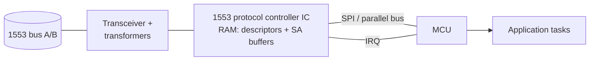

# 04 · MIL-STD-1553

> MIL-STD-1553 is the command/response data bus used in military aircraft and weapon platforms. This chapter covers the protocol and the integration patterns I consider good practice when building a Remote Terminal on a microcontroller. All of it is based on the public standard; nothing here describes a specific program.

**Contents:** [Why it exists](#why-it-exists) · [Physical layer](#physical-layer) · [Roles](#roles) · [Word formats](#word-formats) · [Transfer types](#transfer-types) · [Timing](#timing) · [MIL-STD-1760](#mil-std-1760) · [Building an RT on an MCU](#building-a-remote-terminal-on-an-mcu) · [Validation in depth](#validation-in-depth)

---

## Why it exists

A platform has dozens of subsystems (navigation, mission computers, stores, sensors) that must exchange data **deterministically** over shared wiring. MIL-STD-1553 (first published in 1973) solves this with a single bus controller that schedules every transfer, so latency is known by design rather than by measurement.

---

## Physical layer

| Property | Value |
|---|---|
| Medium | shielded twisted pair, ~70–85 Ω characteristic impedance (78 Ω nominal) |
| Redundancy | **dual bus (A and B)**; an RT answers on whichever bus it was addressed on |
| Data rate | **1 Mbit/s**, fixed |
| Encoding | **Manchester II bi-phase** (the clock is embedded in the data) |
| Coupling | transformer-coupled stubs (up to ~6 m) or direct-coupled stubs (~0.3 m) |
| Termination | both bus ends terminated in the cable's characteristic impedance |

The bus controller retries on the other bus when one fails. That is the core of the standard's fault tolerance.

---

## Roles

```
            Bus A ═══════════════════════════════════════
            Bus B ═══════════════════════════════════════
                 │            │          │           │
              ┌──┴──┐      ┌──┴──┐    ┌──┴──┐     ┌──┴──┐
              │ BC  │      │ RT  │    │ RT  │ ... │ BM  │
              └─────┘      └─────┘    └─────┘     └─────┘
```

| Role | Function |
|---|---|
| **BC** (Bus Controller) | Starts **every** transfer. There is exactly one active BC per bus. |
| **RT** (Remote Terminal) | Responds only when commanded. Addresses **0–30**; address 31 is broadcast. |
| **BM** (Bus Monitor) | Listens and records, never transmits. Used for test and data logging. |

> **The defining rule:** an RT never speaks unless the BC asks it to.

---

## Word formats

Every word is 20 bit-times: a **3-bit-time sync**, **16 data bits** and **1 odd-parity bit**. The sync pattern tells command/status words apart from data words.

**Command word** (BC → RT):
```
| RT address (5) | T/R (1) | Subaddress / mode (5) | Word count / mode code (5) |
```
- `T/R = 1`: the RT transmits. `T/R = 0`: the RT receives.
- Subaddress **0 or 31** marks a **mode command** (for example *transmit status word*, *reset RT*, *transmitter shutdown*).
- Word count **0 means 32** data words.

**Data word:** 16 bits of payload, 1–32 per message.

**Status word** (RT → BC, the first word of every RT response):
```
| RT address (5) | Message error | Instrumentation | Service request | (reserved ×3) |
| Broadcast cmd received | Busy | Subsystem flag | Dynamic bus control acceptance | Terminal flag |
```
The status word is how an RT reports "received but invalid", "busy" or "my subsystem has a fault" without the BC having to poll a separate message.

---

## Transfer types

```
BC → RT (receive):    BC: [CMD  RT=n, R, SA, WC=k] [DATA × k]
                      RT:                                       [STATUS]

RT → BC (transmit):   BC: [CMD  RT=n, T, SA, WC=k]
                      RT:                            [STATUS] [DATA × k]

RT → RT:              BC: [CMD rx-RT, R] [CMD tx-RT, T]
                      tx-RT:                             [STATUS] [DATA × k]
                      rx-RT:                                                 [STATUS]
```

Broadcast versions (address 31) exist for BC → RT and RT → RT transfers. RTs do **not** respond with a status word to broadcast messages; they only set the *broadcast received* bit.

---

## Timing

| Parameter | Value |
|---|---|
| RT response time (end of command/data → start of status) | **4–12 µs** |
| BC "no response" timeout | ≥ 14 µs |
| Minimum inter-message gap | 4 µs |

The response window is far too tight to handle in firmware. **That is why RTs use a dedicated protocol controller IC**, and the MCU only exchanges message buffers with it.

---

## MIL-STD-1760

MIL-STD-1760 defines the electrical and logical interface between an aircraft and its stores. Its data path runs over 1553 and adds message headers and a **message checksum** on top of 1553's per-word parity. A 1553 RT that must follow 1760 therefore validates content as well as transport.

---

## Building a Remote Terminal on an MCU



The patterns I consider essential:

1. **Let the controller IC own the protocol.** It handles Manchester coding, response timing, status word generation and illegal-command responses. Firmware configures it and moves buffers in and out.
2. **Descriptor table + per-subaddress buffers.** Each subaddress gets its own receive and transmit buffer in the controller's RAM. Firmware decides the memory map once, at initialisation.
3. **Illegalisation table.** Explicitly mark every subaddress, direction and word-count combination the interface does **not** support. The controller then answers illegal commands with the message-error bit, without firmware involvement.
4. **Detect new data, don't assume it.** Check the controller's per-message status (message received, error flags, time tag) before copying a receive buffer, and ignore buffers that were not updated since the last read.
5. **Double-buffer or ping-pong transmit data.** Transmit buffers are updated so the BC can never read a half-written message.
6. **Report health through the protocol.** Fault bits go into a periodically transmitted status message and the *subsystem flag*, so the BC always sees the current health without an extra request.
7. **Keep the ISR short.** The controller interrupt only signals a task, and buffer handling happens at task level ([deferred processing](02-rtos-and-concurrency.md#binary-semaphore-a-signal)).

---

## Validation in depth

For commands that can change the state of the system, one integrity check is not enough. I structure validation as **independent layers**, and a command is acted on only if every layer passes:

| Layer | Checks | Catches |
|---|---|---|
| 1. Transport | sync, Manchester, parity, word count (controller IC) | bit errors on the wire |
| 2. Message | header and message checksum (for example the 1760 checksum) | corrupted or misrouted messages |
| 3. Application | independent consistency check on safety-relevant fields, plausibility and state-machine guards | a well-formed message carrying an unsafe or inconsistent command |

Each failure maps to a distinct error code. It is logged, reported in the status message, and **never** results in partial execution of the command.

[← Previous: Serial Protocols](03-serial-protocols.md) · [Back to index](../README.md) · [Next: Sensors & Navigation →](05-sensors-and-navigation.md)
