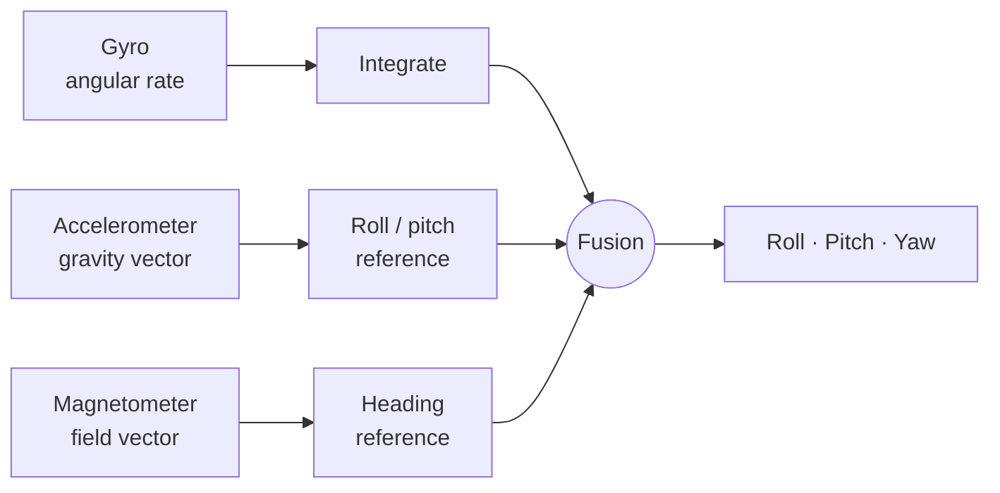
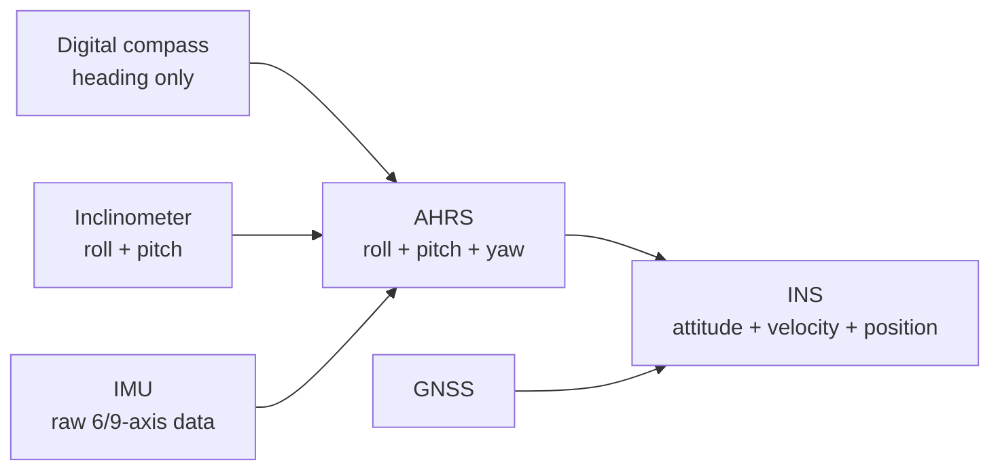

# 05 · Sensors & Navigation

> What each inertial sensor is good and bad at, why they are always fused, how the common filters compare, and how compasses, inclinometers, IMUs, AHRS and INS relate to each other.

**Contents:** [The three sensors](#the-three-sensors) · [Why fuse them](#why-fuse-them) · [Complementary vs Kalman](#complementary-vs-kalman) · [Signal filters](#signal-filters) · [Calibration](#calibration) · [System hierarchy](#system-hierarchy) · [IMU + GNSS](#imu--gnss) · [Quick answers](#quick-answers)

---

## The three sensors

### Accelerometer
Measures linear acceleration **including gravity**. At rest, the direction of gravity gives **roll and pitch**. It cannot give **yaw**, because rotating about the vertical axis does not change the gravity vector.

**Weakness:** vibration and real motion. Once the platform accelerates, the measured vector is gravity *plus* motion, so the tilt estimate is wrong. On its own it is not a reliable attitude reference on a moving platform.

### Gyroscope
Measures **angular rate** on three axes. Integrating the rate gives angle.

**Strength:** very accurate in the short term, follows fast manoeuvres, little affected by vibration.
**Weakness — drift:** any small bias is integrated too, so the angle error grows without bound. A gyro alone produces a reference that slowly "slides".

### Magnetometer
Measures the local magnetic field and gives an **absolute heading** — usually the only absolute yaw reference when GNSS is not available.

**Weakness — magnetic disturbance:**
- **Hard iron:** a fixed field carried by the platform (motors, magnets). Appears as a constant **offset**.
- **Soft iron:** ferromagnetic material bending the Earth's field. Appears as a heading-dependent **ellipse** distortion.

Both must be calibrated out, or heading stays systematically wrong.

---

## Why fuse them

| Sensor | Short term | Long term | Missing |
|---|---|---|---|
| Accelerometer | noisy, disturbed by motion | good roll/pitch at rest | no yaw |
| Gyroscope | accurate, fast | drifts | no absolute reference |
| Magnetometer | sensitive to local disturbance | absolute heading | unreliable near interference |

The weaknesses are complementary. Sensor fusion keeps the **gyro's short-term accuracy** and uses the **accelerometer and magnetometer as long-term absolute references** to cancel the drift.

---

## Complementary vs Kalman

| | Complementary filter | Kalman filter |
|---|---|---|
| Idea | high-pass the integrated gyro, low-pass the absolute reference, add them | predict with a process model, correct with measurements weighted by their noise |
| Weighting | fixed (usually one coefficient) | dynamic, from the noise covariances |
| Tuning | one or two parameters | process and measurement noise matrices |
| CPU / memory | very low | higher (matrix operations) |
| Debugging | easy | harder; needs a model you trust |
| Pick it when | resources are tight and dynamics are simple | several sensors with changing reliability, or the best achievable estimate is required |

**Kalman loop in one line each:**
1. **Predict** — propagate the state with the model (for example gyro integration) and grow the uncertainty.
2. **Update** — compare the prediction with a new measurement; the difference (innovation) is blended in according to how much each side is trusted.

> On an embedded target, the integration work around the filter matters as much as the maths: fixed sample timing, consistent units and frames, sensible initialisation, and a way to log the internal states while tuning.

---

## Signal filters

| Filter | What it does | Cost | Risk / trade-off | Typical use |
|---|---|---|---|---|
| **Low-pass** | removes high-frequency noise | low | adds lag; more smoothing = more delay | slowly changing quantities (temperature, pressure) |
| **High-pass** | removes DC and slow drift | low | discards the absolute level | when only change matters, or to strip a slow bias |
| **IIR (recursive)** | uses past *outputs*: `y[n] = a·y[n−1] + b·x[n]` | very low | feedback can make it **unstable**; non-linear phase | most embedded smoothing |
| **FIR (convolution)** | weighted sum of past *inputs* only | higher (many taps) | always stable; can be **linear phase** | when signal shape must be preserved |

IIR gets a given response with far fewer coefficients. FIR costs more CPU but can never go unstable and delays all frequencies equally.

---

## Calibration

No sensor is accurate straight from the factory: manufacturing tolerances, temperature and mounting misalignment all leave systematic errors. Calibration measures those errors once and removes them in software.

- **Magnetometer (hard/soft iron):** rotate the unit through many orientations, fit an offset vector (hard iron) and a matrix that maps the ellipse back to a sphere (soft iron). Store in non-volatile memory, apply to every sample.
- **Accelerometer / gyro:** estimate **bias** and **scale factor** by holding the unit in known orientations (for example the six-face method) and comparing against the expected values.
- **Temperature:** if bias drifts with temperature, characterise it over the range and store a compensation curve.

---

## System hierarchy

These products build on each other:

| System | Output | Main sensors | Limitation |
|---|---|---|---|
| **Digital magnetic compass** | heading | magnetometer (+ accelerometer for tilt compensation) | no dynamic attitude |
| **Inclinometer** | roll, pitch | accelerometer (+ gyro for dynamic use) | no heading |
| **IMU** | raw angular rate and acceleration (sometimes magnetic field) | gyro, accelerometer, (magnetometer) | **does not compute attitude** |
| **AHRS** | full attitude: roll, pitch, yaw | IMU + magnetometer + fusion algorithm | no position |
| **INS** | attitude, velocity, position | IMU + navigation algorithm, usually GNSS-aided | pure inertial position drifts quickly |

> Common question: *"Does an IMU give attitude?"* — No. An IMU delivers raw inertial measurements; the attitude is computed by the AHRS layer on top.

---

## IMU + GNSS

Position from an IMU means integrating acceleration **twice**, so errors grow roughly with the square of time. GNSS gives drift-free position and velocity, but at a low rate (≈1–10 Hz) and can drop out (tunnels, terrain, jamming).

| | IMU | GNSS |
|---|---|---|
| Rate | hundreds of Hz | ≈1–10 Hz |
| Short term | very accurate | noisy, lags manoeuvres |
| Long term | drifts | bounded error |
| Availability | always | can be lost |

**Coupling levels:**
- **Loosely coupled** — GNSS computes its own position/velocity; a Kalman filter fuses that solution with the inertial solution.
- **Tightly coupled** — raw GNSS measurements (pseudoranges) go into the same filter as the IMU data. Still useful with fewer than four satellites, so it is more robust.

---

## Quick answers

- **Why fuse?** Accelerometer is disturbed by motion, gyro drifts, magnetometer is disturbed by local fields — together they cover each other.
- **Complementary or Kalman?** Complementary when resources are tight and dynamics simple; Kalman when sensor reliability varies and the best estimate is needed.
- **Gyro drift?** Integrated bias; corrected continuously by the absolute references.
- **Hard vs soft iron?** Constant offset vs heading-dependent ellipse; both removed by a rotation-based calibration.
- **IIR vs FIR?** IIR is cheap but can be unstable; FIR is always stable and can be linear-phase but costs more.
- **Why IMU + GNSS?** IMU is fast but drifts; GNSS is drift-free but slow and can be lost.

[← Previous: MIL-STD-1553](04-mil-std-1553.md) · [Back to index](../README.md) · [Next: Software Architecture →](06-software-architecture.md)
