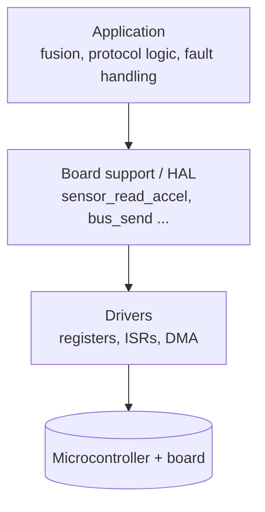
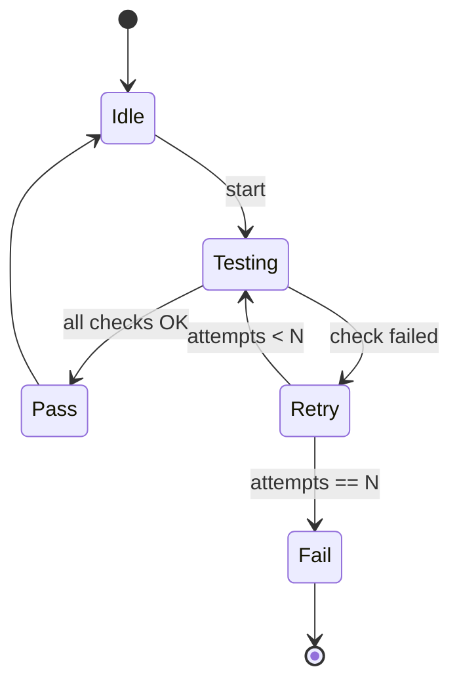
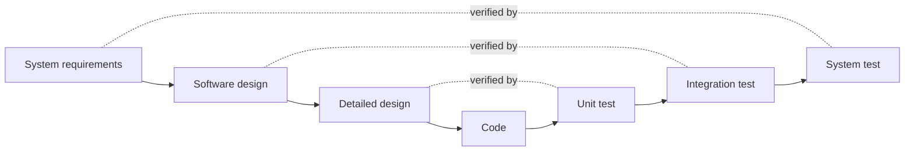

# 06 · Software Architecture

> How I structure firmware so it survives a change of microcontroller, can be tested without hardware, and handles faults by design rather than as an afterthought.

**Contents:** [Layered architecture](#layered-architecture) · [Platform independence](#platform-independence) · [Module interfaces](#module-interfaces) · [State machines](#state-machines) · [Fault management](#fault-management) · [Patterns](#patterns) · [Traceability & V-model](#traceability-and-the-v-model) · [Quick answers](#quick-answers)

---

## Layered architecture

| Layer | Owns | Knows about hardware? |
|---|---|---|
| **Driver** | register access, interrupt handlers, DMA setup | yes — fully MCU-specific |
| **BSP / HAL** | a clean API for the board ("read accelerometer"), hides which bus and pins are used | only through the drivers |
| **Application** | business logic: fusion, protocol handling, fault management | no |

**Why layer instead of one monolith:**
- **Portability.** Moving to a different MCU family should mean rewriting the driver layer only; the BSP API and application stay the same.
- **Testability.** With a stable BSP interface, the application can be unit-tested on a PC against stub BSP functions, long before field tests.

**Watch for leaky abstractions.** If the BSP returns a vendor-specific error code, the application now depends on the hardware. The BSP should translate everything into a platform-independent error enum.

---

## Platform independence

1. **Fixed driver signatures** — `spi_write(const uint8_t *data, uint16_t len)` stays the same on every MCU; only the implementation changes.
2. **Conditional compilation stays inside drivers.** `#ifdef` per target is acceptable in the driver layer and nowhere else. Scattered `#ifdef`s in application code are exactly what layering is meant to prevent.
3. **Fixed-width types** (`uint8_t`, `uint32_t`) everywhere, so sizes do not change between compilers (see [Embedded C](01-embedded-c.md#fixed-width-types-stdinth)).

---

## Module interfaces

- Keep the public header **minimal**: only what callers need.
- Everything else is `static` inside the `.c` file — private state and helper functions are invisible outside the module.
- One module, one responsibility. A BSP function contains no application logic.

The payoff: the inside of a module (for example a filter implementation) can be rewritten without touching any caller. When reading unfamiliar code, a clean interface also shows immediately what is safe to change and what is a public contract.

---

## State machines

Use a state machine when behaviour reads naturally as *"where am I, what happened, where do I go next"*. A built-in test is a good example:

**Why not an `if/else` chain:**
- Adding a state does not touch existing branches.
- Each state and transition can be tested in isolation.
- Lower cyclomatic complexity, which also lowers structural-coverage effort (see [DO-178C](07-do-178c.md#structural-coverage)).

| Implementation | Good for | Watch out |
|---|---|---|
| `switch`-based | up to ~10 states; very readable | grows unwieldy as states multiply |
| Function-pointer table | many states, frequent extension | bounds-check the state index; never call a NULL handler |

---

## Fault management

Design it in from the start. Added later, it ends up inconsistent: every module reports errors differently, logging is missing in critical places, and recovery behaviour varies.

A consistent pattern for every module:

1. **Identify** — each module/function has an ID, so a fault can be traced to its source (fault isolation).
2. **Classify** — separate **transient** from **permanent** faults with a retry count or an M-of-N threshold, so one noisy sample does not mark the unit as failed.
3. **Persist** — log faults to non-volatile memory so they survive power loss and can be read back after a field event.
4. **Report** — expose health in the status message so the system above can react.

---

## Patterns

### Callback / observer
A driver calls a function pointer registered by a higher layer when an event occurs ("frame received"). The driver never needs to know who is listening, so the same driver can be reused in a different product unchanged.

### Singleton — sparingly
Fine for a resource that is physically unique (one specific SPI peripheral). Elsewhere it introduces hidden global state and coupling, and makes it hard to replace the module with a stub in tests.

### Memory pools instead of heap
Fixed-size blocks, constant-time allocation, no fragmentation — see [RTOS & Concurrency](02-rtos-and-concurrency.md#memory-and-performance).

---

## Traceability and the V-model

Every component should be able to answer *"why does this exist?"* — a requirement ID, a change request or a recorded design decision. It costs a comment and saves hours for whoever modifies the code later.

A clean layered architecture maps directly onto the right-hand side: drivers are verified with hardware integration tests, the BSP against stubs, the application with logic tests. When layers are tangled, so are the test levels.

---

## Quick answers

- **Why layers?** Portability and testability — a new MCU changes only the drivers; a stable BSP lets the application run against stubs.
- **State machine or if/else?** State machine whenever behaviour is state-based; it is easier to extend, test and cover.
- **Callbacks?** They keep drivers independent of the layers above, so drivers are reusable.
- **Singleton?** Only for physically unique resources.
- **Fault handling?** By design: ID + transient/permanent classification + non-volatile log + status reporting, identical in every module.

[← Previous: Sensors & Navigation](05-sensors-and-navigation.md) · [Back to index](../README.md) · [Next: DO-178C →](07-do-178c.md)
