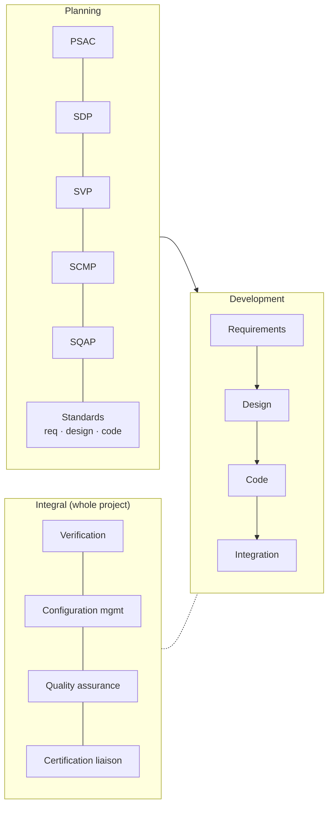
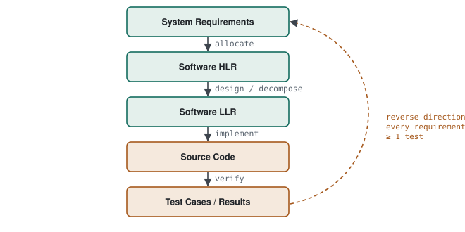

# 07 · DO-178C

> A practical overview of the airborne software certification standard: software levels, the three groups of processes, traceability, verification methods, structural coverage and the certification audits.

**Contents:** [What it is](#what-it-is) · [Software levels](#software-levels) · [Processes](#processes) · [Traceability](#traceability) · [Verification methods](#verification-methods) · [Structural coverage](#structural-coverage) · [Stages of involvement](#stages-of-involvement) · [Problem reports & CM](#problem-reports-and-configuration-management) · [Tool qualification](#tool-qualification) · [Quick answers](#quick-answers)

---

## What it is

DO-178C, *Software Considerations in Airborne Systems and Equipment Certification*, is the guidance accepted by authorities such as the FAA and EASA for certifying airborne software.

It is a **process** standard, not a coding standard. It does not claim the software is bug-free; it requires **systematic, auditable evidence** that the software was developed and verified correctly. That is why it is so heavy on documentation and traceability.

---

## Software levels

The level comes from the **system safety assessment** — the software team does not choose it.

| Level | Failure condition | Example | Coverage required |
|---|---|---|---|
| **A** | Catastrophic | flight control | MC/DC + decision + statement |
| **B** | Hazardous | critical navigation | decision + statement |
| **C** | Major | secondary systems | statement |
| **D** | Minor | cabin information | none (requirements-based tests only) |
| **E** | No effect | in-flight entertainment | DO-178C objectives do not apply |

The number of objectives, and how many must be met **with independence**, rises steeply from D to A (Level A has 71 objectives).

---

## Processes

| Plan | Purpose |
|---|---|
| **PSAC** — Plan for Software Aspects of Certification | the overall certification strategy; first formal document seen by the authority |
| **SDP** — Software Development Plan | lifecycle, methods, tools and roles for development |
| **SVP** — Software Verification Plan | how reviews, analyses and tests will be done |
| **SCMP** — Software Configuration Management Plan | baselines, change control, archiving |
| **SQAP** — Software Quality Assurance Plan | who audits what, and how often |
| **Standards** | requirements, design and code standards (for example a MISRA C-based coding standard and layering rules) |

---

## Traceability

  <picture>
    <source media="(prefers-color-scheme: dark)" srcset="../assets/diagrams/do178c-traceability-dark.svg">
    
  </picture>

- Every line of code traces to an LLR, every LLR to an HLR, every HLR to a system requirement.
- Tracing works **both ways**: every requirement has at least one test case.
- Traceability is how **dead code** (code with no requirement) and **derived requirements** (requirements that do not trace up to the system level) are found — both need explicit attention and are fed back to the safety assessment.

---

## Verification methods

| Method | What it is | Good for |
|---|---|---|
| **Review** | human inspection against a checklist | requirements, design, code against the standards |
| **Analysis** | systematic or tool-based examination | worst-case execution time, stack usage, static analysis — properties too broad to prove by test alone |
| **Test** | execution on target or representative environment | requirements-based testing, both **normal-range** and **robustness** cases |

---

## Structural coverage

Coverage measures how much of the code the **requirements-based tests** actually exercised. Uncovered code points to missing requirements, missing tests, or code that should not be there.

| Criterion | Meaning | Required at |
|---|---|---|
| **Statement** | every statement executed at least once | A, B, C |
| **Decision** | every decision has taken both true and false | A, B |
| **MC/DC** | each condition in a decision is shown to **independently** change the outcome | A |

For `if (a && (b || c))` MC/DC needs a set of tests where flipping only `a`, only `b`, or only `c` flips the result — typically N+1 tests for N conditions, not 2ᴺ. It is still expensive, which is why Level A code keeps conditions deliberately simple.

---

## Stages of involvement

The authority (or its delegate) reviews the project at four points:

| SOI | Focus | Evidence |
|---|---|---|
| **1** | Planning | PSAC, SDP, SVP, SCMP, SQAP, standards |
| **2** | Development | requirements, design, code, trace data |
| **3** | Verification | test procedures and results, coverage, review records |
| **4** | Final | Software Accomplishment Summary (SAS), configuration index |

An SOI is a process check, not a pass/fail exam: findings are raised and must be closed. Teams run internal readiness reviews through QA before each one.

---

## Problem reports and configuration management

- **Problem reports.** Every discrepancy found in review or test is recorded, classified, resolved and closed, with a full audit trail: when found, who fixed it, what the fix affected.
- **Configuration management.** Every artefact — requirement, design, code, test, result — is under a baseline. The project must be able to prove exactly which code version was tested with which procedures against which requirements. This goes well beyond "it is in Git".

---

## Tool qualification

If a tool can **insert** an error (a code generator) or **fail to detect** one (a coverage or static-analysis tool) and its output is not otherwise verified, the tool itself must be qualified under **DO-330**. If the generated code is fully reviewed and tested anyway, the qualification burden drops.

---

## Quick answers

- **What is DO-178C?** A process standard that requires auditable evidence that software was developed and verified correctly — not a guarantee that it is bug-free.
- **Levels?** A–E by failure severity, set by the safety assessment; A needs MC/DC.
- **HLR vs LLR?** HLR says *what* the software does; LLR says *how*.
- **Why is MC/DC expensive?** Each condition's independent effect must be demonstrated, so Level A code is kept simple.
- **SOIs?** 1 planning, 2 development, 3 verification, 4 final/SAS.
- **Why is CM so strict?** To prove which code, which tests and which requirements belong together.

[← Previous: Software Architecture](06-software-architecture.md) · [Back to index](../README.md) · [Next: Bare-metal, Hardware & Debug →](08-bare-metal-and-debug.md)
