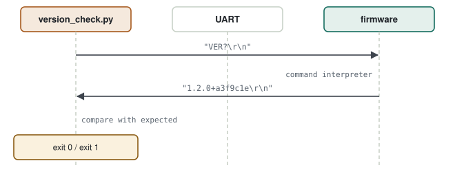

# 12 · Python & Bash Automation

> After every new firmware you do the same thing: open a terminal, connect to the device, ask for the version, send a few commands, read the replies. The question: **how do you hand that repeated manual check to a machine, so that you save time and CI can run the same check every time?**

**Contents:** [How a script talks to firmware](#how-a-script-talks-to-firmware) · [Example: version check](#example-version-check) · [Firmware side: a command interpreter](#firmware-side-a-command-interpreter) · [Reading on-target test output](#reading-on-target-test-output) · [Data capture and analysis](#data-capture-and-analysis) · [Quick jobs with Bash](#quick-jobs-with-bash) · [Practice](#practice) · [Quick answers](#quick-answers) · [Principles](#principles)

---

## How a script talks to firmware

<p align="center">
  <picture>
    <source media="(prefers-color-scheme: dark)" srcset="../assets/diagrams/host-script-sequence-dark.svg">
    
  </picture>
</p>

1. A Python script opens the serial port and sends a command.
2. A small command interpreter in the firmware replies.
3. The script compares the reply with what it expected.
4. It returns an **exit code**: `0` success, `1` failure. CI reads the code and turns the step green or red.

| Concept | Meaning |
|---|---|
| `pyserial` | Python library for reading/writing a serial port |
| timeout | never waiting forever for a reply |
| exit code | the script's result; the language of automation |
| `argparse` | parameters like `--port COM5 --baud 115200` |
| Bash pipeline | filtering logs with `|`, `grep`, `awk` |

> [!TIP]
> **GUI tools vs scripts.** A Qt test or calibration GUI is for people; a Python script is for machines. Both can use the same command protocol — every command behind the GUI also works from a script.

---

## Example: version check

### First approach

```python
s = serial.Serial("COM5", 115200)
s.write(b"VER?\r\n")
print(s.readline())
```

> [!WARNING]
> **Diagnosis — why this is not enough**
> - If the device never answers, `readline()` waits **forever**; the CI job hangs.
> - The result is only printed; CI cannot tell success from failure (exit code is always 0).
> - The port name is hard-coded; it won't work on another machine.

### The right way

**`version_check.py`**

```python
import argparse, sys, serial

p = argparse.ArgumentParser(description="Firmware version check")
p.add_argument("--port", required=True)
p.add_argument("--expect", required=True, help="e.g. 1.2.0+a3f9c1e")
p.add_argument("--timeout", type=float, default=2.0)
a = p.parse_args()

try:
    with serial.Serial(a.port, 115200, timeout=a.timeout) as s:
        s.reset_input_buffer()
        s.write(b"VER?\r\n")
        reply = s.readline().decode(errors="replace").strip()
except serial.SerialException as e:
    print(f"ERROR: cannot open port: {e}")
    sys.exit(2)

if not reply:
    print("ERROR: no reply from device (timeout)")
    sys.exit(3)

print(f"device: {reply!r}  expected: {a.expect!r}")
sys.exit(0 if reply == a.expect else 1)
```

> [!TIP]
> **Result.** No hanging thanks to the timeout; different failures get different exit codes; CI can run this script directly as a stage.

---

## Firmware side: a command interpreter

**Minimal command table**

```c
typedef struct { const char *cmd; void (*handler)(void); } Command_t;

static void cmd_ver(void)  { uart_printf("%s+%s\r\n", FW_VERSION, FW_GIT_HASH); }
static void cmd_stat(void) { uart_printf("BIT=%s FAULTS=%u\r\n", bit_ok() ? "PASS" : "FAIL", fault_count()); }

static const Command_t commands[] = {
    { "VER?",  cmd_ver  },
    { "STAT?", cmd_stat },
};

void command_dispatch(const char *line)
{
    for (size_t i = 0; i < ARRAY_SIZE(commands); i++) {
        if (strcmp(line, commands[i].cmd) == 0) { commands[i].handler(); return; }
    }
    uart_printf("ERR unknown\r\n");
}
```

On a real link (RS-485 with DMA, for example) the pieces are the same, only arranged for an RTOS:

| Generic structure | Typical RTOS implementation |
|---|---|
| UART RX interrupt | DMA + **idle-line** interrupt: fires when a frame ends |
| ISR tells the task | `osThreadFlagsSet(rxTask, FLAG_RX_IDLE)` — the ISR does no parsing |
| line / frame parsing | frame processor → protocol command handler in the task |
| command table | the binary command set from the interface control document |
| reply | binary packet back on the same link |

A useful command to add: **read the persistent fault log** one entry at a time (`index` in, entry + total count out). The host then pulls the whole log with a loop — no separate "how many entries" command needed — and a returned unit tells its own story with one script. The command-table structure is the same idea as the table-driven state machine in [chapter 06](06-software-architecture.md).

---

## Reading on-target test output

When on-target tests print `PASS:` / `FAIL:` lines over UART ([chapter 13](13-unit-test-static-analysis-coverage.md#on-target-tests-and-compile-time-gating)), a script turns them into an exit code — the first step of hardware CI ([chapter 11](11-ci-cd-and-docker.md#hil-stage-the-board-does-not-go-into-docker)).

**`read_tests.py`**

```python
import serial, sys
port = serial.Serial(sys.argv[1], 115200, timeout=10)
fails = []
for raw in iter(port.readline, b""):
    line = raw.decode(errors="replace").strip()
    if line.startswith("FAIL:"):
        fails.append(line)
    if "TESTS PASSED" in line or "FAILED" in line:
        break
print(*fails, sep="\n")
sys.exit(1 if fails else 0)
```

---

## Data capture and analysis

**`log_capture.py` — 60 s of sensor data + a summary**

```python
import csv, statistics, sys, time, serial

PORT, SECONDS = sys.argv[1], 60
rows = []
with serial.Serial(PORT, 115200, timeout=1) as s:
    t_end = time.time() + SECONDS
    while time.time() < t_end:
        line = s.readline().decode(errors="replace").strip()
        if line.startswith("ACC,"):
            _, x, y, z = line.split(",")
            rows.append((float(x), float(y), float(z)))

with open("acc.csv", "w", newline="") as f:
    csv.writer(f).writerows(rows)

for i, axis in enumerate("xyz"):
    vals = [r[i] for r in rows]
    print(f"{axis}: mean={statistics.mean(vals):.4f}  std={statistics.stdev(vals):.4f}")
```

This is the fastest way to see bias and noise before calibration ([chapter 05](05-sensors-and-navigation.md)).

---

## Quick jobs with Bash

```bash
# only error lines from a log, with counts
grep -E "FAULT|ERR" uart.log | sort | uniq -c | sort -rn

# record build size for every commit
arm-none-eabi-size build-arm/app.elf | awk 'NR==2 {print $1, $2, $3}' >> size_history.txt
```

---

## Practice

1. Add `VER?` and `STAT?` to the firmware.
2. Verify with `version_check.py`; pass a wrong `--expect` to see exit code 1, unplug the cable to see the timeout.
3. Capture 60 s with `log_capture.py` and print mean and standard deviation.

---

## Quick answers

- **How is a test script counted as failed in CI?** It returns a non-zero exit code; the CI job marks that as a failure.
- **What should a script do if the device does not answer?** Bound the wait with a timeout, print a clear message about what happened, return a failing exit code.
- **How do you automate a repeated test job?** Add a command interface to the device, send commands from Python and verify the replies, report the result as an exit code plus a CSV/report, and hook it into CI.
---

## Principles

#### 1 — Scripts are written for machines
The result is the exit code, not the text on the screen.

#### 2 — No wait is infinite
Every read has a timeout; a hanging script locks the pipeline.

#### 3 — The device must be able to describe itself
Version, hash, self-test state and fault log readable with one command.

[← Previous: CI/CD & Docker](11-ci-cd-and-docker.md) · [Back to index](../README.md) · [Next: Unit Test, Static Analysis & Coverage →](13-unit-test-static-analysis-coverage.md)
