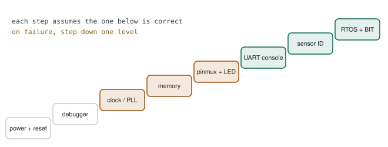

# 16 · Board Bring-up

> A new board arrives from production; you flash the code and nothing happens. The question: **is it the hardware, the clock, the linker or the pin mux — and how do you tell, step by step, without guessing?** Bring-up is a ladder where each step relies on the one below having been verified.

**Contents:** [The ladder](#the-ladder) · [Example: garbage on the UART](#example-garbage-on-the-uart) · [Typical faults and their symptoms](#typical-faults-and-their-symptoms) · [Bring-up checklist for a new board](#bring-up-checklist-for-a-new-board) · [The power-on self-test as a bring-up ladder](#the-power-on-self-test-as-a-bring-up-ladder) · [Practice](#practice) · [Quick answers](#quick-answers) · [Principles](#principles)

---

## The ladder

<p align="center">
  <picture>
    <source media="(prefers-color-scheme: dark)" srcset="../assets/diagrams/bringup-ladder-dark.svg">
    
  </picture>
</p>

Each step assumes the one below is correct. Garbled UART output is most likely not a UART-code problem but a lower step: the clock. So bring-up goes **bottom-up**, and when something fails you step down one level.

| Step | What is verified | Tool | What you see when it's right |
|---|---|---|---|
| 1. Power and reset | supply rails, reset line, boot pins | multimeter, oscilloscope | correct voltages, reset high |
| 2. Debugger | connect to the core over SWD/JTAG | debugger | IDCODE reads, core halts |
| 3. Clock | crystal, PLL lock, bus clocks | MCO pin + oscilloscope | expected frequency |
| 4. Memory | flash wait states, RAM, linker script | debugger, `.map` | variables at the right addresses, RAM test passes |
| 5. Pin mux + LED | alternate functions, GPIO | oscilloscope | LED blinks |
| 6. UART console | baud, pins | terminal | "hello" readable |
| 7. Sensor ID | I²C/SPI, address, mode | logic analyzer | WHO_AM_I returns the right value |
| 8. System | RTOS, watchdog, self-test | log, SystemView | self-test PASS |

> [!NOTE]
> **Register-level bring-up.** Without a vendor HAL the same ladder becomes explicit: core config → PLL → clock mapping → peripheral enable → memory init → interrupt controller → pin mux → drivers. Having done this once by hand is good evidence for "have you brought up a board without the HAL?"

---

## Example: garbage on the UART

You power the board and the terminal shows `ÿ€ø` instead of `Hello`.

### First approach

Look into the UART driver: baud calculation, parity, stop bits… hours of changing UART code.

> [!WARNING]
> **Diagnosis — wrong step.** The UART baud divider is computed **from the clock frequency**. The code assumes HSE = 8 MHz, the board has a 25 MHz crystal → every clock runs 25/8 times faster → the baud rate is off by the same factor. The UART code is fine; the step below is wrong.

### Solution: measure the step below

**STM32F4: route SYSCLK to the MCO2 pin (PC9)**

```c
RCC->CFGR &= ~(RCC_CFGR_MCO2 | RCC_CFGR_MCO2PRE);
RCC->CFGR |=  (0U << RCC_CFGR_MCO2_Pos)         /* 00: SYSCLK          */
           |  (6U << RCC_CFGR_MCO2PRE_Pos);     /* 110: /4 (measurable) */
/* PC9 must be configured as alternate function AF0 */
```

On the oscilloscope you expect 168/4 = 42 MHz and see something far off → `HSE_VALUE` is wrong.

> [!TIP]
> **Result.** One measurement reduced the problem to the clock definition; the UART code never needed touching. Rule: if you are stuck on a step, measure the one below first.

---

## Typical faults and their symptoms

| Symptom | Likely cause | Step |
|---|---|---|
| Debugger won't connect | SWD pins reassigned, low-power mode, reset line | 1–2 |
| Connects but code never runs | wrong boot pin, wrong vector table address | 1, 4 |
| Random HardFault once the PLL is on | clock raised before flash wait states | 3–4 |
| Everything proportionally fast/slow | wrong `HSE_VALUE` | 3 |
| UART/I²C silent | wrong alternate function, clock enable forgotten | 5 |
| I²C NACK | 7-bit vs 8-bit address mix-up, no pull-ups | 7 |
| Globals start with garbage | `.data` copy / `.bss` clear, linker script | 4 |

> [!WARNING]
> **Order of flash wait states.** Increase the flash wait states **before** raising the clock; when lowering, lower the clock first, then reduce the wait states. The reverse order fetches wrong instructions from flash and produces unexplainable faults.

---

## Bring-up checklist for a new board

```
[ ] Supply voltages measured (every rail)
[ ] Reset line and boot pins at the right level
[ ] Debugger reads IDCODE, halt/step work
[ ] HSE/crystal frequency matches the code; SYSCLK measured on MCO
[ ] Flash wait states match the new clock
[ ] .map: vector table at the start of flash, stack at the end of RAM
[ ] LED toggles → GPIO and clock enable correct
[ ] UART "hello" → baud and pin mux correct
[ ] Every sensor's ID register read
[ ] Watchdog, self-test and reset-cause log working
```

---

## The power-on self-test as a bring-up ladder

In a product, the same ladder lives in software: `main()` calls one start-up function, and that function climbs the ladder on every boot. Each step sets a bit in a status word, so when a board comes up wrong, the status word read over the serial link tells you which step failed.

| Step | What runs | On failure |
|---|---|---|
| 1 Reset cause | read the reset flags | non-power-on reset → set a "reset" bit, continue |
| 2 Board init | clock, GPIO, DMA, timer, UART — each through a retry helper | up to 10 attempts, ≥ 4 failures → FAIL |
| 3 Non-volatile memory | integrity of boot flag / configuration / calibration blocks | CRC mismatch → "memory integrity" bit |
| 4–5 Sensors | init of each sensor over SPI / I²C | "sensor init" bits |
| 6 Summary | bit 0 = OR of all other bits | — |
| 7 Clear reset flags | **after** the self-test, so the reset bit holds the cause of *this* boot | — |
| 8 Failsafe outputs | permanently failed sensors report a defined sentinel value | — |
| 9 Runtime monitoring | start the sliding windows for continuous self-test | — |
| 10 Watchdog | started last, right before the scheduler | — |

**A retry helper tolerates transient faults during start-up**

```c
/* FAIL, FAIL, PASS      → 2 failures < 4 → PASS (early exit)
 * FAIL × 4              → 4 ≥ 4          → FAIL               */
bool selftest_with_retry(int32_t (*step)(void), uint8_t max_tries, uint8_t fail_limit)
{
    uint8_t fails = 0U;
    for (uint8_t i = 0U; i < max_tries; i++) {
        if (step() == 0) { return fails < fail_limit; }
        if (++fails >= fail_limit) { return false; }
        delay_ms(10);
    }
    return false;
}
```

> [!WARNING]
> **Design choice — the system does not halt.** No self-test failure ends in `while (1)`; the device keeps talking on its serial link in a **failsafe** mode. A silent unit in the field tells you nothing; a talking one reports its status word and its persistent log. The ladder's "on failure, step down" rule becomes automatic: the status word says which step dropped out.

> [!TIP]
> **When a new board revision arrives**
> 1. Enable a one-time EEPROM smoke test (compile-time symbol) → confirm the EEPROM writes and reads back on a reserved scratch block, read the result over the serial link.
> 2. Disable it and enable the full on-target test build → all tests pass ([chapter 13](13-unit-test-static-analysis-coverage.md#on-target-tests-and-compile-time-gating)).
> 3. Disable both → release build; the status word must read 0.

---

## Practice

1. Map a register-level init sequence onto the ladder table at the top.
2. Enable MCO on an STM32 and verify SYSCLK with an oscilloscope.
3. Set `HSE_VALUE` wrong on purpose; watch the UART output break and diagnose it with MCO.
4. Write the smallest test that reads the board sensor's WHO_AM_I register.

**Related:** [chapter 08](08-bare-metal-and-debug.md) (clock tree, PLL, watchdog), [chapter 17](17-gdb-and-fault-analysis.md).

---

## Quick answers

- **A new board arrives. What do you do first?** Measure power and reset, connect the debugger to the core, verify the clock with MCO, then bring up the LED and the UART console; then go through the peripherals one by one.
- **The code doesn't run and the debugger won't connect either.** Supply and reset, SWD pins reassigned to another function, boot pins, low-power modes; if needed, "connect under reset".
- **The UART prints garbage.** Clock first: measure SYSCLK on MCO, check the HSE definition. If the clock is right, check the baud calculation and the other side's settings.
---

## Principles

#### 1 — Bottom-up
No step is taken before the one below is verified.

#### 2 — Don't guess, measure
MCO, an oscilloscope and a logic analyzer are faster than hours of code changes.

#### 3 — The symptom is up, the cause is down
Garbled UART is usually the clock; an unexplained fault is usually wait states or the linker.

[← Previous: Atomics & Memory Barriers](15-atomics-and-memory-barriers.md) · [Back to index](../README.md) · [Next: GDB & Fault Analysis →](17-gdb-and-fault-analysis.md)
