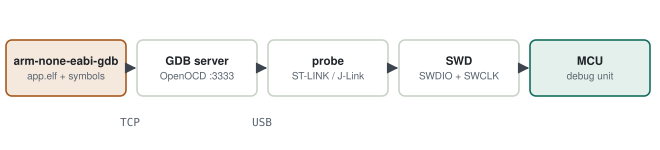
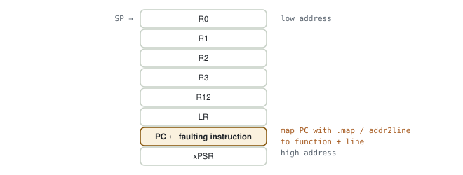
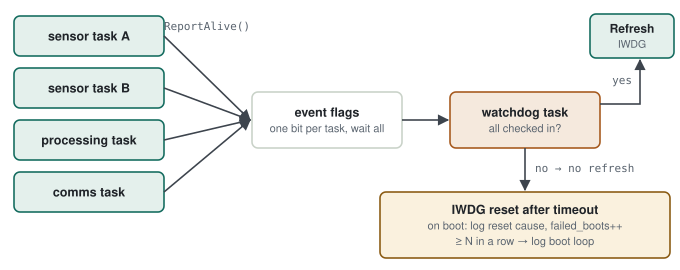

# 17 · GDB & Fault Analysis

> The device resets once a day in the field and never in the lab. The question: **in a system where you cannot see the moment of failure, how do you find where and why it fails?** The answer has three parts: using the debugger without the IDE, reading the trace the CPU leaves at the moment of a fault, and having the device record its own reset causes.

**Contents:** [The debugger chain](#the-debugger-chain) · [Example: a variable that randomly corrupts](#example-a-variable-that-randomly-corrupts) · [Decoding a HardFault](#decoding-a-hardfault) · [In the field: reset cause and stack overflow](#in-the-field-reset-cause-and-stack-overflow) · [Watchdog manager, reset-cause latch and boot-loop detection](#watchdog-manager-reset-cause-latch-and-boot-loop-detection) · [Practice](#practice) · [Quick answers](#quick-answers) · [Principles](#principles)

---

## The debugger chain

When you press "Debug" in the IDE, this chain runs behind it:

<p align="center">
  <picture>
    <source media="(prefers-color-scheme: dark)" srcset="../assets/diagrams/gdb-chain-dark.svg">
    
  </picture>
</p>

| Link | Role |
|---|---|
| `arm-none-eabi-gdb` | interprets commands using the symbols and line info in the `.elf` |
| GDB server (OpenOCD, ST-LINK GDB server, J-Link GDB server) | translates GDB commands into probe operations, opens a TCP port |
| Probe (ST-LINK, J-Link) | USB ↔ SWD bridge |
| SWD | two-wire debug interface (SWDIO, SWCLK) |
| MCU debug unit | halts the core, reads registers and memory, implements breakpoints/watchpoints |

> [!TIP]
> **Why the command line?** The same chain is used in CI, on a remote test machine, or on a Linux box without an IDE. Knowing the command line also tells you what each IDE button does.

**A basic session**

```bash
openocd -f interface/stlink.cfg -f target/stm32f4x.cfg      # separate terminal, :3333
arm-none-eabi-gdb build-arm/app.elf
(gdb) target extended-remote :3333
(gdb) monitor reset halt
(gdb) load                          # write to flash
(gdb) break filter_update
(gdb) continue
(gdb) bt                            # call stack
(gdb) info locals
(gdb) p/x sensor_buf
```

| Command | What it does |
|---|---|
| `break f` / `tbreak f` | stop at f / stop once |
| `watch x` | stop when x is **written** (hardware watchpoint) |
| `rwatch x` / `awatch x` | stop when read / on any access |
| `bt` | who called whom |
| `x/8wx addr` | show 8 words in hex from an address |
| `info registers` | core registers |
| `monitor reset halt` | GDB-server command: reset and halt |

---

## Example: a variable that randomly corrupts

`imu_scale` turns into a nonsense value now and then. The only code that writes it is `imu_init()`.

### First approach

Add `printf`s and watch the value; rebuild and reflash for every attempt.

> [!WARNING]
> **Diagnosis — why you can't find it.** **Your code** isn't writing the variable; a neighbouring buffer overflows into it. `printf` changes the timing, so the bug sometimes even disappears. Without seeing who writes, you spend hours looking at the wrong function.

### Solution: a watchpoint

```gdb
(gdb) watch imu_scale
(gdb) continue
Hardware watchpoint 2: imu_scale
Old value = 0.00122
New value = 4.6e-41
uart_rx_isr () at src/uart.c:88
88        rx_buf[rx_idx++] = USART2->DR;
(gdb) p rx_idx
$1 = 64
```

The `.map` shows `imu_scale` right after `rx_buf[64]`: `rx_idx` has no bounds check, and the 65th byte lands in the neighbouring variable.

> [!TIP]
> **Result.** Two commands caught the writer: a missing bounds check in the UART ISR. Rule: "a variable gets corrupted" → watchpoint + neighbours in the `.map` ([chapter 10](10-build-system-and-cross-compile.md#which-symbols-are-listed-and-which-are-not)).

### Watchpoints in STM32CubeIDE

| Way | How | When |
|---|---|---|
| Menu | halt in a debug session → right-click the variable → **Add Watchpoint (C/C++)…** → choose Write / Read, optionally a *Condition* → Resume | quick, one variable |
| GDB console | **Console** → select the `arm-none-eabi-gdb` console → `watch`, `rwatch`, `awatch`, `info watchpoints`, `delete N` | by address, conditional |
| Live Expressions | **Window → Show View → Live Expressions** — reads values over SWD while running, without halting | to catch the moment of corruption first |

```gdb
watch *(uint32_t *)0x20001A40      # address of the neighbouring variable, from the .map
watch g_status_word                # who sets this status bit?
```

When it stops, the call stack in the **Debug** view shows the writing function; the editor stops on the line after the write.

> [!WARNING]
> **Cortex-M0+ limits**
> - At most **2** hardware watchpoints (4 on an M4).
> - The hardware does not compare values: for an `if ...` condition GDB halts on every write and checks it itself, which slows the code.
> - No SWV data trace (no SWO on M0+); use Live Expressions instead.
> - A watchpoint on a local variable is deleted when it goes out of scope; use an `-O0`/`-Og` build.
> - The IWDG keeps running at a breakpoint: unless the DBGMCU freeze bit is set, the board resets while you wait.

---

## Decoding a HardFault

On a fault, Cortex-M automatically pushes eight registers onto the stack:

<p align="center">
  <picture>
    <source media="(prefers-color-scheme: dark)" srcset="../assets/diagrams/hardfault-stack-frame-dark.svg">
    
  </picture>
</p>

The most valuable is the **stacked PC**: the address of the faulting instruction. The fault status registers tell you why.

| Register | Address | What it tells |
|---|---|---|
| CFSR | 0xE000ED28 | MemManage / BusFault / UsageFault bits |
| HFSR | 0xE000ED2C | FORCED: a lower fault escalated to HardFault |
| MMFAR | 0xE000ED34 | address of the MemManage fault (if valid) |
| BFAR | 0xE000ED38 | address of the BusFault (if valid) |

| CFSR bit | Meaning | Typical cause |
|---|---|---|
| UsageFault · DIVBYZERO | divide by zero | if `DIV_0_TRP` is enabled |
| UsageFault · UNALIGNED | unaligned access | `packed` struct, cast pointer |
| UsageFault · INVSTATE | invalid state | function pointer with Thumb bit 0 (NULL/garbage) |
| BusFault · PRECISERR + BFAR | access to an invalid address | NULL pointer, peripheral clock off |
| BusFault · IMPRECISERR | buffered write; address not exact | write error, PC a little further on |
| MemManage · DACCVIOL | MPU violation | stack overflow (MPU guard) |

**A handler that captures the fault**

```c
void HardFault_Handler(void) __attribute__((naked));
void HardFault_Handler(void)
{
    __asm volatile(
        "tst lr, #4      \n"     /* which stack: MSP or PSP */
        "ite eq          \n"
        "mrseq r0, msp   \n"
        "mrsne r0, psp   \n"
        "b hardfault_c   \n");
}

void hardfault_c(uint32_t *frame)
{
    volatile uint32_t pc   = frame[6];
    volatile uint32_t lr   = frame[5];
    volatile uint32_t cfsr = SCB->CFSR;
    volatile uint32_t bfar = SCB->BFAR;
    fault_log_save(pc, lr, cfsr, bfar);   /* to persistent memory */
    __BKPT(0);                            /* stop if a debugger is attached */
    NVIC_SystemReset();
}
```

```bash
arm-none-eabi-addr2line -e build-arm/app.elf -f 0x08001a52
# filter_update
# src/filter.c:47
```

---

## In the field: reset cause and stack overflow

**Read the reset cause at boot (STM32F4)**

```c
uint32_t csr = RCC->CSR;
ResetCause_t cause =
    (csr & RCC_CSR_IWDGRSTF) ? RST_IWDG :
    (csr & RCC_CSR_WWDGRSTF) ? RST_WWDG :
    (csr & RCC_CSR_SFTRSTF)  ? RST_SOFTWARE :
    (csr & RCC_CSR_BORRSTF)  ? RST_BROWNOUT :
    (csr & RCC_CSR_PORRSTF)  ? RST_POWER_ON :
    (csr & RCC_CSR_PINRSTF)  ? RST_PIN : RST_UNKNOWN;
RCC->CSR |= RCC_CSR_RMVF;              /* clear the flags */
fault_log_reset(cause);
```

| Reset cause | What it suggests |
|---|---|
| IWDG | a task missed its check-in → which task? (feed per task, see the watchdog manager below) |
| Software | `NVIC_SystemReset` from the HardFault handler → check the fault log |
| Brown-out | supply dips → hardware, peak current |
| Pin | external reset, EMI |

**FreeRTOS stack overflow**

```c
/* FreeRTOSConfig.h */
#define configCHECK_FOR_STACK_OVERFLOW 2

void vApplicationStackOverflowHook(TaskHandle_t t, char *name)
{
    fault_log_stack(name);
    NVIC_SystemReset();
}

/* periodic check: lowest remaining stack (words) */
UBaseType_t left = uxTaskGetStackHighWaterMark(NULL);
```

---

## Watchdog manager, reset-cause latch and boot-loop detection

The principle "a device in the field must tell its own story" in three concrete pieces:

### Watchdog manager: which task is stuck

<p align="center">
  <picture>
    <source media="(prefers-color-scheme: dark)" srcset="../assets/diagrams/watchdog-manager-dark.svg">
    
  </picture>
</p>

```c
/* in every monitored task's loop */
wdg_report_alive(WDG_TASK_SENSOR_A);            /* osEventFlagsSet */

/* watchdog task */
if (wdg_wait_all_healthy(WDG_CHECK_PERIOD_MS)) { /* osFlagsWaitAll */
    iwdg_refresh();
}
```

Feeding from a single task only proves "at least one task runs". Here the IWDG is refreshed only if **every** task checked in within the period; if one hangs, refreshing stops and the hardware resets after its timeout.

### Reset cause: a per-boot latch

```c
/* first step of the self-test — even before non-volatile memory is up */
selftest_check_reset_source(&result);
if (result.non_power_on_reset) {
    status.bits.invalid_reset = 1U;
}
/* ... whole self-test ... */
clear_reset_flags();                    /* last — keeps this boot's cause in the status bit */
```

> [!WARNING]
> **Diagnosis — clearing the flags too early.** If the reset flags are never cleared, the next boot reads the old cause again; if they are cleared at the start of the self-test, the cause of this boot can be lost. Read first, clear after the self-test: the status bit holds the cause of *this* boot.

### Boot-loop detection: count in EEPROM, not RAM

The status word lives in RAM; a device resetting every two seconds never stays up long enough to be read. So the counter goes into the persistent boot record:

```c
if (status.bits.invalid_reset) {
    boot.failed_boots++;
    if (boot.failed_boots >= BOOT_LOOP_THRESHOLD) {
        log_error(SEVERITY_FATAL, EVT_BOOT_LOOP, (uint8_t)boot.failed_boots);
    }
} else if (boot.failed_boots != 0U) {
    boot.failed_boots = 0U;             /* a normal boot → the loop is broken */
}
```

> [!TIP]
> **Reading a returned unit.** Read the log → is there a FATAL boot-loop entry → which module's event code comes right before it → together with the reset bit: "watchdog reset loop after module X" in one read. Adding the stacked PC and CFSR from the HardFault handler to the same log is the natural next step.

---

## Practice

1. Connect with OpenOCD + GDB; use `load`, `break`, `bt`.
2. Write past the end of an array on purpose; catch it with a watchpoint.
3. Call a NULL function pointer to trigger a HardFault; read CFSR and the stacked PC, map it to a line with `addr2line`.
4. Print the reset cause on the UART at boot; trigger the IWDG on purpose.
5. Print every task's stack high-water mark.

---

## Quick answers

- **A variable gets corrupted at random. How do you find the cause?** Put a watchpoint on its address; it stops at the writing instruction and the backtrace shows the source. It's usually a neighbouring buffer overflow; I check the neighbours in the `.map`.
- **How do you debug a HardFault?** In the handler, read the stacked PC and LR and CFSR/HFSR/BFAR; map the PC to a line with `addr2line`. The CFSR bit tells the cause: unaligned access, NULL, divide by zero, invalid state.
- **The device occasionally resets in the field.** Log the reset cause and the last fault records to persistent memory at boot; for a watchdog reset find which task missed its check-in; for brown-out look at the supply.
- **Breakpoint vs watchpoint?** A breakpoint stops at an instruction address; a watchpoint stops when a data address is accessed. A watchpoint answers "who wrote this?".
- **How do you design a watchdog in an RTOS?** A watchdog task refreshes the hardware watchdog only when every monitored task has checked in within the period (event flags, wait-all). Start the watchdog as the last step before the scheduler, and log the reset cause and a boot-loop counter in persistent memory.
---

## Principles

#### 1 — A fault leaves a trace
The stacked PC and CFSR often name the cause directly; a handler that doesn't save them throws the information away.

#### 2 — "Who wrote it?" is answered by a watchpoint
`printf` changes the timing; a watchpoint doesn't.

#### 3 — A device in the field must tell its own story
Without reset cause, fault log and stack high-water mark, a field defect is guesswork.

[← Previous: Board Bring-up](16-board-bring-up.md) · [Back to index](../README.md) · [Next: Firmware Update & Secure Boot →](18-firmware-update-and-secure-boot.md)
