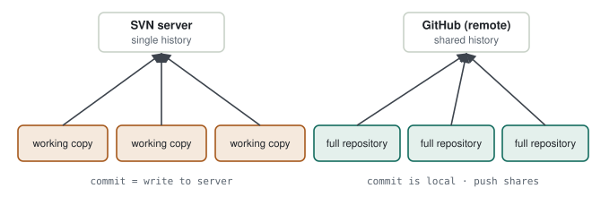
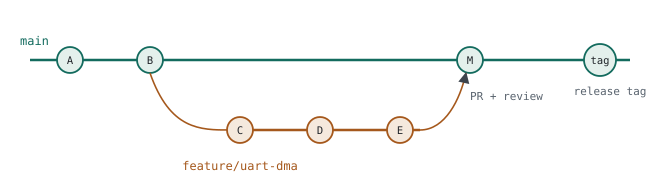
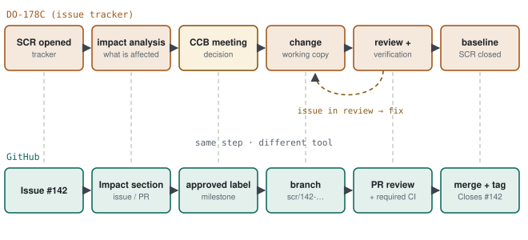
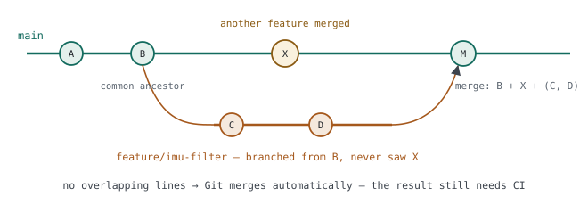
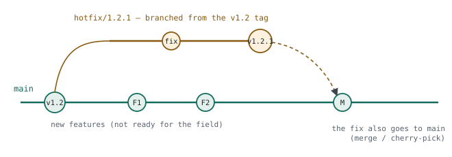

# 01 · Git & Code Review

> Two people change the same file at the same time; one makes a mistake and the code ships. The real question: **before a change enters the main code, who looks at what, and how — and later, how do we answer "why is this line here?"** Git with a pull-request workflow is today's standard answer.

**Contents:** [SVN to Git](#0--from-svn-to-git) · [Feature branch + PR](#1--example-adding-dma-to-a-uart) · [Change control in DO-178C](#2--how-a-change-moves-in-a-do-178c-project) · [Branch scenarios](#3--branch-scenarios) · [Good commits](#4--good-commits-good-prs) · [Commit conventions & deviations](#5--commit-conventions-and-recorded-deviations) · [Practice](#6--practice) · [Interview questions](#7--interview-questions) · [Principles](#principles)

---

## 0 · From SVN to Git

### 0.1 The difference in one sentence

In SVN the history lives **on the server**; committing means writing to the server. In Git every machine has a **complete repository**; a commit is local and `push` shares it.

<p align="center">
  <picture>
    <source media="(prefers-color-scheme: dark)" srcset="../assets/diagrams/svn-vs-git-dark.svg">
    
  </picture>
</p>

An analogy: SVN is a shared notebook — to write, you go to the notebook. In Git everyone has a full copy; you write as many pages as you like, then propose "please add my pages to the shared notebook". That proposal is a **pull request**.

**SVN → Git**

```
svn checkout      →  git clone
svn update        →  git pull            (fetch + merge)
svn commit        →  git commit (local)  +  git push (share)
branches/ folder  →  git switch -c feature/x   (seconds, cheap)
```

### 0.2 Concepts

| Concept | Meaning | Equivalent in a tracker-driven process |
|---|---|---|
| commit | snapshot of a change + message | SVN commit |
| branch | short-lived line of work off the main line | trial code in a separate folder |
| merge | joining two lines | — |
| conflict | both lines changed the same lines; resolved by hand | two people editing the same document |
| pull request (PR) | "take this branch into main" + review + automated checks | opening a change request (SCR) |
| code review | another engineer inspects and approves the PR | assigning reviewers to the SCR |
| tag | permanent version label on a commit | baseline |

### 0.3 What a pull request is

**PR = Pull Request:** "review the changes on my branch and, if they are fine, take them into main". The name comes from asking the maintainers to *pull* your changes. GitLab calls the same thing a **Merge Request (MR)**.

**PR life cycle**

```
feature/uart-dma  ──►  PR opened  ──►  review + CI  ──►  approval  ──►  merge to main
  (your code)          what, why,       comments, fixes,                   (PR closes)
                       how tested       re-run tests
```

| Inside a PR | Purpose |
|---|---|
| Change | the branch's commits; file-by-file diff |
| Description | what changed, why, how it was tested |
| Review | another engineer comments on lines, approves or requests changes |
| Automated checks | CI runs; the result shows green/red on the PR |

Without approval and passing checks, nothing enters main — so main stays releasable at all times.

| Tracker / SCR | GitHub / PR |
|---|---|
| SCR opened; change and rationale written | PR opened; written in the description |
| reviewers assigned | reviewers assigned |
| comments in the ticket | comments directly on code lines |
| approval → new document revision | approval → merge to main |
| SCR linked to the revision and closed | PR closed; commits and test results stay linked |

> [!TIP]
> **One-line bridge:** "The review process we ran with change requests in an issue tracker is what a PR does in Git." The difference: PR comments sit on the code itself, and tests run automatically on every change.

---

## 1 · Example: adding DMA to a UART

### 1.1 First approach: commit straight to main

You move UART reception to DMA and push three commits straight to `main`. The second has a bug, and meanwhile a colleague wants to cut a release from `main`.

> [!WARNING]
> **Diagnosis — what broke**
> - `main` can now contain half-finished work at any moment; whoever releases gets your unfinished DMA code.
> - The bug entered the main line without anyone seeing it; there was no review.
> - To undo it, your three commits are now interleaved with everyone else's.

### 1.2 Solution: feature branch + PR

<p align="center">
  <picture>
    <source media="(prefers-color-scheme: dark)" srcset="../assets/diagrams/git-branch-graph-dark.svg">
    
  </picture>
</p>

1. Branch off `main` into a short-lived `feature/uart-dma`.
2. Make small, single-purpose commits (C, D, E).
3. Open a PR; CI runs automatically and an engineer reviews.
4. After approval, merge into `main` (M). When the release is ready, tag it (`v1.2.0`).

**Daily flow**

```bash
git switch main && git pull
git switch -c feature/uart-dma
# ... code ...
git add src/uart.c src/uart.h
git commit -m "uart: move RX to DMA, end-of-frame on idle-line interrupt"
git push -u origin feature/uart-dma          # open the PR on GitHub
# review + green CI → merge
git switch main && git pull
git tag -a v1.2.0 -m "release 1.2.0" && git push --tags
```

> [!TIP]
> **Result.** `main` is releasable at any time; every change has been seen by at least one other person; if something goes wrong, a single PR can be reverted.

---

## 2 · How a change moves in a DO-178C project

In a certified project, changing a coding-standard rule or a line of code is not "open the file and fix it". A change request is opened in the issue tracker first, then the right people meet and decide. This section lays out that flow the way DO-178C expects it, and maps each step to GitHub.

### 2.1 Why so many steps

In DO-178C, code, requirements, design and tests are under a **baseline** ([chapter 07](../chapters/07-do-178c.md)). When a line changes, these questions need answers backed by evidence:

- **Why** was the change made? (problem report / change request)
- **What** does it affect? (which requirement, design section, code, test)
- **Who** approved it and **who** reviewed it?
- Which tests were **re-run**, and with what result?
- Which **baseline** does the new state belong to?

DO-178C requires this through the problem reporting, change control and change review objectives of the configuration-management process. The change request (SCR) is where these answers are collected.

### 2.2 The flow as it should be

<p align="center">
  <picture>
    <source media="(prefers-color-scheme: dark)" srcset="../assets/diagrams/change-process-tracker-vs-github-dark.svg">
    
  </picture>
</p>

| # | Step | Who | Output |
|---|---|---|---|
| 1 | Need or defect identified | any engineer, test, customer | problem description |
| 2 | **SCR opened**: what, why, priority, affected artefacts | proposing engineer | SCR-142 |
| 3 | **Impact analysis**: affected requirements / design / code / tests; which tests must be re-run | proposer + technical lead | analysis attached to the SCR |
| 4 | **Change control board (CCB)**: approve / reject / defer | e.g. five people: proposer, two engineers who know the area, CM lead, SQA or project lead | decision recorded in the SCR |
| 5 | **Change** made in a working copy separate from the baseline | assigned engineer | the change |
| 6 | **Review + verification**: checklist review, affected tests re-run | reviewers (independent at Level A/B) | review record, test results |
| 7 | **SQA check**: was the process followed? | SQA | conformance record |
| 8 | **CM**: new baseline / document revision created and linked to the SCR | CM lead | new version |
| 9 | **SCR closed** | CCB / CM | complete audit trail |

> [!NOTE]
> **Who sits in the meeting.** For a coding-standard change, the SCR is typically assigned to the engineers who researched the topic; comments collect in the ticket, the meeting decides if needed, the document moves to a new revision after approval, and the SCR closes linked to that revision. The table above is the same process written with DO-178C's role separation (CM, SQA, independent review).

### 2.3 Example: SCR-142 — a new MISRA rule

| Step | In the tracker | On GitHub |
|---|---|---|
| Open | SCR-142: "Add Rule 17.7 (use return values) to the coding standard; the I²C driver ignores return values" | Issue #142, same description, `scr` label |
| Impact analysis | coding standard §4.3; affected modules i2c, spi, uart; static-analysis configuration | "Impact" section in the issue |
| Decision | five-person meeting: approved; I²C and SPI in this release, UART in the next | `approved` label + milestone `v1.3` |
| Change | document + code in a separate working copy | branch `scr/142-misra-17-7` |
| Review | two reviewers with a checklist; comments in the SCR | PR with 2 required approvals, line comments |
| Verification | static analysis re-run, affected unit tests | CI: cppcheck + host tests required |
| Close | document rev C, SCR-142 closed | merge + tag `v1.3.0`; `Closes #142` closes the issue |

**PR template — `.github/pull_request_template.md`**

```markdown
## Related request
Closes #142   (SCR-142)

## What changed
Return values are checked in the I²C and SPI drivers; Rule 17.7 added to coding standard §4.3.

## Why
Ignored error paths can cause silent data loss in the field.

## Impact analysis
- Document: coding standard §4.3
- Code: src/i2c.c, src/spi.c
- Tests: test_i2c.c, test_spi.c (new robustness tests)

## Verification
- [x] Static analysis clean
- [x] Host unit tests pass
- [x] I²C sensor read test on the board

## Review checklist
- [ ] Error paths handled
- [ ] ISR / RTOS rules
- [ ] Requirement / SCR referenced in commit messages
```

> [!TIP]
> **Result.** GitHub does not replace the meeting; it carries the **record** of the decision and the evidence. Because issue ↔ branch ↔ commit ↔ PR ↔ CI result ↔ tag are linked, "why did this line change, who approved it, which tests did it pass?" is answered in one click — the same audit trail as the SCR.

> [!WARNING]
> **What is still missing in a safety-critical project.** GitHub alone does not satisfy DO-178C configuration management: tool qualification, independent-review records, the formal definition of a baseline and problem-report classification must be defined in the process plans (SCMP, SQAP). Branch protection, required reviewers and required CI are the tool-enforced part of that plan.

---

## 3 · Branch scenarios

Git questions in interviews rarely ask "what is the command"; they describe a situation and ask what you would do. These are the common ones.

### 3.1 Main moved on while you were on your branch

<p align="center">
  <picture>
    <source media="(prefers-color-scheme: dark)" srcset="../assets/diagrams/main-moved-while-branching-dark.svg">
    
  </picture>
</p>

You branched `feature/imu-filter` from B and committed C and D. Meanwhile a colleague merged feature X into main. Now you want to merge your branch.

**What Git does:** a three-way merge. It finds the common ancestor B and compares the B→X changes with the B→D changes:

| Situation | Result |
|---|---|
| Different files, or different parts of the same file | merged automatically; merge commit M is created |
| The same lines changed | **conflict**, resolved by hand (3.2) |

> [!WARNING]
> **Diagnosis — no conflict, but broken code (semantic conflict).** X changed the unit of `imu_read()` from m/s² to g; your filter still expects m/s². The lines differ, so Git says nothing and the merge looks "clean". It compiles, the tests pass (if they don't cover X), and the filter is off by a factor of 9.81. Or X changed a function signature and your new call no longer compiles. Git merges text, **not meaning**.

**What to do:**

1. Before merging, bring main's changes **into your branch** and test there:

```bash
git switch feature/imu-filter
git fetch origin
git merge origin/main          # option A: merge — keeps history, adds a merge commit
# or
git rebase origin/main         # option B: rebase — rewrites C, D on top of X, linear history
git push --force-with-lease    # only after a rebase, and only if the branch is yours alone
```

2. Make CI run on the merged result: on GitHub, enable "Require branches to be up to date before merging" plus required CI. The PR's tests then run on the code as merged with main.

| | Merge (main → branch) | Rebase (branch → tip of main) | Squash merge (in the PR) |
|---|---|---|---|
| History | as-is + merge commit | linear; commits rewritten | the branch becomes one commit |
| On a shared branch | safe | **don't** (rewrites others' history) | — |
| When | the branch is shared | the branch is yours and you want clean history | small PRs, one line of history in main |

> [!TIP]
> **Rule:** bring main into the branch before merging, test the combined result in CI, then merge. A semantic conflict is caught by **tests**, not by Git.

### 3.2 Two people changed the same line — conflict

Git cannot know which one is right, so it writes both into the file:

```c
<<<<<<< HEAD
#define UART_BAUD  115200U
=======
#define UART_BAUD  921600U
>>>>>>> feature/uart-dma
```

Resolution: **decide** the correct value (ask the other change's author if needed), remove the markers, build and test, then `git add` + `git commit`. Put the reasoning in the commit message.

> [!TIP]
> **Fewer conflicts:** short-lived branches (a few days), bringing main into the branch often, small PRs. Merging a three-week branch is far harder than merging a one-day branch.

### 3.3 The released version needs an urgent fix, but main has unfinished features

<p align="center">
  <picture>
    <source media="(prefers-color-scheme: dark)" srcset="../assets/diagrams/hotfix-from-tag-dark.svg">
    
  </picture>
</p>

v1.2 is in the field and a critical defect is found. Main already has F1 and F2, which must not ship yet. Releasing from main would ship them too.

```bash
git switch -c hotfix/1.2.1 v1.2.0      # branch from the tag
# ... fix + test ...
git tag -a v1.2.1 -m "hotfix: ..."
git switch main && git merge hotfix/1.2.1     # or: git cherry-pick <fix-commit>
```

> [!WARNING]
> **The fix must also reach main.** If the hotfix stays only on the release branch, the next release (v1.3) brings the defect back (a regression). In DO-178C terms the fix affects both baselines, and both must be recorded against the SCR.

### 3.4 A merged change causes a problem in the field

Main's history is never rewritten (no `reset`, no force-push). A **new commit** that reverses the change is created:

```bash
git revert -m 1 <merge-commit-hash>    # -m 1: keep the main-line side of the merge
```

> [!TIP]
> **Reverting is also a change.** The revert goes through PR, review and CI too; in DO-178C it is a new SCR. Because nothing is deleted, "what happened and why it was reverted" stays traceable.

### 3.5 You committed to main by mistake

| Situation | What to do |
|---|---|
| Not pushed yet | `git switch -c feature/x` (the commit stays on the new branch), then `git switch main && git reset --hard origin/main` |
| Tried to push, main is protected | the push is rejected — that is what branch protection is for |
| Pushed and others have pulled | don't rewrite history; undo with `git revert` |

### 3.6 The branch has been open for weeks

> [!WARNING]
> **Diagnosis — branch drift.** Main moves every day; the longer the branch lives, the higher the risk of conflicts and semantic conflicts, the bigger the review — and nobody really reviews a 3,000-line PR.

Remedies: split the feature into small parts merged through separate PRs; bring main into the branch regularly; merge an unfinished feature behind a **feature flag** (the code is in main but disabled).

---

## 4 · Good commits, good PRs

| | Bad | Good |
|---|---|---|
| Commit message | `fix` | `imu: release CS after DMA completes on SPI read (data shift)` |
| Commit size | 40 files, 3 features | one purpose, a few files if needed |
| PR description | empty | what changed, why, how it was tested |

**Commit message template**

```
module: one-line summary (≤ 72 chars, what was done)

Why: which problem, which requirement / SCR.
Tested: host test / measurement on the board.
```

> [!TIP]
> **Why `git bisect` needs small commits.** A defect appears in the field; v1.1 is good, v1.2 is bad, with 60 commits between them. `git bisect` does a binary search and finds the culprit in about six steps. If commits are large or don't build, this doesn't work.

---

## 5 · Commit conventions and recorded deviations

Teams that do not use Git can apply the same discipline. Two practices that carry over to any version-control system:

**A tagged commit-message convention** — the tag says which area a change belongs to, so history can be filtered:

```text
[AREA][MODULE] Description

[ERROR_MGMT][ERROR_LOG] Log a repeated event once more at the 5th repetition
[BOOT][SYSTEM_START] Move the boot-loop counter to the persistent boot flag
```

| Practice without Git | Git equivalent |
|---|---|
| `[AREA][MODULE]`-tagged commit | Conventional Commits (`fix(error-log): ...`) |
| change table in the standards document | `CHANGELOG.md` + PR description |
| rule IDs in code (`[TST-005]`, `[ERR-008]`) | "which rule" reference in the PR |
| checklist-based review | checklist in the PR template |
| release checklist before delivery | release branch + tag (`firmware_vX.Y.Z`) |

**Recorded deviations** — when code knowingly breaks a SHALL rule of the coding standard, the deviation is documented next to the code and approved in review:

```c
/* DEVIATION [JPL-004]: Function length 75 lines.
 * Justification: State machine switch statement; refactoring would hurt
 * readability. Approved by <reviewer> on YYYY-MM-DD.
 */
```

> [!TIP]
> **"What do you look for in a code review?"** A concrete answer beats a generic one: "Our standard has a layer access matrix — a driver may not call the board layer, middleware only calls services. In review I check the includes first: an application file that includes the vendor HAL header is a layering violation."

---

## 6 · Practice

1. Create a GitHub repository; add `build*/`, `*.o` and IDE files to `.gitignore`.
2. Protect `main` (no direct push, PR required).
3. Add the first feature with a feature branch + PR; review your own PR against the code-review table in [chapter 06](../chapters/06-software-architecture.md).
4. Change the same line on two branches on purpose and resolve the conflict.
5. **Semantic-conflict experiment:** change a function's unit on one branch, add code that uses that function on another; merge both — Git reports no conflict; do your tests catch it?
6. Add the PR template (§2.3); close a change through Issue → branch → PR → `Closes #n`.
7. Tag `v0.1.0`; open `hotfix/0.1.1` from it and get the fix into both the tag and main.

---

## 7 · Interview questions

<details>
<summary><b>Merge vs rebase?</b></summary>

Merge joins two histories with a merge commit; history stays as it was. Rebase rewrites commits onto the tip of the target; history becomes linear. You don't rebase a branch others share, because it rewrites history.
</details>

<details>
<summary><b>What do you look for in a code review?</b></summary>

Correctness and error paths, ISR/RTOS rules, memory and bounds checks, readability, and whether there is a test. A full checklist is in [chapter 06](../chapters/06-software-architecture.md).
</details>

<details>
<summary><b>How do you find which change introduced a field defect?</b></summary>

Read the version and commit hash from the device, then binary-search between the good and bad versions with `git bisect`.
</details>

<details>
<summary><b>How does a code change move through a DO-178C project?</b></summary>

A change request is opened first: what, why, which artefacts are affected. Impact analysis follows, the right people (proposer, engineers who know the area, CM and SQA) meet and decide. The change is made in a separate working copy, reviewed with a checklist, affected tests are re-run, a new baseline is created and the SCR closes linked to that revision. On GitHub the equivalent is Issue → branch → PR (required reviewers + CI) → merge + tag.
</details>

<details>
<summary><b>Main gained another feature after you branched. What happens when you merge?</b></summary>

Git finds the common ancestor and does a three-way merge. Different lines merge automatically; the same lines conflict. The real risk is a semantic conflict with no textual conflict: if the other change altered the meaning of an interface, the code can build and still be wrong. So before merging I bring main into my branch (merge or rebase) and test the combined result in CI.
</details>

<details>
<summary><b>How do you choose between merge and rebase?</b></summary>

If the branch is shared, merge (history does not change). If it is mine alone and a linear history is wanted, rebase, then `--force-with-lease`. I never rewrite history on a shared branch or on main.
</details>

<details>
<summary><b>The released version has an urgent defect, and main has unfinished features. What do you do?</b></summary>

Branch from the release tag, fix and test, tag a new version, and bring the fix into main by merge or cherry-pick so the defect does not return in the next release.
</details>

<details>
<summary><b>How do you undo a merged change?</b></summary>

`git revert` creates a new commit that reverses it; main's history is not rewritten. The revert also goes through PR and CI.
</details>

---

## Principles

#### 1 — `main` must always be releasable
Unfinished work stays on a branch; only reviewed, tested code enters the main line.

#### 2 — Small, single-purpose changes
Small commits are what make review, revert and `git bisect` possible.

#### 3 — The message explains *why*
The code already shows *what*; six months later you need *why*.

#### 4 — Git merges text, not meaning
No conflict does not mean correct; merged code is always tested.

#### 5 — The tool carries the process; people make the decision
A CCB decision and a PR approval both belong to people; the tool keeps a traceable record of them.
