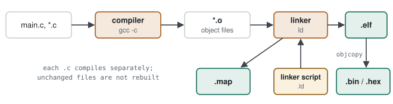
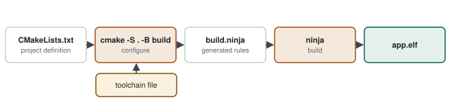

# 02 · Build System & Cross-Compile

> You press Build in the IDE, lines scroll past and an `.elf` appears. The question: **what happens in those lines, and how do you reproduce the same result without the IDE — on another machine, on a CI server?** Understanding the build is a prerequisite for CI and the answer to "can you build without the IDE?"

**Contents:** [Source to flash](#0--from-source-to-flash) · [Make and CMake](#1--make-and-cmake) · [Minimal setup](#2--minimal-setup) · [The `.map` file](#3--the-map-file) · [IDE builds and bootloader offsets](#4--ide-builds-and-bootloader-offsets) · [Practice](#5--practice) · [Interview questions](#6--interview-questions) · [Principles](#principles)

---

## 0 · From source to flash

### 0.1 The build chain

<p align="center">
  <picture>
    <source media="(prefers-color-scheme: dark)" srcset="../assets/diagrams/build-chain-dark.svg">
    
  </picture>
</p>

| Stage | Tool | Input → output | What it does |
|---|---|---|---|
| Preprocess + compile | `arm-none-eabi-gcc -c` | `.c` → `.o` | turns each file **separately** into machine code; addresses are not known yet |
| Link | `arm-none-eabi-ld` (via gcc) | `.o` + linker script → `.elf` | combines the pieces, assigns addresses, resolves symbols |
| Placement report | linker `-Map` | → `.map` | which function sits where, how much space it takes |
| Raw image | `arm-none-eabi-objcopy` | `.elf` → `.bin/.hex` | drops debug info, extracts the bytes to write to flash |

An analogy: the compiler is the author writing each chapter separately, the linker is the editor binding them into a book with page numbers, and the linker script is the page layout that says "the cover goes here, the table of contents there".

### 0.2 Cross-compiling

Your PC is x86; the target is a Cortex-M. The PC's `gcc` emits x86 code, so the target needs **another compiler**: `arm-none-eabi-gcc`. The name says it all: *arm* the architecture, *none* no operating system (bare-metal), *eabi* the calling convention.

---

## 1 · Make and CMake

### 1.1 First approach: commands by hand

```bash
arm-none-eabi-gcc -mcpu=cortex-m4 -mthumb -c main.c -o main.o
arm-none-eabi-gcc -mcpu=cortex-m4 -mthumb -c uart.c -o uart.o
arm-none-eabi-gcc -T stm32f4.ld main.o uart.o -o app.elf
```

> [!WARNING]
> **Diagnosis — why manual commands do not scale.** With 40 files, rebuilding everything after each change is slow; tracking which file changed is impossible; forget a flag on one file and you silently get a differently built binary.

### 1.2 Make: rebuild only what changed

Make works with "target, dependencies, command" rules. If `uart.c` is newer than `uart.o`, only that file is rebuilt.

### 1.3 CMake: the layer that generates the build

CMake does not compile anything itself. You describe the project in a platform-independent way (`CMakeLists.txt`), and CMake **generates** Make or Ninja files. A **toolchain file** tells it which compiler to use.

<p align="center">
  <picture>
    <source media="(prefers-color-scheme: dark)" srcset="../assets/diagrams/cmake-flow-dark.svg">
    
  </picture>
</p>

| | Make | CMake |
|---|---|---|
| What | build tool | build *generator* |
| File you write | `Makefile` | `CMakeLists.txt` |
| Platform | baked into the file | swapped with a toolchain file |
| Host + ARM builds from one source | hard | two build directories, easy |

> [!TIP]
> **Result.** With CMake the same source builds on the host (unit tests) and for ARM (firmware); only the toolchain file changes. This is the foundation of CI and of the tests in [05](05-unit-test-static-analysis-coverage.md).

---

## 2 · Minimal setup

**`cmake/arm-gcc.cmake` — toolchain file**

```cmake
set(CMAKE_SYSTEM_NAME Generic)                 # no operating system
set(CMAKE_SYSTEM_PROCESSOR arm)
set(CMAKE_C_COMPILER   arm-none-eabi-gcc)
set(CMAKE_ASM_COMPILER arm-none-eabi-gcc)
set(CMAKE_TRY_COMPILE_TARGET_TYPE STATIC_LIBRARY)   # don't try to run test programs on the host
```

**`CMakeLists.txt` (summary)**

```cmake
cmake_minimum_required(VERSION 3.20)
project(imu_fw C ASM)

add_executable(app.elf src/main.c src/uart.c src/packet.c startup_stm32f411.s)

target_compile_options(app.elf PRIVATE -mcpu=cortex-m4 -mthumb -mfloat-abi=hard -mfpu=fpv4-sp-d16
                                        -O2 -g -ffunction-sections -fdata-sections -Wall)
target_link_options(app.elf PRIVATE -T${CMAKE_SOURCE_DIR}/STM32F411.ld -Wl,--gc-sections
                                     -Wl,-Map=app.map -mcpu=cortex-m4 -mthumb)
```

**Building from the terminal**

```bash
cmake -S . -B build-arm -G Ninja -DCMAKE_TOOLCHAIN_FILE=cmake/arm-gcc.cmake
cmake --build build-arm
arm-none-eabi-size build-arm/app.elf
#    text    data     bss     dec
#   18324     112    4620   23056
```

### What the flags do

| Flag | What it does | If you forget it |
|---|---|---|
| `-mcpu=cortex-m4 -mthumb` | correct instruction set | builds but does not run / HardFault |
| `-mfloat-abi=hard -mfpu=...` | hardware FPU | floats emulated in software, very slow |
| `-O2` / `-Os` | optimisation | large, slow code |
| `-g` | debug info (in the `.elf`, never flashed) | GDB cannot show source lines |
| `-ffunction-sections` + `--gc-sections` | drop unused functions | wasted flash |

> [!WARNING]
> **`text + data` fill flash, `data + bss` fill RAM.** In `size` output, **text** is code and constants, **data** is initialised variables (stored in flash, copied to RAM at startup) and **bss** is zero-initialised variables. When RAM runs out, look for the largest `.bss` symbols in the `.map` — usually big buffers or the RTOS heap.

---

## 3 · The `.map` file

### 3.1 Where it is produced

The `.map` is produced by the **linker**, in the link step. The compiler (`gcc -c`) cannot produce it, because addresses are not known yet. The linker assigns the addresses, so the linker writes the "what did I put where" report.

**Its place in the chain**

```
*.c ──gcc -c──► *.o ──► LINKER (ld) ──► app.elf
                          ▲      └──► app.map
                    linker script (.ld)
```

**Asking the linker for a map file (GCC)**

```bash
arm-none-eabi-gcc ... -T STM32F411.ld -Wl,-Map=app.map -o app.elf
```

The `-Wl,` prefix makes gcc pass the option that follows to the linker.

| Environment | Location | How to enable |
|---|---|---|
| STM32CubeIDE | `Debug/` or `Release/` → `project_name.map` | on by default (Properties → C/C++ Build → Settings → MCU GCC Linker → General) |
| CMake (this note) | build directory, e.g. `build-arm/app.map` | `-Wl,-Map=app.map` |
| TI Code Composer Studio | `Debug/` → `project_name.map` | linker option `--map_file` |
| Hand-written `make` | wherever your Makefile says | `LDFLAGS += -Wl,-Map=$(TARGET).map` |

### 3.2 What is inside

| Part | Information |
|---|---|
| Memory Configuration | flash/RAM start addresses and sizes |
| Section placement | where `.text`, `.data`, `.bss` were placed |
| Symbols | address and size of each function/global variable, and which `.o` it came from |
| Discarded input sections | unused code removed by `--gc-sections` |

### 3.3 Reading it

```
.text.filter_update   0x08001a40   0x1f4   build/src/filter.c.o
.bss.rx_buffer        0x20000400   0x800   build/src/uart.c.o
```

Read as: `filter_update` is in flash at 0x08001a40, 500 bytes; `rx_buffer` is in RAM, 2 KB. "Why is flash full?" and "which function contains the PC from the HardFault?" are both answered here ([09](09-gdb-and-fault-analysis.md)).

### 3.4 Which symbols are listed and which are not

| What | Section | In the `.map` |
|---|---|---|
| global function / variable | `.text`, `.data`, `.bss` | ✔ name + address, on its own line |
| `static` function / variable (including function-local statics) | `.text`, `.data`, `.bss` | ✔ only **in the section name**: `.bss.s_retry_count` |
| `const` tables, strings | `.rodata` | ✔ |
| local (automatic) variable | stack | ✘ no fixed address |

> [!TIP]
> **Seeing statics.** The linker writes a symbol line only for global symbols. With `-ffunction-sections -fdata-sections` (the STM32CubeIDE default), each static gets its own section, so you find it by section name. Function-local statics get a suffix: `.bss.counter.0`. With those flags off, all statics of a file appear as one `.bss` block with no names. If you can't find one: `arm-none-eabi-nm -n -S app.elf`, or in GDB `p &variable`.

**In practice:** when a buffer overruns into its neighbour, find the buffer's line in the `.map`; the variable on the next line is the victim. Put a watchpoint on its address ([09 §1.3](09-gdb-and-fault-analysis.md#13-watchpoints-in-stm32cubeide)).

---

## 4 · IDE builds and bootloader offsets

### 4.1 What the IDE does behind the button

An Eclipse-based IDE such as STM32CubeIDE runs the same chain as §0: `arm-none-eabi-gcc` compiles each `.c`, the linker combines them according to the linker script, and `.elf`, `.map` and optionally `.bin/.hex` land in `Debug/`. It uses a "managed build": you don't write makefiles, it **generates** `Debug/makefile` and `subdir.mk` from the project settings.

| Where in STM32CubeIDE | Command-line equivalent |
|---|---|
| Properties → C/C++ Build → Settings → MCU GCC Compiler → Preprocessor → **Define symbols** | `-DPROJECT_TEST` |
| … → MCU GCC Compiler → Include paths | `-I../src/services/inc` |
| … → MCU GCC Compiler → Optimization | `-O0` / `-Os` |
| … → MCU GCC Linker → General → Linker Script | `-T STM32xxxx_FLASH.ld` |
| … → MCU Post build outputs | `objcopy -O binary app.elf app.bin` |
| Build Configurations (Debug / Release) | two build directories with different flag sets |

### 4.2 When the application does not start at the beginning of flash

With a bootloader in the first pages of flash, the application is linked at an offset. Example with a 32 KB bootloader on a 512 KB part:

**Linker script — `MEMORY` block of the application**

```ld
MEMORY
{
  RAM   (xrw) : ORIGIN = 0x20000000, LENGTH = 128K
  FLASH (rx)  : ORIGIN = 0x08008000, LENGTH = 480K
}
```

Keep the numbers in one shared header that both the bootloader and the application include:

```c
/* shared/memory_map.h — single source of truth */
#define BOOTLOADER_START_ADDR    0x08000000U
#define BOOTLOADER_SIZE          (32U * 1024U)
#define APPLICATION_START_ADDR   0x08008000U
#define APPLICATION_SIZE         (480U * 1024U)
#define APP_VTOR_ADDR            APPLICATION_START_ADDR   /* SCB->VTOR */
```

> [!WARNING]
> **Diagnosis — the offset changed in only one place.** The linker script says `0x08008000`, but the application never updates `SCB->VTOR`: on the first interrupt the core jumps through the bootloader's vector table → HardFault. Or the bootloader jumps to `0x08010000` while the application is linked at `0x08008000`: nothing runs. The same number must agree in three places — the linker script, the bootloader's jump address and VTOR.

> [!TIP]
> **Result.** The shared header defines the addresses once. A linker script cannot include a C header, so the value is written there by hand — which is why checking in the `.map` that `.isr_vector` landed at the application start belongs on the release checklist:
>
> ```text
> .isr_vector     0x08008000      0x1c4
>  .isr_vector    0x08008000      0x1c4 ./Core/Startup/startup_stm32xxxx.o
> ```

---

## 5 · Practice

1. Generate the project from STM32CubeMX with "CMake" (or "Makefile") output; close the IDE and build from the terminal.
2. Move the toolchain settings into a separate file; keep two directories, `build-host/` and `build-arm/`.
3. Measure the `text` difference between `-O0` and `-O2`.
4. Find the five largest functions and the `.bss` total in the `.map`.

---

## 6 · Interview questions

<details>
<summary><b>CMake vs Make?</b></summary>

Make builds; CMake generates Make/Ninja files from a platform-independent project description. For cross-compiling, the compiler is chosen with a toolchain file, so the same project builds separately for host and target.
</details>

<details>
<summary><b><code>.elf</code> vs <code>.bin</code>?</b></summary>

The `.elf` contains sections, symbols and debug info; the debugger uses it. The `.bin` is just the raw bytes to write to flash.
</details>

<details>
<summary><b>The firmware no longer fits in flash. What do you do?</b></summary>

Find the largest symbols with `size` and the `.map`; use `--gc-sections` and `-Os`, review large constant tables, replace heavy libraries such as `printf` with lighter versions.
</details>

<details>
<summary><b>What does a linker script do?</b></summary>

It defines the memory regions (flash and RAM addresses and sizes) and which section goes where, and gives the startup code the flash address of the `.data` initial values.
</details>

---

## Principles

#### 1 — The build must be repeatable
Same commit, same toolchain → same binary. An IDE-bound build does not guarantee that.

#### 2 — Compiler choice in one place
The toolchain file separates host from target; the source files stay the same in both.

#### 3 — The `.map` file is evidence
Flash/RAM usage and fault addresses are read from the map file, not guessed.
