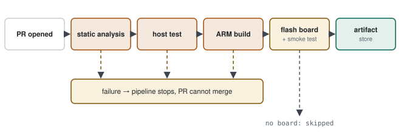
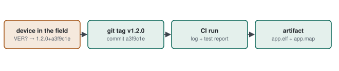

# 03 · CI/CD & Docker

> A colleague opens a PR. It builds on your machine and the tests pass; it gets merged, and the next day it does not build on someone else's machine. The question: **how do we get rid of "works on my machine", and how do we prove which source and which tests produced every binary in the field?** The answer: a pipeline that runs automatically, in the same clean environment, on every change.

**Contents:** [Concepts](#0--concepts) · [Without CI](#1--example-without-ci) · [Firmware pipeline](#2--solution-a-firmware-pipeline) · [Traceability](#3--traceability-from-binary-to-source) · [Docker](#4--docker-pinning-the-environment) · [Hardware CI](#5--ci-with-hardware-self-hosted-runner) · [Retrofitting CI to an IDE + SVN project](#6--retrofitting-ci-to-an-ide--svn-project) · [Practice](#7--practice) · [Interview questions](#8--interview-questions) · [Principles](#principles)

---

## 0 · Concepts

| Concept | Meaning | Analogy |
|---|---|---|
| CI (Continuous Integration) | build + checks run automatically on every change | quality control as each part passes the line |
| Continuous Delivery | verified output becomes a release-ready package | packed product on the shelf |
| Continuous Deployment | distribution is automatic too | product ships to the customer by itself |
| pipeline | all the steps | production line |
| job | a group of steps in the pipeline | one station |
| runner | the machine that runs a job | the worker at the station |
| artifact | stored output | labelled product + test report |
| container (Docker) | tool environment with pinned versions | the identical toolbox at every station |

> [!NOTE]
> **The same goal as baselines.** In a V-model or DO-178C process, closing each phase with a verification record and putting work under configuration management answer one question by hand: **which binary, from which source, with which tests?** CI answers it automatically on every commit.

---

## 1 · Example without CI

A colleague changed `packet.c` in a PR. You read it, it looked fine, you merged it.

> [!WARNING]
> **Diagnosis — what slipped through**
> - The change broke **one of the host tests**; nobody ran them.
> - Your colleague had a different `arm-none-eabi-gcc` version; a warning that shows on your machine never showed on theirs.
> - A release was cut the next day; nobody can say which commit the field binary came from.

---

## 2 · Solution: a firmware pipeline

<p align="center">
  <picture>
    <source media="(prefers-color-scheme: dark)" srcset="../assets/diagrams/ci-pipeline-dark.svg">
    
  </picture>
</p>

| Stage | What it does | If it fails |
|---|---|---|
| Static analysis | cppcheck / clang-tidy / MISRA checker | the PR cannot merge |
| Host tests | unit tests on the PC ([05](05-unit-test-static-analysis-coverage.md)) | the PR cannot merge |
| ARM build | builds the real firmware, `size` report | the PR cannot merge |
| Flash + smoke test | basic check on a board attached to a self-hosted runner ([04](04-python-and-bash-automation.md)) | no board: "skipped"; board present: blocks the merge |
| Artifact | `.elf`, `.bin`, `.map`, test report stored | — |

**GitHub Actions — `.github/workflows/ci.yml`**

```yaml
name: ci
on: [push, pull_request]

jobs:
  build-test:
    runs-on: ubuntu-latest
    steps:
      - uses: actions/checkout@v4
      - run: sudo apt-get update && sudo apt-get install -y gcc-arm-none-eabi cmake ninja-build cppcheck
      - name: Static analysis
        run: cppcheck --enable=warning,style --error-exitcode=1 src/
      - name: Host unit tests
        run: |
          cmake -S . -B build-host
          cmake --build build-host
          ctest --test-dir build-host --output-on-failure
      - name: ARM build
        run: |
          cmake -S . -B build-arm -G Ninja -DCMAKE_TOOLCHAIN_FILE=cmake/arm-gcc.cmake
          cmake --build build-arm
          arm-none-eabi-size build-arm/app.elf
      - uses: actions/upload-artifact@v4
        with:
          name: firmware-${{ github.sha }}
          path: |
            build-arm/app.elf
            build-arm/app.map
```

> [!TIP]
> **Result.** A broken test, a warning or a build error now shows up **before** the merge; every successful run's output is stored, labelled with its commit hash.

---

## 3 · Traceability: from binary to source

<p align="center">
  <picture>
    <source media="(prefers-color-scheme: dark)" srcset="../assets/diagrams/binary-traceability-dark.svg">
    
  </picture>
</p>

1. Embed the commit hash in the firmware at build time.
2. Make the device answer `VER?` with version + hash ([04](04-python-and-bash-automation.md)).
3. From the tag, go to the CI run, and from there to the artifact and the test report.

**Embedding the commit hash (CMake)**

```cmake
execute_process(COMMAND git rev-parse --short HEAD OUTPUT_VARIABLE GIT_HASH OUTPUT_STRIP_TRAILING_WHITESPACE)
target_compile_definitions(app.elf PRIVATE FW_GIT_HASH="${GIT_HASH}")
```

---

## 4 · Docker: pinning the environment

### 4.1 The problem

A CI runner installs whatever `gcc-arm-none-eabi` version `apt-get` offers that day. Build the same commit six months later and a different compiler version gives a different binary.

### 4.2 The solution

Put the toolchain, with a fixed version, into an image; CI and developers both build inside that image.

**Dockerfile (example)**

```dockerfile
FROM ubuntu:24.04
RUN apt-get update && apt-get install -y gcc-arm-none-eabi cmake ninja-build cppcheck python3 \
    && rm -rf /var/lib/apt/lists/*
WORKDIR /src
```

```bash
docker build -t imu-fw-build .
docker run --rm -v "$PWD":/src imu-fw-build cmake -S . -B build-arm -G Ninja -DCMAKE_TOOLCHAIN_FILE=cmake/arm-gcc.cmake
```

---

## 5 · CI with hardware (self-hosted runner)

A cloud runner has no board. To test on hardware, register a machine in the lab as a runner and connect the board over USB; the last pipeline stage runs there: flash the `.bin`, run `version_check.py`, read the self-test result.

| Question | Design decision |
|---|---|
| No board connected? | stage "skipped", but host stages stay mandatory |
| Two PRs want the board at once? | one job at a time on that runner (concurrency) |
| The board hangs? | timeout in the script + power cycling (USB relay) |

---

## 6 · Retrofitting CI to an IDE + SVN project

Many embedded teams build in an IDE (e.g. STM32CubeIDE), keep code in SVN, test on the board by hand and release with a checklist. CI can be added without changing how developers work.

### 6.1 Target flow

| # | Stage | Where | What runs | If red |
|---|---|---|---|---|
| 1 | Static analysis | Docker | `cppcheck --addon=misra` on the application sources (vendor HAL excluded) | commit rejected |
| 2 | Host tests | Docker | pure-logic modules on the PC with `gcc` + Unity (6.3) | rejected |
| 3 | ARM build | Docker | two configurations: **Release** and **Test** (`-DPROJECT_TEST`) | rejected |
| 4 | Size check | Docker | `arm-none-eabi-size` against the flash/RAM budget (minus the bootloader region) | rejected |
| 5 | Flash | lab PC | programmer CLI writes the Test build to the application start address | no board: skipped |
| 6 | Read results | lab PC | test output over UART; last line must be `ALL TESTS PASSED` | rejected |
| — | Artifact | CI server | `app.bin`, `app.map`, test log, source revision | — |

> [!TIP]
> **Why Jenkins for SVN.** GitHub Actions needs Git. Jenkins' Subversion plugin watches the repository directly (polling or an SVN `post-commit` hook) and stays inside the company network, so source code never leaves it — often a hard requirement in defence work. If the team moves to Git, the same stages map one-to-one to GitLab CI or GitHub Actions.

### 6.2 Building in Docker

Two ways to build an IDE project in a container:

| | A — IDE headless build | B — move to CMake |
|---|---|---|
| What | install the IDE's Linux version in the image and build from the command line | `CMakeLists.txt` + toolchain file ([02](02-build-system-and-cross-compile.md)) instead of the IDE project |
| Pro | project files untouched; developers keep the IDE | small image, fast; works with VS Code / CLion too |
| Con | large image (GBs), fragile Eclipse workspace settings | `.cproject` and CMake must be kept in sync |
| When | **first step** — CI up without breaking anything | long term |

**Option A — Eclipse/CDT headless build (STM32CubeIDE on Linux)**

```bash
stm32cubeide --launcher.suppressErrors -nosplash \
  -application org.eclipse.cdt.managedbuilder.core.headlessbuild \
  -data /tmp/ws \
  -import /src/fw_project \
  -build fw_project/Release \
  -build fw_project/Test
```

Create a second **Build Configuration** named `Test` (Project → Build Configurations → Manage → New, copied from Debug) and add the test symbol only to its Define-symbols list. The symbol you used to switch on and off by hand becomes two fixed builds in CI, and the test code can never slip into the release build ([05 §5](05-unit-test-static-analysis-coverage.md#5--on-target-tests-and-compile-time-gating)).

> [!WARNING]
> **Pin the compiler version the IDE uses.** Read it in the IDE (*Help → About → Installation Details*) or with `arm-none-eabi-gcc --version` and use exactly that in the image. The goal is not "the newest" but **the same version the team builds with**.

### 6.3 What moves from the board to the host

| Module type | Touches hardware? | Test where |
|---|---|---|
| ring buffer | no | **host** |
| self-test sliding windows | no | **host** |
| UART frame parsing (takes a byte array) | no | **host** |
| command protocol decoding | no | **host** |
| measurement range / rate-of-change / stuck checks | no — works on numbers | **host** |
| error-log de-duplication | not except the EEPROM write | host (with a fake EEPROM) |
| hardware CRC unit | **yes** | HIL |
| non-volatile storage, A/B records | **yes** | HIL (+ logic on host with a fake EEPROM) |
| sensor communication | **yes** | HIL |

The key to moving code to the host is dependency injection ([05 §1.2](05-unit-test-static-analysis-coverage.md#12-solution-put-the-dependency-behind-an-interface)). If drivers already talk through function-pointer I/O structs, the same pattern applied to the EEPROM write lets the logger's de-duplication test run without a board.

**Host test build (inside Docker, PC gcc, not ARM)**

```bash
gcc -I src/services/inc -I src/common -I tests_host/unity \
    src/services/selftest_window.c \
    tests_host/test_sliding_window.c tests_host/unity/unity.c \
    -o build-host/test_sliding_window && ./build-host/test_sliding_window
```

> [!WARNING]
> **A HAL include breaks the host build.** A service file that includes the vendor HAL header (for example only for `HAL_Delay`) will not compile on the PC. The fix is the layering rule itself: services call the board layer (`BSP_Delay`), not the HAL. The host build becomes a check that **catches layering violations automatically**.

### 6.4 HIL stage: the board does not go into Docker

The programmer and the USB-UART adapter are plugged into a Windows lab PC. Passing USB devices into a container (especially on Windows) is awkward and fragile, so the HIL stage runs on that PC directly as a **Jenkins agent**, without Docker.

**HIL step (Windows agent)**

```bat
STM32_Programmer_CLI -c port=SWD -w build\Test\fw_project.bin 0x08008000 -v -rst
python tools\read_tests.py --port COM5 --baud 115200 --timeout 30
```

| Design decision | Why |
|---|---|
| `.bin` written at the application start, no full chip erase | the bootloader stays on the board and is write-protected |
| Test build first, then the Release build and a self-test readout | proves the Release image also boots with a clean self-test |
| `read_tests.py` from [04](04-python-and-bash-automation.md) | exit code 1 if the last line is not `ALL TESTS PASSED` → red |
| 30 s timeout | the pipeline never waits forever on a hung board |
| one board, one job (`concurrency = 1`) | two commits never flash the same board at once |
| USB relay power cycling (optional) | the agent can reset a locked-up board |

### 6.5 Traceability with SVN

The SVN equivalent of the git hash in §3 is the revision number.

```bash
REV=$(svn info --show-item revision)        # e.g. 1423
DIRTY=$(svnversion | grep -q M && echo "-dirty")
# IDE: Define symbols  FW_SVN_REV=${REV}   /   CMake: -DFW_SVN_REV=${REV}
```

```c
/* returned by the version command over UART */
static const char fw_version[] = "v1.4.2-r" STR(FW_SVN_REV) " " __DATE__;
```

> [!TIP]
> **Result.** Ask a returned unit for its version → `v1.4.2-r1423` → the Jenkins build of r1423 → the same `.map`, the same test log. The `-dirty` suffix lets the release checklist catch a binary built from uncommitted changes.

### 6.6 Order of introduction

1. **Week 1** — Jenkins + Docker image; only stages 3 and 4. "Does it build?" is answered on every commit.
2. **Week 2** — add cppcheck; report-only first, make it blocking once the warnings are cleaned up.
3. **Week 3** — move the sliding-window and ring-buffer tests to the host (easiest, no HAL dependency).
4. **Week 4** — HIL agent: flash + `read_tests.py`.
5. Then — embed the revision in the binary, archive artifacts, cut releases from Jenkins.

---

## 7 · Practice

1. Add the workflow; host build + tests first, then the ARM build.
2. Put a CI badge in the README.
3. On a `v*` tag, attach `.bin`, `.map` and the test report to a GitHub Release.
4. Break a test on purpose and watch the PR turn red.

---

## 8 · Interview questions

<details>
<summary><b>How do you test on hardware in CI?</b></summary>

A self-hosted runner connected to the board, as a separate pipeline stage. Without a board the stage is skipped, but host tests and the build are always mandatory.
</details>

<details>
<summary><b>Delivery vs deployment?</b></summary>

Delivery produces a verified, release-ready package; deployment also distributes it automatically. Automatic field deployment is rare for firmware; delivery is usually enough.
</details>

<details>
<summary><b>How do you find the source of a binary in the field?</b></summary>

Commit hash (or SVN revision) embedded in the firmware → tag → CI run → artifact and test report.
</details>

<details>
<summary><b>How would you add CI to an existing IDE-based project in SVN?</b></summary>

Jenkins, because it works with SVN and stays on the internal network. Build inside Docker with the IDE's compiler version pinned — headless IDE build first, CMake later. Release and Test as two build configurations. Pure logic tested on the host with Unity; CRC, EEPROM and sensors on a Windows agent with the board attached, using the existing on-target tests. Flash only the application region so the bootloader stays intact, and embed the SVN revision in the binary.
</details>

---

## Principles

#### 1 — Red means no merge
A pipeline is worth something only if a failure actually stops something.

#### 2 — Every output is tied to a commit
A binary without a hash or revision is not traceable.

#### 3 — The environment is code
The toolchain version is versioned too; Docker is the easiest way to do that.
