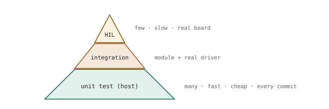
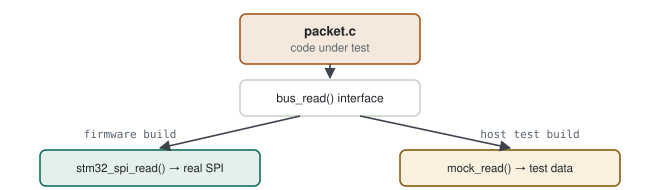
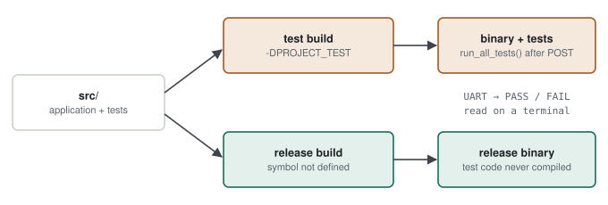

# 05 · Unit Test, Static Analysis & Coverage

> You changed a packet parser, connected the board, sent a few packets — it worked. The question: **how do you know it also works with a bad checksum, a truncated packet or the longest possible packet — and who will notice when someone changes this function six months from now?** The answer: tests that run in seconds without hardware, tools that look for bugs without running the code, and a measurement of what the tests do not cover.

**Contents:** [Test levels](#0--test-levels) · [Testable hardware code](#1--making-hardware-dependent-code-testable) · [Unity](#2--first-tests-with-unity) · [Static analysis](#3--static-analysis) · [Coverage](#4--coverage-where-the-tests-dont-look) · [On-target tests](#5--on-target-tests-and-compile-time-gating) · [Practice](#6--practice) · [Interview questions](#7--interview-questions) · [Principles](#principles)

---

## 0 · Test levels

<p align="center">
  <picture>
    <source media="(prefers-color-scheme: dark)" srcset="../assets/diagrams/test-pyramid-dark.svg">
    
  </picture>
</p>

| Level | What is tested | Where | How many |
|---|---|---|---|
| Unit | one function/module, dependencies faked | host PC | hundreds, seconds |
| Integration | module + real driver | board | dozens |
| HIL | whole system, real hardware and signals | test rig | few, slow |

The pyramid logic: catch most defects where it is cheapest (unit) and keep the expensive tests (HIL) for what unit tests cannot see.

> [!NOTE]
> **DO-178C link.** The "requirements-based test: nominal + robustness" split from [chapter 07](../chapters/07-do-178c.md) applies here too: every function is tested with normal inputs **and** with invalid/edge inputs.

---

## 1 · Making hardware-dependent code testable

### 1.1 First approach

```c
int16_t imu_read_accel_x(void) {
    uint8_t buf[2];
    HAL_SPI_Receive(&hspi1, buf, 2, 10);   /* HAL called directly */
    return (int16_t)((buf[0] << 8) | buf[1]);
}
```

> [!WARNING]
> **Diagnosis — why this cannot be tested.** The function is tied to the HAL; there is no `HAL_SPI_Receive` on the PC, so it doesn't even compile. To check the big-endian conversion you need a board, a sensor and a debugger.

### 1.2 Solution: put the dependency behind an interface

<p align="center">
  <picture>
    <source media="(prefers-color-scheme: dark)" srcset="../assets/diagrams/dependency-injection-dark.svg">
    
  </picture>
</p>

The `Accel_IO_t` idea from [chapter 06](../chapters/06-software-architecture.md): hardware access is injected through function pointers. The firmware build wires in the real SPI; the test build wires in a fake. The logic (conversion, parsing, filtering) is the same code in both.

| | Stub | Mock |
|---|---|---|
| What it does | returns a fixed answer | returns an answer **and** checks how it was called |
| Example | `bus_read` always returns `{0x01,0x00}` | checks that `bus_read` was called **once** with register 0x3B for 6 bytes |

> [!TIP]
> **Result.** Conversion and parsing logic is tested on the PC, without a board, on every commit; the board is only needed for real hardware behaviour.

---

## 2 · First tests with Unity

**`test_packet.c`**

```c
#include "unity.h"
#include "packet.h"

void setUp(void) {}
void tearDown(void) {}

/* nominal */
void test_valid_packet_is_accepted(void) {
    uint8_t pkt[] = {0xAA, 0x03, 0x10, 0x20, 0x30, 0x00};
    pkt[5] = packet_checksum(pkt, 5);
    TEST_ASSERT_TRUE(packet_is_valid(pkt, sizeof pkt));
}

/* robustness: corrupted checksum */
void test_corrupted_checksum_is_rejected(void) {
    uint8_t pkt[] = {0xAA, 0x03, 0x10, 0x20, 0x30, 0x00};
    pkt[5] = packet_checksum(pkt, 5) ^ 0xFF;
    TEST_ASSERT_FALSE(packet_is_valid(pkt, sizeof pkt));
}

/* robustness: length field larger than the buffer */
void test_length_overflow_is_rejected(void) {
    uint8_t pkt[] = {0xAA, 0xFF, 0x10};
    TEST_ASSERT_FALSE(packet_is_valid(pkt, sizeof pkt));
}

int main(void) {
    UNITY_BEGIN();
    RUN_TEST(test_valid_packet_is_accepted);
    RUN_TEST(test_corrupted_checksum_is_rejected);
    RUN_TEST(test_length_overflow_is_rejected);
    return UNITY_END();
}
```

> [!TIP]
> **Which tests to write.** For every function: one normal case, the boundaries (0, the maximum, one more than the maximum), invalid input (NULL, corrupted data). The third test above catches a classic buffer overflow — the most expensive kind of defect in the field.

---

## 3 · Static analysis

Reads the code without running it and finds likely defects: uninitialised variables, out-of-bounds array access, NULL dereference, unused values, MISRA rule violations.

```bash
cppcheck --enable=warning,style,performance --error-exitcode=1 src/
```

```
src/packet.c:42:12: error: Array 'buf[8]' accessed at index 8, which is out of bounds. [arrayIndexOutOfBounds]
```

> [!WARNING]
> **Silencing a warning ≠ fixing it.** Every warning has two options: **fix it**, or **write down why it is accepted** (e.g. a deliberate cast for a hardware register). The MISRA deviation record in DO-178C projects is the formal version of this. A warning suppressed without a reason is a hidden defect.

---

## 4 · Coverage: where the tests don't look

```c
int clamp(int v, int lo, int hi) {
    if (v < lo) return lo;          /* A */
    if (v > hi) return hi;          /* B */
    return v;                       /* C */
}
```

| Test set | Statement | Branch | What was missed |
|---|---|---|---|
| `clamp(5,0,10)` | C ran, the returns in A and B did not → 60 % | the "true" side of both ifs never ran → 50 % | boundary behaviour |
| + `clamp(-1,0,10)`, `clamp(11,0,10)` | 100 % | 100 % | — |

**Measuring with gcov / gcovr**

```bash
gcc --coverage -o test_packet test_packet.c packet.c unity.c
./test_packet
gcovr -r . --branches
```

> [!WARNING]
> **100 % coverage is not proof of correctness.** A test with no assertions also executes the lines and produces 100 %. Coverage answers "what did I **not** test", not "is it correct". That is why DO-178C puts requirements-based tests first and uses coverage afterwards to reveal the gaps.

---

## 5 · On-target tests and compile-time gating

Not every team has host tests. A common, pragmatic alternative: a small test framework that runs **on the target**, living in the same source tree as the product code and switched on by a preprocessor symbol.

<p align="center">
  <picture>
    <source media="(prefers-color-scheme: dark)" srcset="../assets/diagrams/test-build-gating-dark.svg">
    
  </picture>
</p>

### 5.1 Gating with `#ifdef`

```c
#ifdef PROJECT_TEST
#include "test_runner.h"
#endif

/* ... power-on self-test steps ... */

#ifdef PROJECT_TEST
    run_all_tests();          /* hardware initialised, watchdog not started yet */
#endif

watchdog_start();             /* last step before the scheduler */
rtos_start();
```

The symbol is not `#define`d in code; it is set in the build configuration (STM32CubeIDE: Properties → C/C++ Build → Settings → MCU GCC Compiler → Preprocessor → Define symbols) and reaches the compiler as `-DPROJECT_TEST`. Without it, `test_runner.h` is never even included; the release binary contains no test code.

| Symbol | When enabled | What runs |
|---|---|---|
| `PROJECT_TEST` | development / regression | `run_all_tests()` after the power-on self-test |
| `EEPROM_SMOKE_TEST` | once, when a new board revision arrives | write/read of a reserved scratch block in EEPROM |
| none | release | product code only |

> [!WARNING]
> **Why the tests run exactly there.** `run_all_tests()` runs **after** hardware initialisation (the board layer is ready) but **before** the independent watchdog starts. Once started, the IWDG cannot be stopped and resets the MCU if not refreshed within its timeout; long tests would put the board into a reset loop. The order is a deliberate design decision.

### 5.2 The framework: one macro

```c
#define TEST_ASSERT(cond, msg)                                     \
    do {                                                           \
        if (!(cond)) {                                             \
            test_printf("FAIL: %s (line %d)\r\n", msg, __LINE__);  \
            g_failCount++;                                         \
        } else {                                                   \
            test_printf("PASS: %s\r\n", msg);                      \
        }                                                          \
    } while (0)
```

`test_printf` sends the text out over the UART; a summary function prints `ALL TESTS PASSED` or `N TEST(S) FAILED` at the end. The `do { } while (0)` wrapper makes the macro behave like a single statement:

| Without the wrapper | Problem |
|---|---|
| `#define F(m) a(m); b++` | in `if (x) F("e");` only `a()` is inside the `if`; `b++` always runs |
| `#define F(m) { a(m); b++; }` | `if (x) F("e"); else ...` → the `;` after `}` ends the `if`, `else` has no `if` → compile error |
| `#define F(m) do { a(m); b++; } while (0)` | one statement that needs the trailing `;`; works in any `if/else`; `while (0)` is optimised away |

### 5.3 What to test, layer by layer

| Layer | Example module | Example test |
|---|---|---|
| Board | CRC unit | NULL buffer → `WRONG_PARAM`; same data twice → same CRC |
| Service | ring buffer | push to a full buffer → oldest entry overwritten |
| Service | frame processor | frame boundaries on idle line |
| Service | self-test windows | 4 failures in a window of 10 → FAIL |
| Service | non-volatile manager | A/B copies; recovery from a corrupted copy |
| Service | error log | de-duplication of a repeating event |
| Application | measurement manager | range / rate-of-change / stuck checks |
| Application | command protocol | invalid command, wrong length |

**A robustness test**

```c
static void test_crc_calculate_null_data(void)
{
    uint32_t crc = 0;
    int32_t ret = crc_calculate(NULL, 4, &crc);
    TEST_ASSERT(ret == ERR_WRONG_PARAM, "NULL data must return ERR_WRONG_PARAM");
}
```

> [!TIP]
> **Delete dead tests.** Tests live with the product code; a test for a function that no longer exists, or one that verifies nothing, is deleted — not commented out.

### 5.4 On-target vs host (Unity)

| | On-target framework | Host (Unity, §2) |
|---|---|---|
| Runs on | the board | the PC, in seconds |
| Needs hardware | yes | no (mock/fake) |
| Verifies real peripherals | yes (CRC unit, EEPROM) | no |
| In CI | needs a hardware runner | easy on every commit |
| Coverage | hard | easy with `gcov` |

The two complement each other: hardware-dependent modules on target, pure logic (ring buffer, sliding windows, protocol parsing) on the host — those are the first candidates to move ([03 §6.3](03-ci-cd-and-docker.md#63-what-moves-from-the-board-to-the-host)).

---

## 6 · Practice

1. Make `packet.c` independent of the HAL.
2. Add Unity; write four tests: nominal, bad checksum, short packet, maximum length.
3. Hook it into CMake with `ctest`; add it to CI ([03](03-ci-cd-and-docker.md)).
4. Run cppcheck; fix every warning or write down why it stays.
5. Measure branch coverage, find the branch that keeps it below 100 % and add a test.

---

## 7 · Interview questions

<details>
<summary><b>How do you test hardware-dependent code?</b></summary>

Put hardware access behind an interface; test the logic on the host with a fake implementation. Verify real hardware behaviour with integration and HIL tests on the board.
</details>

<details>
<summary><b>Mock vs stub?</b></summary>

A stub returns fixed values; a mock also verifies which parameters it was called with and how many times.
</details>

<details>
<summary><b>Statement vs branch coverage?</b></summary>

Statement coverage asks whether each line ran; branch coverage asks whether both outcomes of each decision ran. Branch is stronger; MC/DC also requires each sub-condition's independent effect ([chapter 07](../chapters/07-do-178c.md)).
</details>

<details>
<summary><b>Is 100 % coverage enough?</b></summary>

No. It measures lines executed, not correct results; it is meaningful only together with requirements-based and robustness tests.
</details>

<details>
<summary><b>Why wrap a multi-statement macro in <code>do { } while (0)</code>?</b></summary>

So the macro, followed by `;`, behaves as one statement and is safe inside an `if/else` without braces.
</details>

---

## Principles

#### 1 — Testability is a design decision
If the hardware dependency isn't behind an interface, tests cannot be added later.

#### 2 — Robustness tests are the most valuable
The normal case already works; defects live at the boundaries and in bad input.

#### 3 — Coverage is a compass, not a target
It shows missing tests; a high number does not prove correctness.
