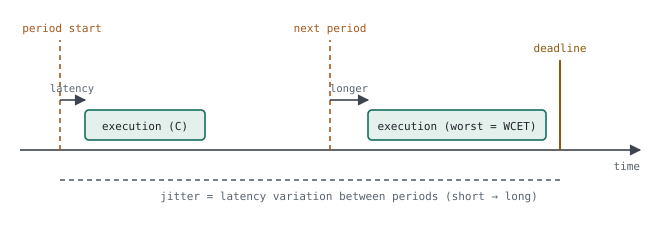

# 06 · Real-time Metrics

> "Real-time" often gets heard as "fast". The real question is different: **when an event arrives, can you guarantee the latest moment the system will respond — and can you measure and show it?** Real-time is measured not by average speed but by how predictable the worst case is.

**Contents:** [Five concepts](#0--five-concepts-in-one-picture) · [Why averages mislead](#1--why-the-average-misleads) · [Jitter of a 1 kHz task](#2--example-jitter-of-a-1-khz-sensor-task) · [Measuring](#3--measuring) · [Schedulability](#4--schedulability-does-everything-fit) · [Periods and timeouts in an RTOS design](#5--periods-and-timeouts-in-an-rtos-design) · [Practice](#6--practice) · [Interview questions](#7--interview-questions) · [Principles](#principles)

---

## 0 · Five concepts in one picture

<p align="center">
  <picture>
    <source media="(prefers-color-scheme: dark)" srcset="../assets/diagrams/realtime-timeline-dark.svg">
    
  </picture>
</p>

| Concept | Definition | Example in an attitude system |
|---|---|---|
| Period (T) | repeat interval of periodic work | sensor task every 1 ms |
| Latency | from the event to the start of the response | timer interrupt to the first line of the task |
| Execution time (C) | how long the work itself takes | filter update |
| WCET | the worst value of C | cache miss, long interrupt, longest branch |
| Jitter | variation of the start time from period to period | 990–1012 µs instead of 1000 µs |
| Deadline | the latest moment the work must finish | before the next sample |
| Response time | event → end of work = latency + waiting + C | must be below the deadline |

> [!TIP]
> **Analogy.** A bus comes every 10 minutes (period). It reaches the stop sometimes 30 s late, sometimes 2 minutes (latency); the spread of that delay is jitter. The ride takes 25 minutes in the worst traffic (WCET). You must be at work by 9:00 (deadline). You plan for the worst day, not the average.

### Hard vs soft real-time

| | Hard | Soft |
|---|---|---|
| Missed deadline | system failure | quality degrades |
| Example | fire control, flight control, motor current loop | video, user interface |

---

## 1 · Why the average misleads

Duration of one ISR over 1000 measurements:

| Statistic | Value |
|---|---|
| Mean | 20 µs |
| 99th percentile | 35 µs |
| **Maximum** | **400 µs** |

The deadline is 100 µs.

> [!WARNING]
> **Diagnosis.** Looking at the mean you'd say "5× margin". But work that takes 400 µs once in 1000 runs makes a system with a 100 µs deadline a **faulty** system — for an ISR that runs thousands of times an hour, "once in 1000" means several times a minute. Real-time design looks at the **tail** of the histogram.

What stretches the tail:

| Cause | Why | Remedy |
|---|---|---|
| Long critical section | no other interrupt can enter during `__disable_irq()` | shorten it: copy and leave |
| Same- or higher-priority ISR | waiting in line | review priorities, shorten ISRs |
| Flash wait states / cache | first access is slow | run critical code from RAM (ITCM) |
| `vTaskDelay` | delay counts from the previous *end*, so it drifts | `vTaskDelayUntil` |
| Dynamic memory | `malloc` time is unbounded | static allocation / pools |

---

## 2 · Example: jitter of a 1 kHz sensor task

### 2.1 First approach

```c
void vSensorTask(void *p) {
    for (;;) {
        read_and_filter();           /* takes 50–300 µs */
        vTaskDelay(pdMS_TO_TICKS(1));
    }
}
```

> [!WARNING]
> **Diagnosis — the period drifts.** `vTaskDelay(1)` means "wait 1 ms from now". If the work took 300 µs, the real period is 1.3 ms; as the work time varies, so does the period. The filter assumes a fixed sample time, so the attitude estimate degrades ([chapter 05](../chapters/05-sensors-and-navigation.md)).

### 2.2 Solution

```c
void vSensorTask(void *p) {
    TickType_t last = xTaskGetTickCount();
    for (;;) {
        vTaskDelayUntil(&last, pdMS_TO_TICKS(1));   /* absolute period */
        read_and_filter();
    }
}
```

> [!TIP]
> **Result.** Wake-up times are tied to absolute time; the period stays at 1 ms even if the work time varies. The remaining jitter comes only from interrupts and priorities, and it can be measured.

---

## 3 · Measuring

### 3.1 GPIO + logic analyzer

Set a pin at the start of the task and clear it at the end. On a logic analyzer, the pulse width is C, the time between rising edges is the period, and the spread of edge times is the jitter.

### 3.2 DWT cycle counter

**Cortex-M3/M4/M7 cycle counter**

```c
CoreDebug->DEMCR |= CoreDebug_DEMCR_TRCENA_Msk;   /* enable the trace unit */
DWT->CYCCNT = 0;
DWT->CTRL  |= DWT_CTRL_CYCCNTENA_Msk;             /* start the counter      */

uint32_t t0 = DWT->CYCCNT;
filter_update();
uint32_t c = DWT->CYCCNT - t0;                    /* cycles; µs = c / (SystemCoreClock/1e6) */
if (c > c_max) c_max = c;                         /* worst observed time */
```

> [!NOTE]
> Cortex-M0/M0+ have no `CYCCNT`; use a free-running hardware timer instead.

### 3.3 SEGGER SystemView

Shows a timeline of tasks and ISRs: who pre-empted whom, and for how long.

> [!WARNING]
> **Measured maximum ≠ true WCET.** A measurement only gives the worst of the scenarios you tried. That is why safety-critical systems use static WCET analysis — one of the objectives DO-178C covers with "analysis" ([chapter 07](../chapters/07-do-178c.md)).

---

## 4 · Schedulability: does everything fit?

**CPU utilisation and the rate-monotonic sufficient condition (Liu–Layland)**

```
U = Σ (C_i / T_i)

Rate-monotonic (shorter period = higher priority), sufficient condition:
U ≤ n · (2^(1/n) − 1)        n=1: 1.00   n=2: 0.83   n=3: 0.78   n→∞: ≈ 0.69
```

**Example: three tasks**

```
sensor   C=0.3 ms  T=1 ms    → 0.30
filter   C=1.0 ms  T=5 ms    → 0.20
comms    C=2.0 ms  T=10 ms   → 0.20
U = 0.70  ≤  0.78 (n=3)  → the sufficient condition holds
```

> [!TIP]
> **Sufficient, not necessary.** Above the bound the system may still work; then do a response-time analysis per task. Below the bound, deadlines are guaranteed.

---

## 5 · Periods and timeouts in an RTOS design

A typical sensor firmware with an event-driven comms task and periodic acquisition:

| Task | Priority | Trigger | Period / timeout |
|---|---|---|---|
| comms (RX processing) | High | thread flag from the UART idle-line ISR | event-driven |
| sensor A (SPI ADC) | Normal | `osDelay(10)` | 10 ms |
| sensor B (I²C, DMA) | Normal | timer callback → thread flag, then DMA-complete flag | DMA wait 300 ms |
| processing | Normal | `osDelay(10)` | 10 ms |
| watchdog manager | Normal | `osEventFlagsWait(..., 300 ms)` | 300 ms |

> [!WARNING]
> **Where to look in such code — a period built with `osDelay`.** `osDelay(10)` at the end of the loop means "wait 10 ms", not "run every 10 ms": the loop's own work (SPI read, self-test update) is added every turn, so the period becomes 10 ms + work and drifts. The fix from §2 applies:
>
> ```c
> uint32_t next = osKernelGetTickCount();
> for (;;) {
>     next += ADC_READ_PERIOD_MS;
>     /* ... read ... */
>     osDelayUntil(next);      /* wait until an absolute time */
> }
> ```
>
> For a pressure or temperature measurement, a fixed sample time directly affects rate-of-change checks: ROC = Δvalue / Δt, and Δt is assumed constant.

> [!TIP]
> **What is right — waiting with a timeout.** The I²C task waits for DMA completion not forever but for 300 ms; on timeout it records a communication failure in its self-test window. If the bus hangs, the task does not lock up, it keeps reporting to the watchdog manager, and the fault shows up in the status word.
>
> ```c
> flags = osThreadFlagsWait(FLAG_I2C_RX_COMPLETE, osFlagsWaitAny, TASK_TIMEOUT_MS);
> if (flags == osFlagsErrorTimeout) {
>     selftest_update(&w->i2c_comm, false);
> }
> ```

---

## 6 · Practice

1. Toggle a GPIO at the start of a 1 kHz task; measure period and jitter with a logic analyzer.
2. Show the `vTaskDelay` ↔ `vTaskDelayUntil` difference with measurements.
3. Measure the filter's cycle count over 10,000 calls: min / mean / max.
4. Add a long critical section to one task on purpose; watch the other task's jitter grow.

---

## 7 · Interview questions

<details>
<summary><b>What does real-time mean?</b></summary>

Not fast, but predictable: the latest response time is guaranteed and measurable.
</details>

<details>
<summary><b>Latency vs jitter?</b></summary>

Latency is the delay of one response; jitter is how much that delay varies from period to period.
</details>

<details>
<summary><b>How do you show the system never misses deadlines?</b></summary>

Determine WCET and period for every task, do a utilisation and, if needed, response-time analysis, then confirm by measuring under worst-case load.
</details>

<details>
<summary><b>What increases interrupt latency?</b></summary>

Long critical sections, same- or higher-priority ISRs, BASEPRI masking, flash wait states and cache misses.
</details>

---

## Principles

#### 1 — Look at the tail, not the average
Real-time correctness is measured by the worst case.

#### 2 — Tie the period to absolute time
`vTaskDelayUntil` / `osDelayUntil`; otherwise the work time shifts the period.

#### 3 — Measure, then claim
A number not seen on GPIO, DWT or SystemView is a guess in an interview.
