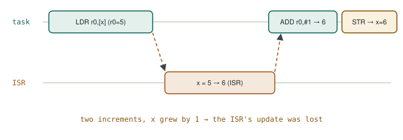

# 07 · Atomics & Memory Barriers

> [Chapter 01](../chapters/01-embedded-c.md) says "`volatile` does not make anything atomic". The interviewer's next question is always the same: **then what does, and what exactly breaks in the field when `volatile` and atomic are mixed up?** This note builds the answer at assembly level.

**Contents:** [Why `x++` is not one step](#0--why-x-is-not-one-step) · [Four fixes](#1--four-fixes-and-when-to-use-which) · [Memory barriers](#2--memory-barriers-guaranteeing-order) · [Two patterns from real firmware](#3--two-patterns-from-real-firmware) · [Practice](#4--practice) · [Interview questions](#5--interview-questions) · [Principles](#principles)

---

## 0 · Why `x++` is not one step

One line of C, `x++`, is three Cortex-M instructions:

**`counter++` compiled**

```asm
LDR  r0, [r1]      ; 1) read from memory
ADDS r0, r0, #1    ; 2) increment in a register
STR  r0, [r1]      ; 3) write back to memory
```

An interrupt can land between these instructions. If the interrupt changes the same variable:

<p align="center">
  <picture>
    <source media="(prefers-color-scheme: dark)" srcset="../assets/diagrams/lost-update-race-dark.svg">
    
  </picture>
</p>

| Time | Task | ISR | x in memory |
|---|---|---|---|
| 1 | `LDR` → r0 = 5 | | 5 |
| 2 | *(interrupted)* | x = 5 → 6 | 6 |
| 3 | `ADDS` → r0 = 6 | | 6 |
| 4 | `STR` → x = 6 | | **6** (should be 7) |

> [!WARNING]
> **Diagnosis — lost update.** Two increments happened; the counter went up by one. `volatile` fixes nothing here: it tells the compiler "don't cache this in a register, read/write memory every time"; it does not make the read and the write **indivisible**. The bug is rare (the interrupt must land exactly between two instructions), so it hides in testing and shows up in the field.

| | volatile | atomic |
|---|---|---|
| Guarantees | every access really goes to memory | the operation completes without interruption |
| Solves | the compiler optimising the variable away (a flag in a loop) | lost updates in a race |
| Enough when | a single flag set by an ISR and only read by a task | multiple writers, read-modify-write |

---

## 1 · Four fixes and when to use which

### 1.1 Short critical section

```c
uint32_t primask = __get_PRIMASK();   /* save the previous state */
__disable_irq();
counter++;
__set_PRIMASK(primask);               /* safe when nested        */
```

### 1.2 C11 atomics

```c
#include <stdatomic.h>
static atomic_uint counter;
atomic_fetch_add(&counter, 1);        /* LDREX/STREX loop on Cortex-M3 and up */
```

### 1.3 Exclusive access (what C11 compiles to)

**LDREX / STREX**

```asm
retry:
    LDREX  r0, [r1]        ; read and mark "I am watching this address"
    ADDS   r0, r0, #1
    STREX  r2, r0, [r1]    ; if anything intervened, the store FAILS (r2=1)
    CMP    r2, #0
    BNE    retry           ; failed → start over
```

Atomic without disabling interrupts: if anything got in between, the store is refused and retried.

### 1.4 Single-writer rule

Only the ISR writes, the task only reads; if the variable is 32 bits and aligned, a single read on Cortex-M is already atomic. The cheapest fix — but it must be guaranteed by design.

| Method | Cost | When |
|---|---|---|
| Single writer | zero | one producer, one consumer, ≤ 32 bits |
| Critical section | interrupts off briefly | a few instructions; works on Cortex-M0 too |
| `_Atomic` / LDREX-STREX | retry on contention | counters, flags; M3 and up |
| Queue / mutex | an RTOS call | structs, large data, task-to-task |

> [!WARNING]
> **64-bit variables: torn reads.** On a 32-bit MCU, `uint64_t timestamp` is read with two 32-bit accesses. If an ISR updates it between them, the low half is new and the high half old — an impossible timestamp. Copy it inside a critical section, or use the "read high, read low, read high again, retry if different" pattern.

> [!TIP]
> **Result.** Decision order for ISR–task sharing: can it be single-writer → if not, is it a few instructions (critical section / atomic) → if the data is large, use a queue.

---

## 2 · Memory barriers: guaranteeing order

The CPU and the compiler may **reorder** memory accesses when they think it does not change the result. On a single-core Cortex-M this rarely shows; where it does show is at the boundary with hardware.

| Instruction | Meaning |
|---|---|
| `DMB` | memory accesses before the barrier become visible before those after it |
| `DSB` | wait until **all** accesses before the barrier have completed |
| `ISB` | flush the pipeline; following instructions are fetched with the new settings |

**Typical uses**

```c
/* 1) Before handing a buffer to DMA: writes must have reached memory */
fill_tx_buffer(buf);
__DSB();
DMA1_Stream6->CR |= DMA_SxCR_EN;

/* 2) After changing the vector table or the MPU */
SCB->VTOR = (uint32_t)&vector_table_ram;
__DSB(); __ISB();

/* 3) Clearing an interrupt flag right before leaving the ISR
      (prevents re-entering the ISR on some Cortex-M parts) */
TIM2->SR = ~TIM_SR_UIF;
__DSB();
```

> [!TIP]
> **Where it really matters:** Cortex-M7 with caches (DMA and cache coherency), multi-core systems, and ARM64/Linux, whose weak ordering model really breaks sharing without barriers.

---

## 3 · Two patterns from real firmware

### 3.1 Critical section in an error logger with de-duplication

Several tasks can log errors; de-duplication shares three static variables (last event code, repeat count, "limit already reported"). That is the read-modify-write race of §0, one-to-one.

```c
bool log_should_write(uint16_t code)
{
    bool write;

    __disable_irq();
    if (code == last_code) {
        if (repeats < UINT8_MAX) { repeats++; }
        write = (repeats == REPEAT_LIMIT) && !limit_reported;   /* log once more at the limit */
        limit_reported |= write;
    } else {
        write          = true;                                  /* a new event is always logged */
        last_code      = code;
        repeats        = 1U;
        limit_reported = false;
    }
    __enable_irq();

    return write;            /* caller does the EEPROM write OUTSIDE the critical section */
}
```

| Design decision | Why |
|---|---|
| critical section covers only compare + increment | a few µs; interrupt latency impact negligible |
| slow EEPROM write outside the section | an I²C write takes milliseconds; masking interrupts that long can miss a UART idle-line interrupt |
| `__disable_irq` instead of a mutex | the logger is also called before the scheduler starts (during self-test); a mutex needs the scheduler |

> [!WARNING]
> **A deliberate simplification.** A bare `__disable_irq()` / `__enable_irq()` pair is not safe when nested: if the caller already had interrupts disabled, `__enable_irq()` turns them back on too early. The PRIMASK save/restore of §1.1 removes the risk. If the function is never called from an ISR or from inside another critical section, the simple version is correct — and writing "not called from ISR" in the comment makes review easier.

### 3.2 ISR → task: a flag instead of shared data

ISRs don't write shared variables; they only send a **flag** to the task that owns the data:

```c
(void)osThreadFlagsSet(i2cTaskHandle,  FLAG_I2C_RX_COMPLETE);
(void)osThreadFlagsSet(spiTaskHandle,  FLAG_SPI_RX_COMPLETE);
(void)osThreadFlagsSet(commsTaskHandle, FLAG_UART_RX_IDLE);
```

> [!TIP]
> **Result.** The data is in the DMA buffer, the notification is in the thread flag. The task wakes and reads the buffer; ISR and task never modify the same variable at the same time, so atomicity is solved by design — a lightweight version of the "queue / notification" row in §1.

---

## 4 · Practice

1. Let a 1 kHz timer ISR and a task increment the same counter for 10 seconds; compare unprotected and protected results (expected: 2 × count).
2. `arm-none-eabi-objdump -d build-arm/app.elf | grep -A4 counter` — see the instructions of `counter++`.
3. Do the same with `atomic_fetch_add` and find the generated LDREX/STREX loop.

---

## 5 · Interview questions

<details>
<summary><b>volatile vs atomic?</b></summary>

`volatile` stops the compiler from optimising accesses away; atomic guarantees the access is not interrupted. One is a visibility problem, the other an indivisibility problem.
</details>

<details>
<summary><b>How do you share a struct between an ISR and a task?</b></summary>

Copy it inside a short critical section, or send it by value through a queue; do the processing outside the critical section.
</details>

<details>
<summary><b>How do you increment atomically without disabling interrupts?</b></summary>

LDREX/STREX: exclusive read, modify, exclusive write; if anything intervened, the store fails and the loop retries. In C11, `atomic_fetch_add`.
</details>

<details>
<summary><b>DMB vs DSB?</b></summary>

DMB guarantees the order of accesses; DSB also waits for all of them to complete before the next instruction executes.
</details>

---

## Principles

#### 1 — Visibility and indivisibility are separate problems
`volatile` solves the first; atomics and critical sections solve the second.

#### 2 — The cheapest fix is in the design
If a single-writer rule can be established, no protection is needed.

#### 3 — Barriers live at the hardware boundary
DMA, vector table, MPU and multi-core — that's where order matters.
