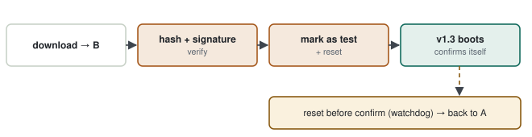

# 10 · Firmware Update & Secure Boot

> You are updating a device in the field and the power goes out halfway through the write. The question: **will the device boot next time — and if someone tries to load their own firmware, how does the device reject it?** A simple UART bootloader often answers the first question only partly and the second not at all; this note builds both.

**Contents:** [What a bootloader does](#0--what-a-bootloader-does) · [Single-slot updates](#1--single-slot-updates-and-why-they-brick) · [Integrity and authenticity](#2--integrity-and-authenticity) · [Rollback](#3--rollback-and-anti-rollback) · [A single slot with an A/B flag](#4--a-single-slot-with-a-redundant-boot-flag) · [Practice](#5--practice) · [Interview questions](#6--interview-questions) · [Principles](#principles)

---

## 0 · What a bootloader does

The bootloader is the small program that runs first after reset. Its job: decide which application image to run, receive a new image when needed and **verify it before running it**.

| Concept | Meaning |
|---|---|
| image header | version, size, hash, signature |
| hash (SHA-256) | **integrity**: is the image corrupted? |
| signature (ECDSA / RSA) | **authenticity**: did an authorised party produce it? |
| secure boot | the application never runs without its signature verified on every boot |
| rollback | return to the previous image if the new one fails (good) |
| anti-rollback | refuse to go back to a known-vulnerable old version on purpose |
| OTA / DFU | over-the-air update / update over USB |

---

## 1 · Single-slot updates and why they brick

### 1.1 First approach

The bootloader receives the new image over UART and writes it **over the running application**.

> [!WARNING]
> **Diagnosis — if power fails.** Power drops at 50 %: flash now holds half old, half new image. If the bootloader doesn't notice, it jumps into it → HardFault, reset loop. Even if it notices, there is **no** runnable image left; the device can only wait to be updated again. In the field, out of reach of a cable, that is a "brick".

### 1.2 Solution: A/B (dual bank)

<p align="center">
  <picture>
    <source media="(prefers-color-scheme: dark)" srcset="../assets/diagrams/ab-update-layout-dark.svg">
    
  </picture>
</p>

The running image is **never touched**. The new image goes into the empty slot, gets verified, and the switch is made with a single flag.

<p align="center">
  <picture>
    <source media="(prefers-color-scheme: dark)" srcset="../assets/diagrams/ab-update-flow-dark.svg">
    
  </picture>
</p>

| Step | What happens | If power fails here |
|---|---|---|
| 1. Write to B | A keeps running | A boots, the update restarts |
| 2. Verify hash + signature | B's integrity and origin checked | A boots |
| 3. Mark B as "test", reset | a single flag is written | the flag is either written or not — no in-between |
| 4. B boots, checks itself, marks itself "confirmed" | | if the confirm wasn't written, the next reset returns to A |
| Watchdog reset before confirm | the new image hung | the bootloader returns to A (rollback) |

> [!TIP]
> **Result.** At no step can the device end up without a runnable image. The price: twice the application space in flash.

> [!NOTE]
> **Why a single flag matters.** The switch is atomic because the "active slot" information is a single word (or a two-copy record with CRC). A single-word flash write either happens or doesn't; there is no half-done "switch".

---

## 2 · Integrity and authenticity

### 2.1 Why CRC is not enough

CRC32 catches accidental corruption (noise, a half-written image) well. But anyone can recompute the CRC for a new image; a malicious image also has a valid CRC.

| | CRC | Hash (SHA-256) | Signature |
|---|---|---|---|
| Accidental corruption | ✓ | ✓ | ✓ |
| Deliberate modification | ✗ | ✗ (the hash is recomputed too) | ✓ |
| Needs a key | no | no | private key at production, public key on the device |

### 2.2 How a signature works

1. At production: `hash = SHA256(image)`, `sig = sign(private_key, hash)`.
2. On the device: the bootloader recomputes `hash` and checks `verify(public_key, hash, sig)`.
3. The public key lives in an immutable region of the bootloader (OTP, locked flash).

> [!WARNING]
> **Security ends where the key lives.** If the public key is in a writable place, an attacker puts their own key there. The bootloader itself must be write-protected (on STM32: RDP/WRP). The private key must never sit in the repository or in CI logs.

---

## 3 · Rollback and anti-rollback

| | Rollback | Anti-rollback |
|---|---|---|
| Purpose | go back if the new version doesn't work | block installing a known-vulnerable old version |
| Mechanism | return to the slot before an unconfirmed image | security version in the image header; monotonic counter on the device |
| Conflict? | no: rollback returns to the "last confirmed" version; anti-rollback rejects versions below the counter | |

> [!TIP]
> **Worth studying:** MCUboot (the open-source bootloader used with Zephyr, Mynewt and STM32) is a mature example of this design: image header, hash and signature in TLVs, swap/overwrite modes, test/confirm logic. Comparing its design document with your own UART bootloader is a good exercise.

---

## 4 · A single slot with a redundant boot flag

Small parts often cannot fit two application slots: with 128 KB of flash, two 56 KB slots plus a bootloader leave too little room. A common compromise keeps **one** application slot and makes the **boot record** redundant instead.

| Region | Content |
|---|---|
| Bootloader | first pages of flash, write-protected |
| Application | the rest of flash, one slot |
| Boot record | external EEPROM, **two copies (A and B)** |

> [!WARNING]
> **Where this sits relative to §1.** If the update is interrupted, the application area can be left corrupt — but the bootloader stays intact in its protected region, and `boot_mode` / `update_stage` in the boot record tell it the update did not finish. In terms of §1.1 this is the **recoverable** form of the single-slot design: not a brick, but "reload required".

### Boot record: A/B copies + CRC + magic

| Read result | Meaning |
|---|---|
| `0` | block CRC valid + magic correct |
| `-1` | NULL pointer |
| `-2` | I/O error or a real CRC mismatch (not blank, corrupted) |
| `-3` | CRC fine but magic wrong |
| `-4` | both copies blank (0xFF) — never provisioned, **not a fault** |

Keeping `-2` and `-4` apart matters: a blank EEPROM on a new board is not a defect and is not logged. In both cases the application **heals itself** with safe defaults:

```c
memset(&boot, 0, sizeof boot);
boot.magic        = BOOT_FLAG_MAGIC;
boot.boot_mode    = BOOT_MODE_APPLICATION;
boot.update_stage = UPDATE_STAGE_NONE;
(void)boot_record_write(&boot);
```

| Field | Purpose |
|---|---|
| `magic` | is this block really a boot record, or random data? |
| `boot_mode` | stay in the bootloader, or jump to the application |
| `update_stage` | at which stage an update was interrupted |
| `total_boots`, `boot_reason` | boot statistics in the field |
| `failed_boots` | boot-loop counter ([09 §4.3](09-gdb-and-fault-analysis.md#43-boot-loop-detection-count-in-eeprom-not-ram)) |
| CRC-32 | reject a half-written copy |

> [!TIP]
> **How the single flag stays atomic here.** A block write to EEPROM can be interrupted, so one copy is not enough. While one copy is written, the other remains old but valid, and the CRC tells which one is complete — the external-EEPROM version of §1.2's "single flag, no in-between".

> [!NOTE]
> **If asked about §2.** Integrity with CRC-32 (often a hardware CRC unit) is enough against accidental corruption. Over a closed serial link with no network exposure, signature verification may not be a requirement; for updates over an open network you add signature verification and a write-protected public key.

---

## 5 · Practice

1. Compare an existing UART bootloader's flow with the table in §1; list the steps where a power loss bricks the device.
2. Append a CRC32 to the image in an STM32 project; the bootloader must not jump without checking it.
3. Draw a linker-script layout that splits flash into two slots (bootloader, A, B, shared area).
4. Read the MCUboot design document and summarise it in your own words.

---

## 6 · Interview questions

<details>
<summary><b>What happens if power fails in the middle of an update?</b></summary>

With an A/B design the running image never changes; the new image is not activated until it is verified and confirmed. If a reset happens before confirmation, the bootloader boots the old one.
</details>

<details>
<summary><b>Is a CRC enough?</b></summary>

Against accidental corruption, yes; against malice, no — proving origin needs a signature.
</details>

<details>
<summary><b>What is secure boot?</b></summary>

On every boot the bootloader verifies the application image's signature with a public key stored in an immutable place; an unverified image never runs.
</details>

<details>
<summary><b>Don't rollback and anti-rollback contradict each other?</b></summary>

No: rollback returns to the last confirmed version; anti-rollback rejects old versions below the security counter.
</details>

---

## Principles

#### 1 — Don't touch the running image
An update always goes somewhere else; the switch is one atomic step.

#### 2 — Integrity ≠ authenticity
CRC/hash prove the image is intact; a signature proves who made it.

#### 3 — The new image must prove itself
An image that doesn't confirm itself is rolled back on the next reset.
