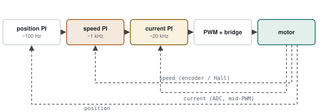

# 11 · Motor Control

> You want to drive an actuator to a given angle. Raise the PWM and the motor turns, but it overshoots, comes back, oscillates. The question: **how do you get the motor to the target position fast, without overshoot and stable even when the load changes — and what does that mean for the embedded software's timing?** Motor control is where control theory meets real-time software.

**Contents:** [PWM, bridge, feedback](#0--pwm-bridge-feedback) · [PID intuitively](#1--pid-intuitively) · [Cascaded loops](#2--cascaded-loops-the-real-job-of-the-firmware) · [BLDC: 6-step and FOC](#3--bldc-6-step-and-foc) · [Practice](#4--practice) · [Interview questions](#5--interview-questions) · [Principles](#principles)

---

## 0 · PWM, bridge, feedback

### 0.1 PWM

Instead of driving the motor with a fixed voltage, you switch it on and off very fast. The **duty cycle** is the on-time fraction; the motor sees the average voltage.

**Average voltage**

```
V_avg = D × V_supply          D = t_on / T_PWM
24 V supply, 25 % duty → the motor sees ≈ 6 V
```

| Parameter | Typical | Why |
|---|---|---|
| PWM frequency | 16–30 kHz | above the audible range; small current ripple |
| Center-aligned | — | symmetric; current sampled mid-period, away from switching noise |
| Dead time | hundreds of ns – a few µs | high and low switches of the same leg never conduct at once |

### 0.2 Why feedback

Open loop assumes "40 % duty = 1000 rpm"; when the load rises, speed drops and you don't know. Closed loop measures the speed and adjusts the duty to correct the difference (the error).

---

## 1 · PID intuitively

| Term | What it does | Car analogy | Too much of it |
|---|---|---|---|
| P (proportional) | strong reaction to large error | far from the target, press hard | oscillation, overshoot |
| I (integral) | removes accumulated error | speed drops on a hill, add throttle slowly | slow oscillation, windup |
| D (derivative) | brakes against the rate of change of error | approaching fast, brake early | amplifies noise |

### 1.1 First approach: P only

> [!WARNING]
> **Diagnosis — steady-state error.** With P alone the motor never quite reaches the target under load: overcoming the load needs a non-zero output, and P gives a non-zero output only with a non-zero error. Raise Kp and the error shrinks, but oscillation starts.

### 1.2 PI and anti-windup

The integral term accumulates small persistent errors and adds them to the output; steady-state error goes to zero.

> [!WARNING]
> **Diagnosis — integral windup.** The motor is stalled or the output is saturated at 100 %. The error stays large and the integral keeps growing. When the obstruction clears, the accumulated integral throws the motor far past the target and it takes a long time to come back.

**Discrete PI + freezing the integral in saturation**

```c
typedef struct { float kp, ki, ts, i, umin, umax; } PI_t;

float pi_step(PI_t *c, float ref, float meas)
{
    float e = ref - meas;
    float u = c->kp * e + c->i;
    if (u > c->umax)      u = c->umax;                 /* saturated: integral stops */
    else if (u < c->umin) u = c->umin;
    else                  c->i += c->ki * c->ts * e;   /* accumulates only outside saturation */
    return u;
}
```

> [!TIP]
> **Result.** P gives a fast response, I gives zero steady-state error, anti-windup gives a controlled return after saturation. D is usually not used in speed/current loops (noise); in position loops it is used with filtering.

---

## 2 · Cascaded loops: the real job of the firmware

<p align="center">
  <picture>
    <source media="(prefers-color-scheme: dark)" srcset="../assets/diagrams/motor-cascade-loops-dark.svg">
    
  </picture>
</p>

| Loop | Typical rate | Runs in | Feedback |
|---|---|---|---|
| Current (torque) | 10–20 kHz | ADC-triggered ISR | shunt + ADC, sampled mid-PWM |
| Speed | ~1 kHz | high-priority task or timer ISR | encoder / Hall |
| Position | ~100 Hz – 1 kHz | task | encoder / potentiometer |

Rule: each inner loop must be **clearly** faster than the outer one (roughly 5–10×); the outer loop sees the inner one as a block that "reaches its target instantly".

> [!WARNING]
> **Jitter breaks control.** A PI computation assumes a fixed `ts`. If the current loop runs at 50 µs one time and 70 µs the next, the integral accumulates wrongly, and noise and vibration grow. That is why the current loop is tied to the ADC conversion-complete interrupt (hardware-timed), not to a software timer — see [06](06-real-time-metrics.md).

> [!NOTE]
> **Actuators in larger systems.** Actuator position and supply voltage/current telemetry reported over a system bus (e.g. MIL-STD-1553, [chapter 04](../chapters/04-mil-std-1553.md)) are exactly the quantities these loops measure; telemetry and fault handling around an actuator are part of the same picture.

---

## 3 · BLDC: 6-step and FOC

| | 6-step (trapezoidal) | FOC |
|---|---|---|
| Rotor position | 3 Hall sensors (60° resolution) | encoder or sensorless estimation |
| Commutation | 6-step table indexed by the Hall state | current transformed to d/q axes (Clarke + Park), controlled by two PIs |
| Torque ripple | noticeable | low |
| Compute load | very low | high (trigonometry; an FPU helps) |
| When | simple, cost-driven | quiet, smooth torque, efficiency |

**6-step commutation table (example ordering)**

```c
/* Hall (CBA) → which phase +, which phase − */
static const uint8_t commutation[8][2] = {
    /* 0 */ {X, X},        /* invalid */
    /* 1 */ {PH_B, PH_C},
    /* 2 */ {PH_C, PH_A},
    /* 3 */ {PH_B, PH_A},
    /* 4 */ {PH_A, PH_B},
    /* 5 */ {PH_A, PH_C},
    /* 6 */ {PH_C, PH_B},
    /* 7 */ {X, X},        /* invalid → fault */
};
```

> [!WARNING]
> **An invalid Hall state is a fault source.** 000 and 111 should never occur physically; if seen, a sensor or cable has failed. Monitor it with built-in-test logic ([chapter 06](../chapters/06-software-architecture.md)): once is transient; if it persists, put the motor into a safe state.

---

## 4 · Practice

1. Set up a timer for center-aligned PWM with dead time; trigger the ADC mid-PWM and verify on an oscilloscope.
2. Build a PI speed loop on a simple DC motor (or a simulation); compare the step response with and without anti-windup.
3. Measure the speed loop's period jitter ([06](06-real-time-metrics.md)).
4. Summarise the FOC block diagram from an application note in your own words.

---

## 5 · Interview questions

<details>
<summary><b>Why is dead time needed?</b></summary>

If the high and low switches conduct at the same time during transitions, the supply is short-circuited (shoot-through); dead time prevents it.
</details>

<details>
<summary><b>What is integral windup and how do you prevent it?</b></summary>

While the output is saturated the integral keeps growing; after saturation ends there is a large overshoot. Freezing or clamping the integral in saturation fixes it.
</details>

<details>
<summary><b>Why cascaded loops?</b></summary>

The inner (current) loop rejects fast disturbances (load, supply); the outer loops focus on slower targets. Each loop can be tuned separately.
</details>

<details>
<summary><b>Why does timing matter in a control loop?</b></summary>

A discrete controller assumes a fixed sample time; jitter changes the effective gain and reduces the stability margin. The current loop runs in a hardware-triggered interrupt.
</details>

---

## Principles

#### 1 — Control quality is timing quality
Without a fixed sample time even a well-tuned PID degrades.

#### 2 — Loops get faster from outside in
Current ≫ speed ≫ position; each feeds the one outside it.

#### 3 — Design for saturation
Real actuators are limited; anti-windup and invalid sensor states are handled from the start.
