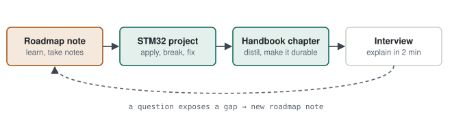
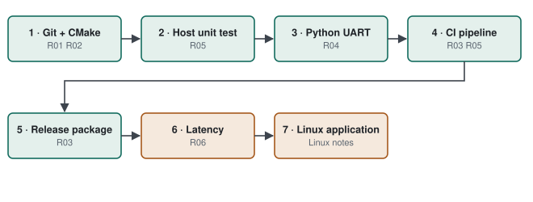

# Roadmap · The chain around the code

> The [handbook chapters](../chapters/) cover what an embedded engineer must *know*: C, RTOS, protocols, architecture, certification. This roadmap covers what modern firmware teams expect *around* that knowledge — how code is reviewed, built, tested and shipped, and how real-time behaviour is measured rather than assumed.

**Contents:** [Why this roadmap](#why-this-roadmap) · [Learning loop](#learning-loop) · [Topic map](#topic-map) · [One project, every topic](#one-project-every-topic) · [Principles](#principles)

---

## Why this roadmap

Picture two engineers who wrote the same sensor firmware on an STM32.

| Question | Engineer A | Engineer B |
|---|---|---|
| "How do you build the code?" | "I press Build in the IDE." | "CMake + `arm-none-eabi`; the IDE is just an editor." |
| "How do you merge a change in a team?" | "I commit to the server." | "Branch, open a PR; CI runs, a reviewer approves, then merge." |
| "How did you test the filter?" | "Ran it on the board and looked at the output." | "Twelve unit tests on the host, plus HIL on the board." |
| "Which version is on the device in the field?" | "I'd have to check the release notes." | "The `VER?` command returns the commit hash." |

Both may know the same engineering. B's answers describe a process that is **repeatable and provable**, and that is what international firmware teams take for granted. Each note in this roadmap closes one link between A and B.

## Learning loop

Every topic goes through four steps. A roadmap note is the working area; once the topic settles, the durable part moves into a handbook chapter.

  <picture>
    <source media="(prefers-color-scheme: dark)" srcset="../assets/diagrams/roadmap-loop-dark.svg">
    
  </picture>

> [!TIP]
> **Why not write the chapter directly?** Writing a half-learned topic into a reference chapter makes incomplete knowledge look final. A roadmap note says "still learning"; a chapter says "I know this and can explain it".

---

## Topic map

Three layers; each layer is a prerequisite for the one above.

| Layer | Notes | Question | Why in this order |
|---|---|---|---|
| **1 · Development chain** | 01 Git · 02 Build · 03 CI · 04 Python · 05 Test | "How is code produced, merged and verified?" | Everything else sits on this chain; CI does not work without build and test |
| **2 · Depth in the fundamentals** | 06 Real-time · 07 Atomics · 08 Bring-up · 09 GDB | "One level below what you already know" | Covered in the chapters, but here with measurement and evidence |
| **3 · Role-specific** | 10 Secure boot · 11 Motor control | "What does this job ad ask for specifically?" | Not every role needs them; pick by target role |

| # | Note | What it closes |
|---|---|---|
| 01 | [Git & Code Review](01-git-and-code-review.md) | branch/PR workflow, merge scenarios, change control in DO-178C projects |
| 02 | [Build System & Cross-Compile](02-build-system-and-cross-compile.md) | building without the IDE, toolchain files, linker script, `.map` file |
| 03 | [CI/CD & Docker](03-ci-cd-and-docker.md) | automated pipeline, pinned toolchain, hardware-in-the-loop CI |
| 04 | [Python & Bash Automation](04-python-and-bash-automation.md) | scripting the device over UART, exit codes, data capture |
| 05 | [Unit Test, Static Analysis & Coverage](05-unit-test-static-analysis-coverage.md) | testable design, Unity, cppcheck, branch coverage |
| 06 | [Real-time Metrics](06-real-time-metrics.md) | latency, jitter, WCET, schedulability, measuring them |
| 07 | [Atomics & Memory Barriers](07-atomics-and-memory-barriers.md) | what `volatile` does not do, LDREX/STREX, DMB/DSB/ISB |
| 08 | [Board Bring-up](08-board-bring-up.md) | bring-up ladder, typical symptoms, checklist |
| 09 | [GDB & Fault Analysis](09-gdb-and-fault-analysis.md) | watchpoints, HardFault decoding, reset causes, watchdog design |
| 10 | [Firmware Update & Secure Boot](10-firmware-update-and-secure-boot.md) | A/B update, integrity vs authenticity, rollback |
| 11 | [Motor Control](11-motor-control.md) | PWM, PI with anti-windup, cascaded loops, 6-step vs FOC |

---

## One project, every topic

Instead of reading the topics separately, apply them all to **one STM32 sensor project**. Each step builds on the previous one, and the result is a repository that shows the whole chain.

  <picture>
    <source media="(prefers-color-scheme: dark)" srcset="../assets/diagrams/roadmap-project-dark.svg">
    
  </picture>

| Step | What you do | What you end up with |
|---|---|---|
| 1 | Git repository with protected `main`; CMake + `arm-none-eabi` from the terminal | a project that builds without the IDE |
| 2 | Packet parser and filter separated from hardware; Unity tests on the host | tests passing under `ctest` |
| 3 | `VER?` / `STAT?` commands in firmware, queried from Python | automated version check |
| 4 | GitHub Actions: cppcheck + host tests + ARM build | green/red badge on every push |
| 5 | On a tag: `.elf/.bin/.map` + test report + commit hash | a traceable release |
| 6 | Period and jitter of a 1 kHz task, measured | real-time behaviour backed by numbers |
| 7 | A small Linux application talking to the same device | a bridge to the Linux side |

> [!IMPORTANT]
> **Four outputs per topic.** A topic is "done" only when it has all four:
> 1. a **two-minute explanation**,
> 2. a **small working example** in the repository,
> 3. a **failure scenario** — you have seen how it breaks,
> 4. a **rationale** — why this approach, and what the alternative was.

---

## Principles

#### 1 — Evidence, not claims
If you can do it with a repeatable tool and show it in a repository, the discussion is over.

#### 2 — Order of the chain
Build and versioning first, then tests, then CI. CI without tests is an empty shell; tests do not run without a build.

#### 3 — One project, many topics
Apply every topic to the same repository; how the topics connect is the real lesson.

#### 4 — A failure scenario is mandatory
"It worked" is not enough. Until you have seen how it breaks, the topic is not settled and deep interview questions have no answer.
